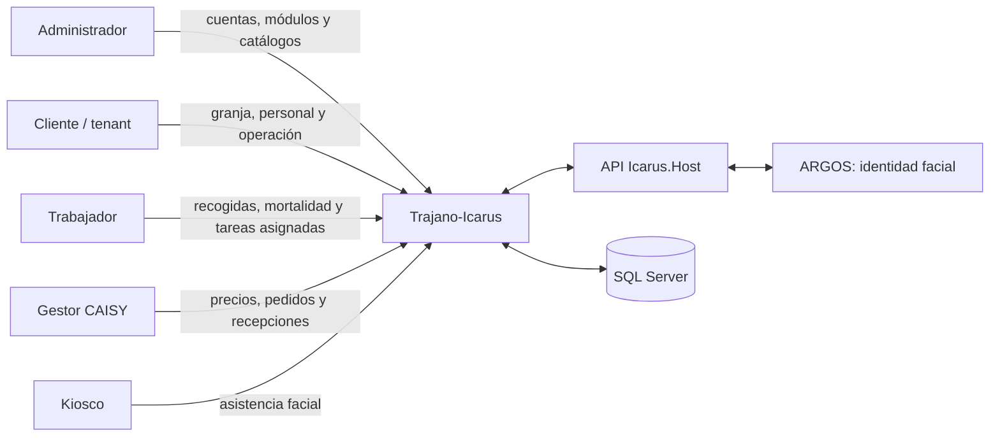
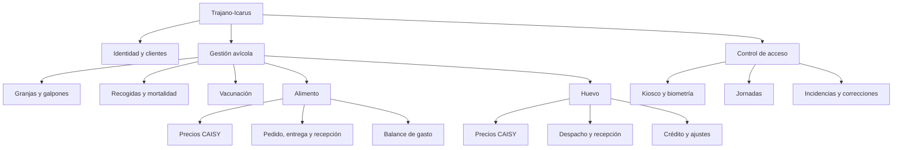

# Trajano-Icarus: documentación integral

Referencia del sistema **implementado en este repositorio**, revisada contra el
código vigente el 30 de octubre de 2026. Los documentos de `docs/superpowers/`
conservan decisiones históricas; esta carpeta explica el producto como un todo.

## Qué es Trajano-Icarus

Plataforma multiempresa para granjeros afiliados a CAISY y sus trabajadores.
Integra gestión avícola, intercambio comercial con la cooperativa y control de
asistencia. El **Cliente es el tenant**: sus datos operativos no se mezclan con
los de otros clientes. CAISY y el Administrador actúan mediante cuentas globales
y permisos específicos.

## Guía de lectura

| Documento | Contenido |
|---|---|
| [Arquitectura](arquitectura.md) | Aplicaciones, capas, dependencias, pipeline HTTP, grafos y despliegue lógico. |
| [Identidad, clientes y permisos](identidad-clientes-permisos.md) | Roles, tenants, módulos, funcionalidades, JWT y aislamiento. |
| [Modelo de datos](datos.md) | Contextos EF, entidades, relaciones, índices, filtros y concurrencia. |
| [Gestión avícola](gestion-avicola.md) | Granjas, galpones, lotes, inventario y vacunación. |
| [Recogida de huevos y mortalidad](recogida-huevos-mortalidad.md) | Recogidas, descarte, eficiencia, sellado diario e offline-first. |
| [Pedidos y recepción de alimentos](pedidos-recepcion-alimentos.md) | Precios, cupo, pedido, entrega, recepción y balance. |
| [Despacho y recepción de huevos](despacho-recepcion-huevos.md) | Precios, despacho, recibo, crédito, correcciones y ajustes. |
| [Control de acceso](control-acceso.md) | Kiosco, ARGOS, enrolamiento, marcaciones, jornadas e incidencias. |
| [Máquinas de estados](maquinas-estados.md) | Todos los ciclos de vida, transiciones, guardas y efectos. |
| [Frontend PWA](frontend-pwa.md) | Rutas, guardas, estado remoto, sesión e IndexedDB. |
| [Trajano.GestorCaisy](gestorcaisy.md) | MVC de oficina, cookie segura y consumo de la API. |
| [Catálogo de API](api.md) | Endpoints, actores, autorización y respuestas destacadas. |
| [Operación y calidad](operacion-calidad.md) | Configuración, observabilidad, pruebas, puerta y despliegue. |

## Mapa funcional

## Aplicaciones y componentes

- `Icarus/src/Host/Icarus.Host/`: API ASP.NET Core y servidor de la PWA.
- `web/`: PWA React para Administrador, Cliente y Trabajador; incluye el kiosco.
- `Icarus/src/Apps/Trajano.GestorCaisy/`: MVC de oficina para cuentas CAISY.
- `Icarus/src/{Identity,Clientes,GestionAvicola,ControlAcceso}/`: módulos con
  Domain, Application e Infrastructure.
- `Icarus/src/BuildingBlocks/`: base de agregados, MediatR, validación,
  paginación, usuario actual y observabilidad.
- `infra/`, `deploy/` y scripts raíz: topología y automatización operativa.
- `quality/`: puerta documental y estructural del repositorio.

## Fuentes y convenciones

- Vocabulario y reglas: [glosario avícola](../dominio/glosario-avicola.md).
- Proceso de desarrollo: [documentación para agentes](../ai/README.md).
- Operación específica: [documentos de operación](../operacion/observabilidad.md).
- Los diagramas usan Mermaid para que puedan revisarse como texto.
- Las rutas entre comillas invertidas identifican código real del repositorio.
- Ningún ejemplo contiene credenciales, tokens, datos biométricos ni PII real.

## Lecturas recomendadas

- **Primera incorporación:** este índice, arquitectura, permisos y el módulo asignado.
- **Cambio de negocio:** documento funcional, máquinas de estados, API y datos.
- **Cambio offline:** recogida/mortalidad y frontend PWA.
- **Despliegue o incidente:** arquitectura y operación/calidad.
