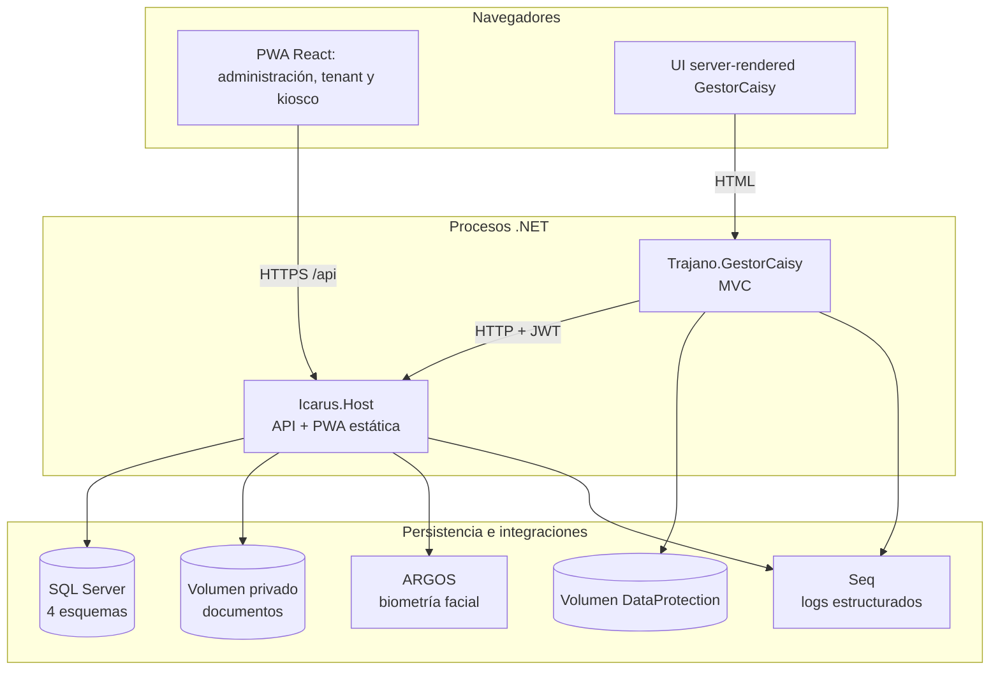
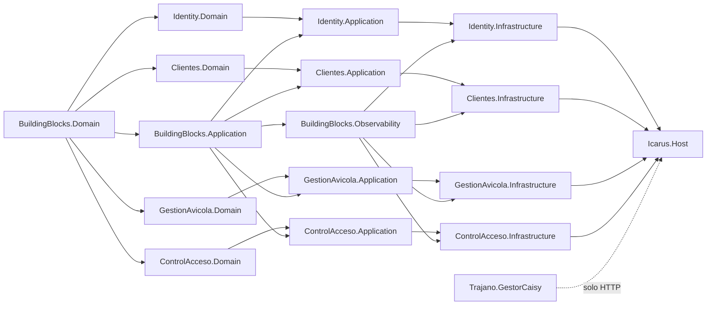
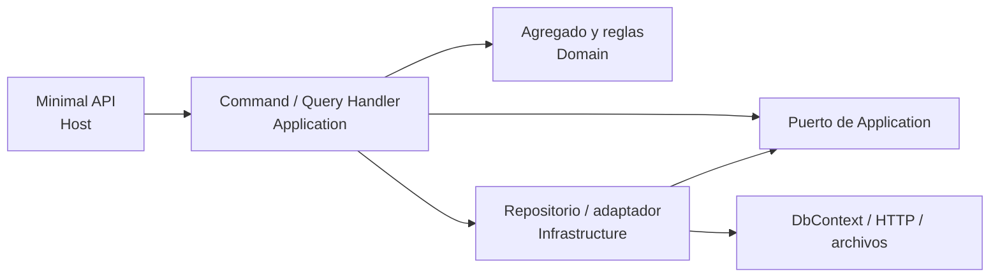
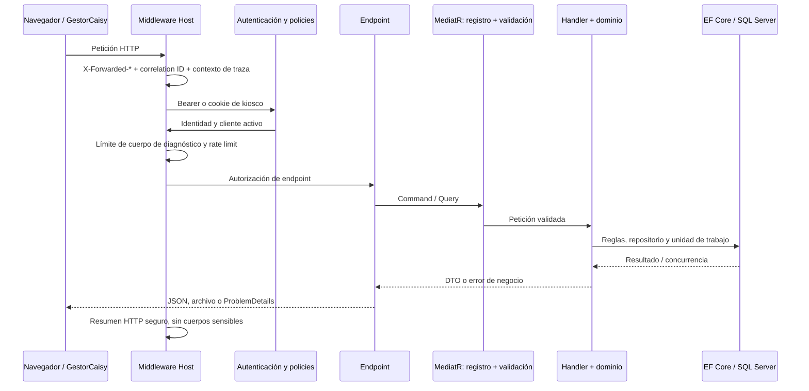
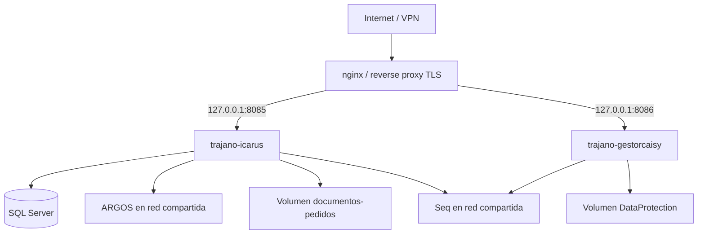

# Arquitectura

## 1. Vista general

Trajano-Icarus es un **monolito modular backend** con dos aplicaciones web. El
`Icarus.Host` concentra API, composición de módulos, migraciones y archivos
estáticos de la PWA. `Trajano.GestorCaisy` es un proceso MVC separado que no
referencia los módulos ni accede a SQL: todo su negocio pasa por la API HTTP.

### Stack confirmado

- Backend y MVC: **.NET 10 / ASP.NET Core**, C#.
- Aplicación: **MediatR 12**, **FluentValidation 11**, DDD con agregados.
- Persistencia: **EF Core 10 + SQL Server**, cuatro `DbContext`.
- Documentos: ClosedXML y PdfPig para importación; QuestPDF para recibos;
  SkiaSharp para copias de visualización.
- Observabilidad: Serilog, consola JSON compacta y Seq.
- PWA: React 19, TypeScript estricto, Vite 8, MUI 9, TanStack Query 5,
  React Router 7, React Hook Form, Zod, IndexedDB y service worker.
- Pruebas: xUnit, NSubstitute, NetArchTest, Testcontainers.MsSql, Vitest y
  Testing Library.

Versiones exactas: `Icarus/Directory.Packages.props` y `web/package.json`.

## 2. Estructura de la solución

| Proyecto | Responsabilidad |
|---|---|
| `BuildingBlocks.Domain` | `Entity`, `AggregateRoot`, eventos y excepciones de dominio. |
| `BuildingBlocks.Application` | `ICurrentUser`, unidad de trabajo, paginación y validación MediatR. |
| `BuildingBlocks.Observability` | Registro de vuelo, correlación, errores e interceptores EF. |
| `Identity.*` | Usuarios, roles, JWT, refresh tokens y cuentas globales CAISY. |
| `Clientes.*` | Tenants, trabajadores, módulos y entitlement operativo. |
| `GestionAvicola.*` | Estructura, producción, sanidad, alimento, huevo, crédito y documentos. |
| `ControlAcceso.*` | Kiosco, ARGOS, enrolamiento, asistencia, jornadas e incidencias. |
| `Icarus.Host` | Composición, endpoints Minimal API, middleware, estáticos y migraciones. |
| `Trajano.GestorCaisy` | MVC de oficina; cliente HTTP y sesión cookie propia. |

### Grafo de dependencias

**Regla importante:** los módulos de dominio no se referencian entre sí. Los ids
como `ClienteId` y `TrabajadorId` cruzan límites como valores, no como objetos o
`DbContext` compartidos. El Host y determinados adaptadores de Infrastructure
hacen la composición. Las pruebas de arquitectura blindan estas fronteras y la
prohibición de SQL/`DbContext` en GestorCaisy.

## 3. Arquitectura por capas

Cada módulo sigue la misma dirección de dependencias:

- **Domain:** invariantes, transiciones y cálculos que no requieren infraestructura.
- **Application:** orquesta autorización ya resuelta, repositorios, reloj,
  transacciones, idempotencia y DTOs.
- **Infrastructure:** EF Core, SQL Server, ARGOS, almacenamiento, importación,
  PDF, protección de plantillas y reloj Bolivia.
- **Host:** traduce HTTP a comandos/consultas, aplica policies y ProblemDetails.

La lógica crítica no está en la UI: las validaciones de frontend mejoran la
experiencia, pero Domain/Application vuelven a validar cada operación.

## 4. Composición y pipeline HTTP

`Icarus.Host/Program.cs` registra MediatR para los cuatro módulos, validadores,
registro de vuelo, contexts, autenticación Bearer, esquema restringido de kiosco,
policies, rate limiting y endpoints.

Orden efectivo destacado: forwarded headers → correlación/contexto → resumen
Serilog → manejo de excepciones → routing → patrón de ruta → autenticación →
identidad observable → cliente activo → límites → autorización → endpoint.

`/api/health` es público. En Development/Testing se añaden sondeos de
entitlement y control de acceso. Los enums JSON se serializan por nombre.

## 5. Persistencia y unidades de trabajo

Los cuatro contexts usan la misma cadena `ConnectionStrings:Icarus`, pero tienen
modelos, esquemas y migraciones independientes:

| Context | Esquema | Unidad de trabajo |
|---|---|---|
| `IdentityDbContext` | `identity` | `IUnitOfWork` propio del módulo |
| `ClientesDbContext` | `clientes` | `IUnitOfWork` |
| `GestionAvicolaDbContext` | `gestion_avicola` | `IUnidadTrabajoGestionAvicola` |
| `ControlAccesoDbContext` | `control_acceso` | `IUnidadTrabajoControlAcceso` |

Las operaciones que exigen efecto atómico combinan agregado, historial,
notificaciones y documentos dentro de una unidad de trabajo. Pedidos, despachos y
publicaciones usan `rowversion`; los wrappers de unidad de trabajo traducen la
concurrencia a errores comprensibles.

Al arrancar en Development/Testing, o cuando `Migraciones:EjecutarAlArranque` es
verdadero, el Host ejecuta las cuatro migraciones en orden. Development siembra
escenarios; Production solo ejecuta el bootstrap de cuentas iniciales si su
configuración está completa.

## 6. Documentos y recibos

SQL guarda metadatos y claves lógicas, no los binarios de las notas. Los
originales y las copias de visualización se guardan en un volumen privado. Hay
adaptadores separados para documentos de precios y respaldos de pedidos/despachos.
Los recibos se generan con QuestPDF desde datos ya persistidos; no constituyen otra
fuente de verdad.

## 7. Integración con ARGOS

Control de Acceso depende del puerto `IProveedorIdentidadFacial`. Infrastructure
selecciona una de tres implementaciones:

1. doble determinista para pruebas/desarrollo (`Biometria:UsarDoble`);
2. cliente HTTP real si `ArgosControlAcceso:Url` está configurada;
3. proveedor no disponible, que falla de forma controlada sin simular biometría.

La URL y la API key se configuran fuera del repositorio. Los datos faciales no se
registran en logs; las plantillas persistidas se protegen criptográficamente.

## 8. Despliegue lógico

- Los contenedores publican puertos solo en loopback; nginx termina TLS.
- La red externa `trajano-shared-network` conecta aplicaciones e integraciones.
- El contenedor principal ejecuta migraciones al arranque en producción.
- Los documentos y las claves DataProtection sobreviven a recreaciones.
- Seq se despliega con ciclo propio; su UI no se publica a Internet.
- ARGOS tiene despliegue independiente y contrato HTTP v2.

Fuentes: `docker-compose.yml`, `docker-compose.gestor.yml`,
`docker-compose.argos.yml`, `docker-compose.seq.yml` y `.github/workflows/`.

## 9. Decisiones transversales

Cada decisión tiene su registro, con contexto, motivo, alternativas y cuándo
reconsiderarla, en el [registro de decisiones](../decisiones/README.md):

- [002](../decisiones/002-errores-por-excepciones-de-dominio.md): errores por
  excepciones de dominio, no Result pattern.
- [003](../decisiones/003-multi-tenant-por-filas-y-claims.md): multi-tenant por
  filas y claims, no una base por cliente.
- [004](../decisiones/004-soft-delete-en-agregados.md): soft delete en los
  agregados de negocio; los historiales no se borran físicamente.
- [005](../decisiones/005-fechas-de-negocio-bolivia-y-utc.md): fechas de negocio
  de Bolivia; instantes técnicos en UTC donde el modelo lo requiere.
- [006](../decisiones/006-online-deliberado-pedidos-y-despachos.md): online
  deliberado para pedidos y despachos; offline solo para recogida y mortalidad.
- [007](../decisiones/007-sin-procesos-programados.md): sin procesos programados
  para vigencias o crédito.
- [008](../decisiones/008-notificaciones-internas-persistentes.md):
  notificaciones internas persistentes, no push como fuente de verdad.

## 10. Fuentes principales

- `Icarus/src/Host/Icarus.Host/Program.cs`
- `Icarus/src/BuildingBlocks/`
- `Icarus/src/*/*.csproj` y `Icarus/Directory.Packages.props`
- `Icarus/tests/Icarus.ArchitectureTests/`
- `Icarus/src/Apps/Trajano.GestorCaisy/Program.cs`
- `web/AGENTS.md` y `web/package.json`
