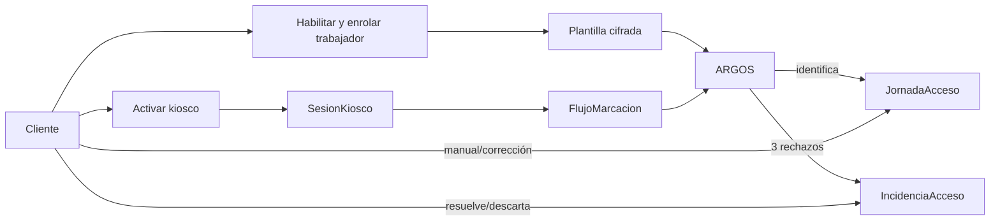
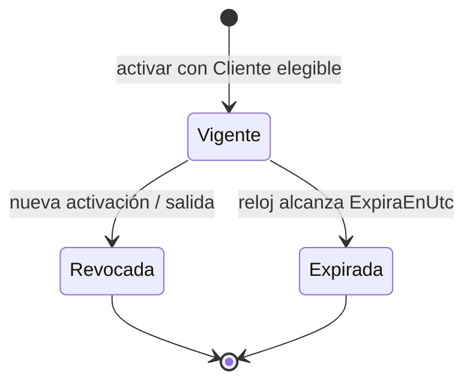
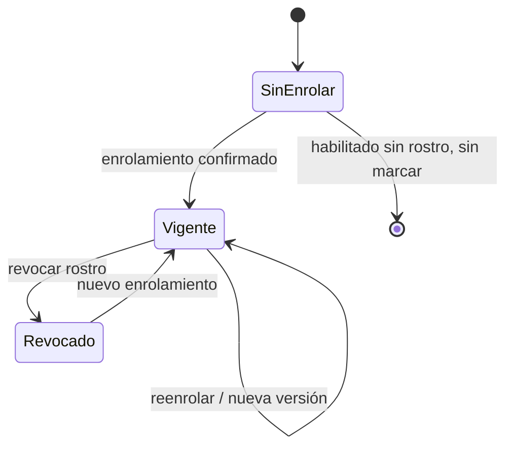
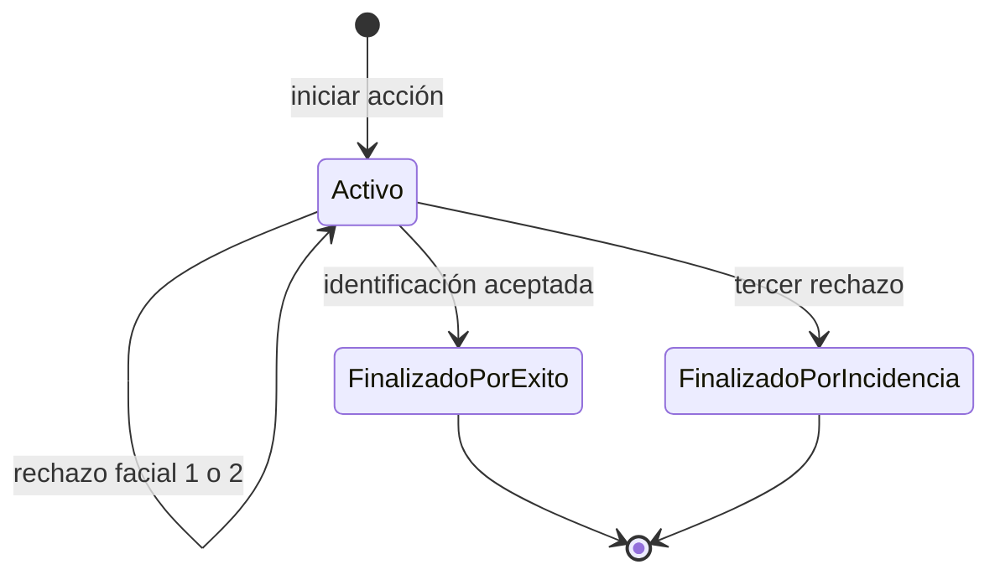
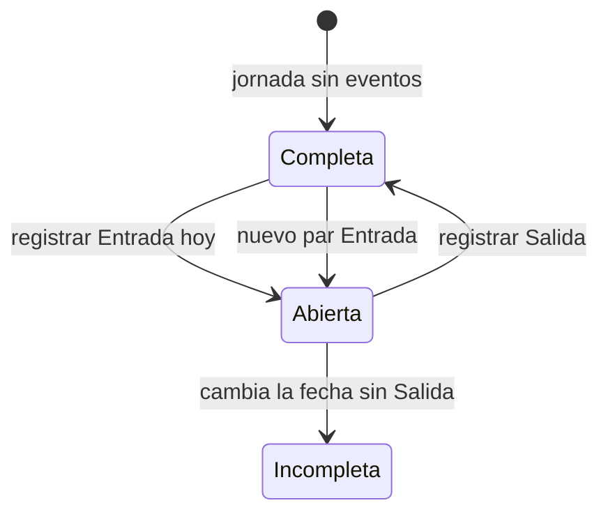
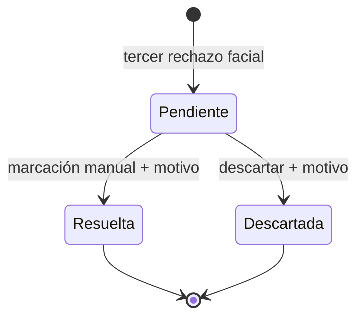

# Control de acceso

## 1. Alcance

Asistencia online de trabajadores en un kiosco por tenant. Incluye habilitación,
enrolamiento facial con ARGOS, entradas/salidas, varios pares diarios, marcación
manual, correcciones auditadas e incidencias. No incluye zonas, huella, salarios ni
funcionamiento offline del kiosco.

## 2. Elegibilidad y privacidad

El módulo `ControlAcceso` debe estar habilitado en el Cliente. El trabajador debe
pertenecer al tenant, estar activo y tener configuración habilitada, enrolamiento
Vigente y una plantilla activa con la misma versión. Esta condición se revalida
justo antes de confirmar una marcación.

Las muestras viajan al backend, que llama a ARGOS por red interna. SQL conserva
plantillas cifradas, nonce/tag y metadatos; no guarda imágenes en el flujo de
marcación. Los resultados técnicos usan códigos genéricos. No se registran rostros,
vectores, nombres, documentos ni marcaciones nominales en logs o diagnósticos.

El adaptador real ARGOS v2 está implementado; el doble determinista se usa solo
cuando se configura. La validación de PAD y latencia en tablet física es una
verificación de hardware distinta de la existencia del adaptador.

## 3. Sesión del kiosco

Solo una cuenta con rol Cliente y módulo vigente activa el kiosco. El Host verifica
credenciales con Identity, deriva el tenant —nunca lo recibe del formulario— y
reemplaza transaccionalmente las sesiones vigentes del cliente.

- Cookie `icarus_kiosco`, host-only, HttpOnly, Secure, SameSite Strict y path
  restringido a `/api/control-acceso`.
- SQL guarda hash, no la credencial en claro.
- Expiración absoluta configurable y revocación.
- Activación limitada por IP y protegida por `X-Icarus-Kiosco` + Origin permitido.
- Recuperación online tras reinicio; no existe sesión offline.
- Salida con reautenticación del mismo Cliente.

`EstaVigente` exige `EstaActiva && ahora < ExpiraEnUtc`. La autenticación también
revalida tenant y módulo online.

## 4. Habilitación y enrolamiento

La configuración comienza deshabilitada y `SinEnrolar`. Habilitar/deshabilitar no
crea ni borra plantillas. Enrolar sustituye la plantilla activa, incrementa versión,
marca Vigente y habilita automáticamente.

El enum contiene `Pendiente`, pero el flujo vigente no lo asigna: la extracción se
realiza antes de confirmar y el resultado local nace Confirmada o Fallida.

### Idempotencia y sustitución

La misma `ClaveIdempotencia` devuelve el resultado local sin llamar otra vez a
ARGOS. Un fallo de extracción se conserva como operación Fallida con motivo
genérico. Un éxito revoca la plantilla anterior, cifra/guarda la nueva, actualiza
configuración y registra Confirmada en una unidad de trabajo.

Revocar rostro pone Revocado, versión 0, deshabilita y desactiva la plantilla. Un
reenrolamiento posterior vuelve a crear una versión vigente.

## 5. Identificación y flujo de capturas

El kiosco envía acción, muestra, formato, clave y `FlujoId` opcional. Sin flujo se
crea uno vinculado a la sesión. El backend construye candidatos solo con personal
habilitado y plantillas recuperables.

Resultados faciales concluyentes que consumen intento:

- `sin_coincidencia`, `ambigua`, `pad_fallido`;
- `sin_rostro`, `varios_rostros`, `modelo_incompatible`.

Un error técnico/proveedor no disponible se devuelve como rechazo técnico sin
consumir uno de los tres intentos. Una captura repetida se responde sin duplicar
el resultado.

El backend es la autoridad del contador. Al tercer rechazo crea Incidencia y
notificación interna en la misma persistencia. El flujo cerrado no admite más
capturas.

## 6. Entrada, salida y propuesta

Tras identificar se revalida elegibilidad/versión. La jornada se busca por tenant,
trabajador y fecha Bolivia.

| Situación | Resultado |
|---|---|
| Entrada sin entrada abierta | Registra Entrada. |
| Salida con entrada abierta | Registra Salida. |
| Salida sin entrada abierta | `salida_sin_entrada`. |
| Entrada con entrada abierta | Reserva PropuestaSalida por 60 s; pide confirmación. |
| Secuencia/intervalo inválido | Rechazo sin marcación. |

La propuesta evita cerrar una jornada por una interpretación ambigua del botón de
entrada. Su confirmación revalida vigencia, trabajador y entrada abierta. La misma
clave reconstruye éxito/propuesta sin duplicar marcación.

**Observación de implementación vigente:** `ConfirmarSalidaHandler` asigna la
jornada a la propuesta mediante `OperacionMarcacion.Confirmar`, pero ese método no
cambia `Estado` de Reservada a Confirmada. Por tanto, el estado persistido de esa
propuesta confirmada permanece Reservada con `JornadaId`. La marcación sí se
registra. Esta referencia describe el código, no lo corrige.

## 7. Jornada y secuencia

Hay una jornada única por tenant/trabajador/fecha boliviana. Las marcaciones deben
alternar Entrada/Salida y pueden formar varios pares diarios.

- Salida: cierra el intervalo desde la última Entrada y no puede solapar otros.
- Entrada: no puede caer dentro de un intervalo cerrado.
- Cada marcación tiene clave idempotente única dentro de la jornada.
- Origen: Kiosco o ManualCliente.

El estado se deriva, no se persiste como columna:

| Estado | Condición |
|---|---|
| `Abierta` | Última marcación Entrada y la jornada es de hoy. |
| `Completa` | Sin marcaciones o última marcación Salida. |
| `Incompleta` | Última marcación Entrada y la jornada es de un día anterior. |

## 8. Marcación manual y correcciones

El Cliente registra manualmente con trabajador, tipo, hora declarada, motivo y
clave. La hora no puede superar el reloj real —tolerancia de un minuto en
Application— y se conserva junto al autor y la hora real de creación. La misma
clave devuelve la jornada sin duplicar.

Una corrección no reescribe las marcaciones originales: agrega `RevisionJornada`
con motivo, autor, versión esperada y valores efectivos. Reglas:

- no corregir jornadas futuras ni valores futuros;
- exigir motivo y autor;
- versión esperada igual a la actual;
- valores alternan Entrada/Salida;
- pares cerrados no se solapan.

`ValoresEfectivos` usa la última revisión hasta su corte de secuencia y añade las
marcaciones originales posteriores. Así la lectura refleja la corrección sin perder
auditoría.

## 9. Incidencias

Nace Pendiente sin trabajador asignado tras el tercer rechazo y enlaza flujo,
sesión, acción y primer/tercer rechazo. El Cliente puede:

- **Resolver:** asigna trabajador, registra marcación manual válida con motivo y
  enlaza jornada. Es idempotente si ya está Resuelta; si la marcación ya existe,
  completa solo la resolución pendiente.
- **Descartar:** cierra con motivo, sin marcación. Repetir descarte no cambia nada;
  descartar una Resuelta produce conflicto.

Versiones opcionales del cliente detectan cambios concurrentes. Las notificaciones
internas enlazan una incidencia y se consultan/marcan como leídas desde la PWA del
Cliente.

## 10. Fuentes principales

- `Icarus/src/ControlAcceso/Icarus.ControlAcceso.Domain/`
- `Icarus/src/ControlAcceso/Icarus.ControlAcceso.Application/Marcaciones/RegistrarMarcacionHandler.cs`
- `Icarus/src/ControlAcceso/Icarus.ControlAcceso.Application/Marcaciones/ConfirmarSalidaHandler.cs`
- `Icarus/src/ControlAcceso/Icarus.ControlAcceso.Application/Trabajadores/`
- `Icarus/src/ControlAcceso/Icarus.ControlAcceso.Application/Jornadas/`
- `Icarus/src/ControlAcceso/Icarus.ControlAcceso.Application/Incidencias/`
- `Icarus/src/Host/Icarus.Host/Servicios/ActivacionKioscoServicio.cs`
