# Modelo de datos

## 1. Organización física

Una misma base SQL Server contiene cuatro esquemas gestionados por cuatro modelos
EF Core independientes. Las migraciones de cada módulo viven en su proyecto
Infrastructure.

| Esquema | Context | Finalidad |
|---|---|---|
| `identity` | `IdentityDbContext` | Cuentas, seguridad ASP.NET Identity y refresh tokens. |
| `clientes` | `ClientesDbContext` | Tenants y trabajadores. |
| `gestion_avicola` | `GestionAvicolaDbContext` | Operación avícola, comercio, documentos y notificaciones. |
| `control_acceso` | `ControlAccesoDbContext` | Kiosco, biometría, asistencia e incidencias. |

Los ids cruzan módulos como **referencias lógicas**. No hay navegaciones ni FK de
Identity a Clientes, ni de Clientes a Gestión Avícola/Control de Acceso. Cada
módulo conserva su independencia.

## 2. Grafo de entidades principal

```mermaid
flowchart TB
    U[Usuario] -->|ClienteId lógico| C[Cliente]
    U -->|TrabajadorId lógico| T[Trabajador]
    U --> RT[RefreshToken]
    C --> T
    C --> G[Granja]
    G --> GA[Galpón]
    GA --> RP[RegistroProduccion]
    GA --> RM[RegistroMortalidad]
    C --> TV[TareaVacunacion]
    GA --> TV
    PV[ProgramaVacunacion] --> IV[ItemPlanVacunacion]
    PV --> TV
    IV --> TV
    C --> PA[PedidoAlimento]
    G --> PA
    PA --> DP[DetallePedidoAlimento]
    PA --> TP[TransicionPedidoAlimento]
    PA --> EP[EntregaPedidoAlimento]
    EP --> DE[DetalleEntregaPedidoAlimento]
    EP --> DN[DocumentoNotaEntrega]
    PA --> RA[RecepcionPedidoAlimento]
    RA --> DR[DetalleRecepcionPedidoAlimento]
    NPA[NotificacionPreciosAlimentos] --> DPA[DetallePrecioAlimento]
    DPA -->|snapshot al enviar| DP
    C --> DH[DespachoHuevo]
    G --> DH
    DH --> DD[DetalleDespachoHuevo]
    DH --> TD[TransicionDespachoHuevo]
    DH --> DOC[DocumentoDespachoHuevo]
    PPH[PublicacionPrecioHuevo] --> DPH[DetallePrecioHuevo]
    DPH -->|snapshot al despachar| DD
    DH --> ACH[AjusteCreditoHuevo]
    C --> CFG[ConfiguracionAccesoTrabajador]
    T -->|TrabajadorId lógico| CFG
    CFG --> PF[PlantillaFacialProtegida]
    C --> SK[SesionKiosco]
    C --> JA[JornadaAcceso]
    T -->|TrabajadorId lógico| JA
    JA --> MA[Marcacion]
    JA --> RJ[RevisionJornada]
    C --> OE[OperacionEnrolamiento]
    C --> OM[OperacionMarcacion]
    SK --> FM[FlujoMarcacion]
    FM --> CM[CapturaMarcacion]
    FM --> IA[IncidenciaAcceso]
    IA --> NA[NotificacionInternaAcceso]
```

Los catálogos `ProgramaVacunacion`, `NotificacionPreciosAlimentos` y
`PublicacionPrecioHuevo` son globales: no llevan tenant.

## 3. Esquema `identity`

| Tabla/modelo | Datos y restricciones relevantes |
|---|---|
| `usuarios` | ASP.NET Identity + rol, tenant, trabajador, activo y bitmask CAISY. |
| `refresh_tokens` | Id, usuario, hash único de 64 caracteres, expiración y revocación. |
| Tablas `IdentityUserContext` | Cuentas, claims, logins y tokens del framework; no se usan roles ni claims de rol ASP.NET. |

Índices: hash del refresh único y usuario indexado. El token original nunca se
persiste.

## 4. Esquema `clientes`

| Tabla | Reglas físicas |
|---|---|
| `clientes` | NIT único; razón social hasta 200; módulos como entero. |
| `trabajadores` | Documento único por tenant; funcionalidades como entero; nombre/documento/cargo con longitudes limitadas. |

Ambos tienen filtro `EstaActivo` y tenant. Para `Cliente`, el tenant se compara
con su propio `Id`; para `Trabajador`, con `ClienteId`.

## 5. Esquema `gestion_avicola`

### 5.1 Estructura y operación diaria

| Tabla | Contenido y restricciones |
|---|---|
| `granjas` | Nombre único por cliente; índice filtrado garantiza una activa por cliente. |
| `galpones` | Número único por granja; capacidad, inventario, poblado y descarte del lote. |
| `registros_produccion` | Fecha/hora, vendibles, descarte, snapshot de vivas e idempotencia. |
| `registros_mortalidad` | Fecha/hora, muertas, snapshot de vivas e idempotencia. |
| `programas_vacunacion` | Catálogo global con nombre único, estado (Borrador/Publicado) y datos generales. |
| `programas_vacunacion_items` | Edad, manejo/vacuna, modo, observaciones y fecha opcional. |
| `tareas_vacunacion` | Snapshot del ítem asignado al galpón, estado y ejecución. |

Producción tiene checks SQL para maples no negativos y sueltos entre 0 y 29;
mortalidad exige muertas > 0. Ambos tienen índice `(GalponId, Fecha)`, índice de
tenant e índice único filtrado de `IdempotencyKey` no nula. El índice es global,
no compuesto por tenant: la clave generada por el cliente debe ser única.

### 5.2 Precios y pedidos de alimento

| Tabla | Contenido y restricciones |
|---|---|
| `notificaciones_precios_alimentos` | Cabecera global, vigencia, aportes, estado y `rowversion`. |
| `detalles_precio_alimento` | Precio por tipo/presentación, rango de edad y precio documental informativo. |
| `pedidos_alimentos` | Tenant, granja, autor, folio, estado, fechas y `rowversion`. |
| `detalles_pedidos_alimentos` | Cantidad solicitada y precio/publicación congelados. |
| `transiciones_pedidos_alimentos` | Origen, destino, actor, fecha, motivo y entrega estimada. |
| `entregas_pedidos_alimentos` | Una por pedido; nota, fecha de despacho y total informado. |
| `detalles_entregas_pedidos_alimentos` | Cantidad entregada y equivalentes de 40 kg por tipo. |
| `documentos_nota_entrega` | Claves privadas, MIME, tamaños, hash y nombre seguro. |
| `recepciones_pedidos_alimentos` | Una por pedido; fecha, total real y diferencias JSON. |
| `detalles_recepciones_pedidos_alimentos` | Cantidad recibida y equivalentes por tipo. |

Restricciones destacadas:

- una vigencia única para publicaciones activas de alimento;
- tipo único dentro de pedido, entrega y recepción;
- una entrega y una recepción por pedido;
- folio `Numero` único generado por secuencia SQL;
- índices por tenant/fecha y estado/tenant/fecha para bandejas y balances.

`DiferenciasJson` conserva un snapshot calculado de las diferencias de recepción.
`TotalRecibido` se calcula con lo realmente recibido y el precio congelado, no con
el total manual de la nota.

### 5.3 Huevo y crédito

| Tabla | Contenido y restricciones |
|---|---|
| `publicaciones_precios_huevo` | Vigencia, servicio, estado, corrección, motivo y `rowversion`. |
| `detalles_precio_huevo` | Un precio por tamaño y publicación. |
| `despachos_huevo` | Tenant, granja, folio, estado, fechas y `rowversion`. |
| `detalles_despacho_huevo` | Amarras, sueltos, huevos, precio unitario y publicación congelados. |
| `transiciones_despacho_huevo` | Historial de cambios de estado. |
| `documentos_despacho_huevo` | Una nota privada por despacho. |
| `ajustes_credito_huevo` | Compensaciones inmutables por correcciones posteriores a recepción. |

La vigencia de publicaciones activas de huevo es única. Cada tamaño aparece una
vez por publicación y por despacho. Los ajustes tienen índices por tenant y
despacho y no se desactivan.

### 5.4 Notificaciones

- `notificaciones_internas`: eventos de pedidos y aviso de crédito insuficiente.
- `notificaciones_internas_despacho_huevo`: eventos del ciclo de despacho de huevo.

Ambas conservan tipo, fecha, metadatos limitados, vínculo al documento y estado de
lectura según el modelo. No tienen filtro EF automático: los repositorios aplican
`ClienteId` del tenant o `null` para la bandeja global CAISY.

## 6. Esquema `control_acceso`

| Tabla | Contenido y restricciones |
|---|---|
| `jornadas_acceso` | Una por tenant/trabajador/fecha boliviana; intervalos y estado. |
| `marcaciones` | Entrada/salida, origen, instante, motivo e idempotencia por jornada. |
| `revisiones_jornada` | Correcciones auditadas con motivo obligatorio. |
| `revisiones_jornada_valores` | Valores antes/después asociados a cada revisión. |
| `configuracion_acceso_trabajador` | Una configuración por tenant/trabajador; habilitación y enrolamiento. |
| `plantillas_faciales` | Contenido cifrado, nonce, tag, modelo, versión y estado. |
| `sesiones_kiosco` | Hash único de credencial, tenant, expiración y actividad. |
| `operaciones_enrolamiento` | Idempotencia única por tenant y resultado de ARGOS. |
| `operaciones_marcacion` | Idempotencia única por tenant, acción y resultado. |
| `flujos_marcacion` | Estado del intento del kiosco, sesión y acción. |
| `capturas_marcacion` | Clave única y resultado; única también por flujo/clave. |
| `incidencias_acceso` | Una por flujo; estado, rechazos y resolución. |
| `notificaciones_internas_acceso` | Una por incidencia e índice por tenant/fecha. |

Las plantillas no se guardan en claro. Los logs y esta documentación no contienen
plantillas, capturas ni datos nominales de acceso.

## 7. Filtros globales EF

| Entidad | Activo | Tenant |
|---|---|---|
| Cliente, Trabajador | Sí | Sí |
| Granja, Galpón, Producción, Mortalidad | Sí | Sí |
| TareaVacunacion | Sí | Sí |
| ProgramaVacunacion e ítems | Sí | No: catálogo global |
| Publicaciones de precios | Sí | No: catálogo global |
| PedidoAlimento, DespachoHuevo | Sí | Sí |
| AjusteCreditoHuevo | No aplica: inmutable | Sí |
| Notificaciones de Gestión Avícola | No global | Alcance explícito en repositorio |
| Jornada y ConfiguracionAcceso | Sí | Sí |
| Plantillas, sesiones, operaciones, flujos, incidencias y avisos de acceso | Según modelo | Sí |

`ClienteId == null` representa una cuenta global y desactiva la restricción de
tenant en el filtro. La autorización de la operación sigue siendo obligatoria.

## 8. Integridad temporal, concurrencia y borrado

- Fechas civiles: `date`; horas: `time`; instantes técnicos: UTC.
- `rowversion` en pedidos, despachos y publicaciones evita pérdida silenciosa de
  escrituras concurrentes.
- Los índices únicos respaldan reglas de dominio e idempotencia ante carreras.
- El borrado de negocio es lógico: `EstaActivo = false`; las excepciones son
  registros técnicos/inmutables que no ofrecen desactivación.
- Algunas relaciones internas usan cascada física de EF —por ejemplo capturas de
  un flujo—; no deben confundirse con un caso de uso de borrado de negocio.

## 9. Consultas calculadas, no tablas derivadas

No existen tablas de saldo o eficiencia que puedan quedar desincronizadas:

- eficiencia: eventos activos del día y último snapshot de gallinas;
- balance de alimento: recepciones terminales × precios congelados;
- crédito de huevo: recepciones maduras + ajustes − gasto de alimento reconocido;
- vigencia de precios: publicación aplicable a la fecha consultada.

## 10. Fuentes principales

- `Icarus/src/*/*Infrastructure/Persistencia/*DbContext.cs`
- `Icarus/src/*/*Infrastructure/Persistencia/Configuracion*.cs`
- `Icarus/src/ControlAcceso/Icarus.ControlAcceso.Infrastructure/Persistencia/ConfiguracionAccesoTrabajadorEntityTypeConfiguration.cs`
- Migraciones y `*ModelSnapshot.cs` de cada Infrastructure.
