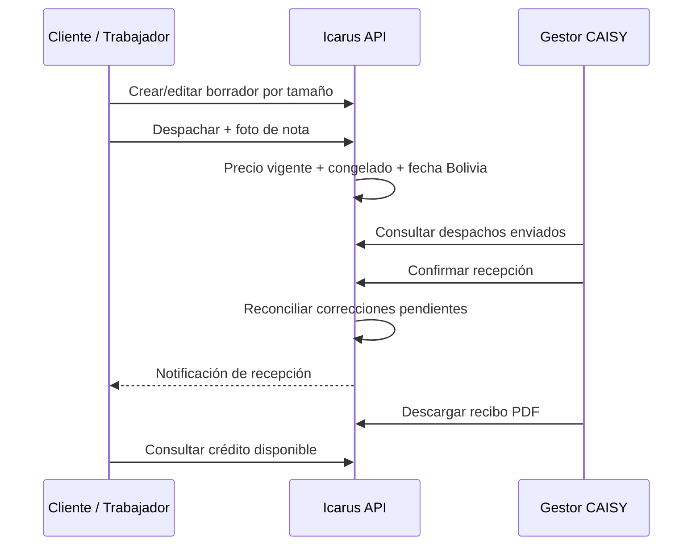
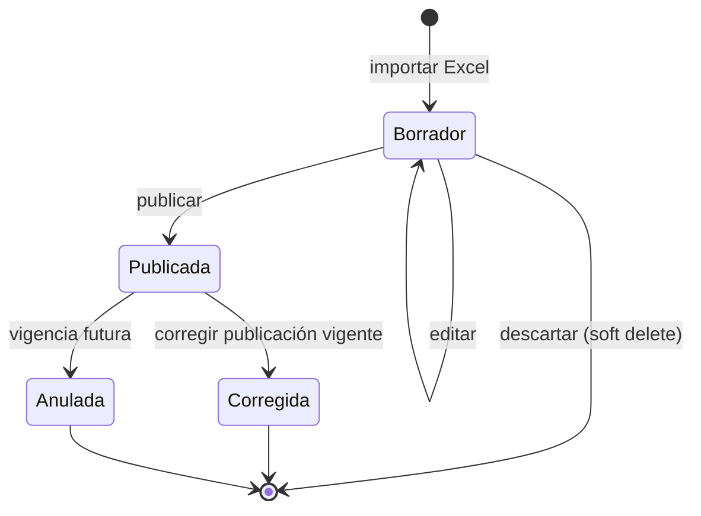
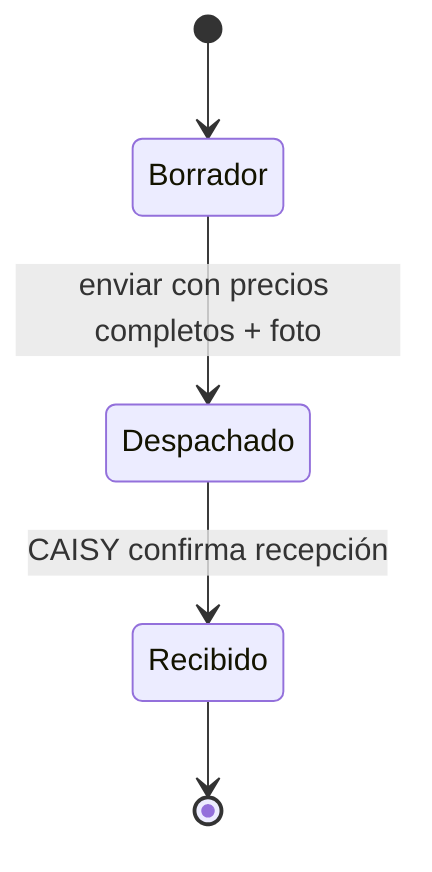
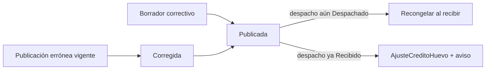
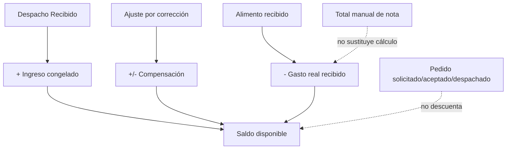

# Despacho y recepción de huevos

## 1. Visión del proceso

El tenant prepara un despacho por tamaños y lo envía a CAISY con precio congelado
y foto de la nota. CAISY confirma recepción sin reconteo formal, genera recibos y
el importe pasa inmediatamente a formar parte del crédito calculado del Cliente.



## 2. Tamaños y unidades

Tamaños: `Extra`, `Primera`, `Segunda`, `Tercera`, `Cuarta`, `Quinta`.

```text
Huevos por línea = CantidadAmarras × 180 + UnidadesSueltas
Subtotal         = Huevos por línea × PrecioUnitarioCongelado
Total            = Σ subtotales
```

Cada tamaño aparece una sola vez. Amarras ≥ 0; sueltos entre 0 y 179; cada línea
debe tener cantidad > 0. Una amarra equivale a 180 huevos o seis maples. El
despacho no valida ni descuenta producción diaria.

## 3. Publicación de precios de huevo

El Gestor CAISY con `GestorRecepcionHuevos` importa exclusivamente Excel. El
original queda privado y produce un borrador editable. Una publicación contiene
fecha de notificación, vigencia, un único servicio > 0 y un precio al productor
> 0 por tamaño. El precio actual del documento es informativo, no bloqueante.

```text
Precio unitario = PrecioAlProductor + Servicio
```



La vigencia activa es única y la publicada es inmutable salvo las transiciones de
anulación/corrección. Una publicación efectiva no se anula. Para corregirla se
crea otra publicación, se previsualiza el impacto y se confirma la corrección.

## 4. Máquina de estados del despacho



Solo Borrador se edita o desactiva. El folio visible es `D-000045`, con número
generado por secuencia SQL. `rowversion` protege cambios concurrentes. Los
reintentos desde un estado incorrecto no duplican transición ni notificación.

## 5. Envío del despacho

En una operación online:

1. se carga el borrador del tenant y su granja activa;
2. se obtiene la publicación vigente a la fecha Bolivia;
3. se calcula precio unitario por tamaño;
4. se guarda la foto de la nota en almacenamiento privado;
5. se congelan precio y `PublicacionPrecioHuevoId` por línea;
6. se fija `FechaDespacho`, se registra transición y se guarda.

Si falta publicación o el precio de una línea, el envío falla completo. Si falla
el archivo, la excepción ocurre antes de tocar el agregado. La nota es única e
inmutable, con original privado y copia de visualización. A diferencia de alimento,
la sube el emisor al despachar.

CAISY no ve borradores en su bandeja ni detalle. Sus listados muestran folio y
granja, no autores. El tenant sí ve sus borradores y puede filtrar por autor.

## 6. Recepción y recibo

CAISY solo puede recibir un estado Despachado. No hay cantidades recibidas por
línea: la verificación es visual y no existe reconteo formal en el sistema.

Antes de cerrar, la aplicación recorre la cadena de publicaciones corregidas. Si
la publicación congelada fue reemplazada mientras el despacho estaba en tránsito y
la cadena termina en una Publicada con precio para el tamaño, **recongela** la
línea al precio correctivo. Después fija `FechaRecepcion` Bolivia, cambia a
Recibido y notifica al tenant en la misma unidad de trabajo.

El recibo PDF se genera con QuestPDF a partir de datos persistidos: líneas,
amarras, sueltos, huevos, precio, subtotales, totales y firma/sello CAISY. Solo está
disponible tras la recepción y puede descargarse repetidamente sin crear otra
transición.

## 7. Corrección de una publicación vigente

La corrección solo se aplica a la publicación realmente vigente hoy. La
correctiva no puede tener vigencia futura y puede compartir la fecha de la
errónea. El gestor primero previsualiza:

- despachos Recibido que usaron la publicación errónea;
- diferencia por línea: `(precio correctivo − precio congelado) × huevos`;
- tamaños sin precio correctivo, que no se compensan;
- total de ajustes distintos de cero.

Al confirmar, una transacción explícita:

1. marca la errónea como Corregida, enlaza correctiva y motivo, y guarda;
2. publica la correctiva y guarda todo lo demás;
3. crea un `AjusteCreditoHuevo` inmutable por despacho Recibido afectado;
4. notifica cada ajuste al tenant.

El primer `SaveChanges` evita que dos Publicada activas compartan vigencia; la
transacción única revierte ambos si algo falla.



## 8. Crédito del Cliente: comportamiento vigente

El saldo es privado del rol Cliente. Ni Trabajador ni GestorCaisy pueden consultar
su balance. Se calcula al consultar, sin tabla de saldo:

```text
Saldo = ingresos de todos los despachos Recibido
        − gasto real de alimento RecibidoConforme/ConDiferencias
        + ajustes de corrección de precio
```

**Disponibilidad:** el ingreso cuenta desde que CAISY confirma la recepción. No hay
espera de 14 días ni filtro por antigüedad. Los pedidos de alimento solicitados,
aceptados o despachados todavía no restan: solo la recepción real reconoce gasto.

`RecibidoReciente` es un dato informativo separado: ingresos con recepción dentro
de los últimos 14 días. Los 14 días son una referencia del ritmo de liquidación,
no un plazo de disponibilidad ni una constante que altere el saldo.

La vista devuelve saldo, recibido reciente, días de referencia y ajustes con monto,
motivo y fecha. Los ajustes no tienen desfase porque compensan un error ya
producido.

### Camino inerte conservado

Existe un query/endpoint histórico para que CAISY consultara crédito de un pedido,
pero su handler exige rol Cliente mientras la ruta pertenece al grupo CAISY. Por
tanto está cerrado deliberadamente: el saldo del Cliente no se expone a CAISY. La
documentación no debe presentarlo como una capacidad disponible.

## 9. Relación contable con alimento



## 10. Fuentes principales

- `Icarus/src/GestionAvicola/Icarus.GestionAvicola.Domain/DespachoHuevo.cs`
- `Icarus/src/GestionAvicola/Icarus.GestionAvicola.Domain/PublicacionPrecioHuevo.cs`
- `Icarus/src/GestionAvicola/Icarus.GestionAvicola.Application/DespachosHuevo/ComandosDespachosHuevo.cs`
- `Icarus/src/GestionAvicola/Icarus.GestionAvicola.Application/PreciosHuevo/ComandosPreciosHuevo.cs`
- `Icarus/src/GestionAvicola/Icarus.GestionAvicola.Application/CreditoHuevo/`
- `Icarus/src/GestionAvicola/Icarus.GestionAvicola.Infrastructure/Repositorios/RepositorioBalanceCreditoHuevo.cs`
