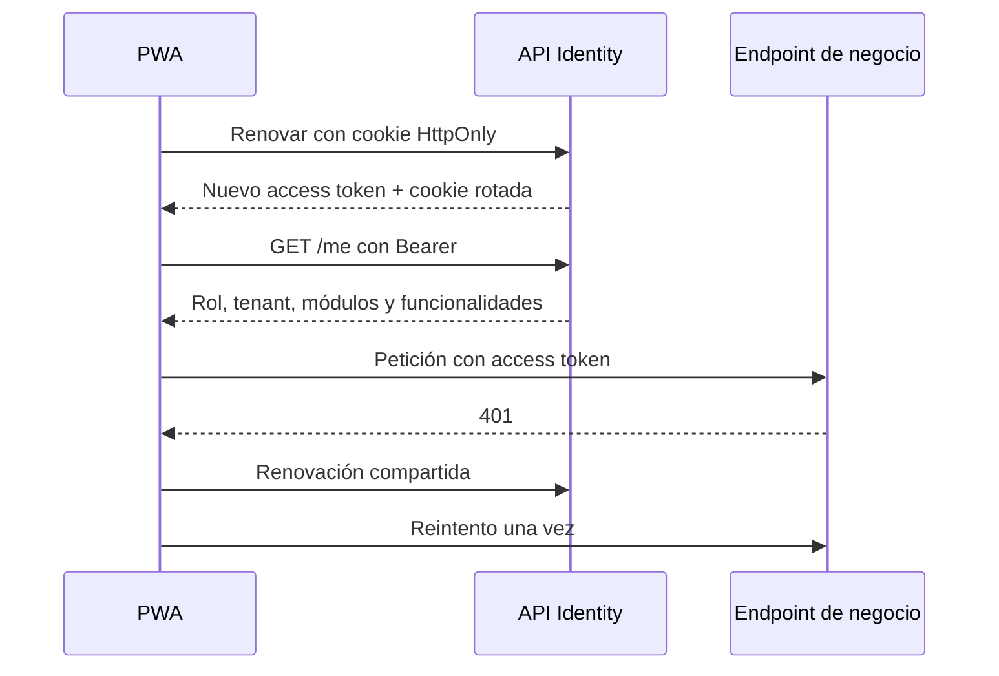
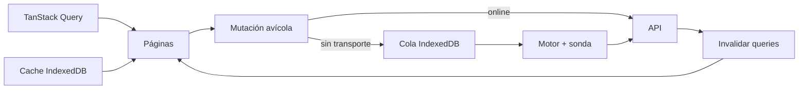

# Frontend PWA

## 1. Aplicación y organización

`web/` contiene la PWA de Administrador, Cliente y Trabajador, más un shell de
kiosco separado. React 19 + TypeScript estricto + Vite 8; MUI para UI, TanStack
Query para estado remoto, React Router para rutas y React Hook Form + Zod para
formularios.

```mermaid
flowchart TB
    APP[src/app\nproviders, router, layout, tema] --> AUTH[src/features/auth\nsesión y guardas]
    APP --> F[src/features\npáginas por módulo]
    F --> LIB[src/lib\nHTTP, contratos y formatos]
    F --> OFF[src/lib/offline\ncola, caché y motor]
    APP --> CO[src/app/offline\ncoordinador y UI]
    CO --> OFF
    F --> API[/api/Icarus.Host]
    LIB --> API
```

Reglas de frontera: `lib` no importa features ni app; una feature no monta
páginas de otra; las rutas se declaran centralmente en `src/app/router.tsx`.
`app` orquesta y no concentra reglas de negocio.

## 2. Rutas y guardas

| Ruta | Acceso UI | Contenido |
|---|---|---|
| `/login` | Pública | Inicio de sesión y entrada offline del trabajador. |
| `/`, `/inicio` | Autenticado | Redirección o inicio según rol/permisos. |
| `/admin/clientes`, `/nuevo`, `/:id` | Administrador | Tenants, módulos y cuentas. |
| `/admin/vacunacion` | Administrador | Catálogo global de programas. |
| `/trabajadores` | Cliente | Personal y funcionalidades. |
| `/control-acceso` | Cliente | Habilitación, enrolamiento y sesión kiosco. |
| `/control-acceso/historial` | Cliente | Jornadas, marcación manual y correcciones. |
| `/control-acceso/incidencias` | Cliente | Resolución/descarte de incidencias. |
| `/avicola`, `/avicola/galpones`, `/:galponId` | ProduccionHuevos, Mortalidad o Vacunacion | Estructura y operación diaria. |
| `/avicola/galpones/:galponId/eficiencia` | Administrador o Cliente + ProduccionHuevos | Eficiencia histórica. |
| `/pedidos`, `/nuevo`, `/:id`, `/:id/editar` | PedidoAlimento | Bandeja, formulario, envío y recepción. |
| `/despachos`, `/nuevo`, `/:id`, `/:id/editar` | DespachoHuevo | Bandeja, formulario, envío y crédito. |
| `*` | Cualquiera | Página no encontrada. |

`ProtectedRoute` exige sesión; `RequiereRol` y `RequiereFuncionalidad` componen
restricciones. Las funcionalidades alternativas usan semántica **OR**. Las páginas
se cargan de forma diferida. Las guardas nunca sustituyen la autorización de API.

## 3. Sesión y transporte HTTP

### PWA principal

- El access token vive solo en memoria (`src/lib/session.ts`).
- El refresh viaja en cookie `icarus_refresh`: HttpOnly, Secure y SameSite Strict.
- Al arrancar se intenta renovar y luego consultar `/api/identidad/me`.
- Un 401 dispara una única renovación compartida y un reintento; si falla, se
  limpia el access token.
- Las peticiones usan `credentials: include`, timeout de 15 s,
  `X-Correlation-ID` y `X-Session-Id`.
- `ApiError` conserva estado, título, ids de correlación y validación, nunca el
  cuerpo completo ni secretos.



408, 502, 503 y 504 se consideran indisponibilidad de transporte para el flujo
offline; los demás errores HTTP son respuestas del backend.

### Sesión offline

Solo Trabajador tiene snapshot de 12 h, sin token ni correo. Al recuperar red se
revalida contra Identity. Cerrar sesión con red borra el snapshot; sin red se
conserva hasta caducar para permitir reingreso offline. Detalles en
[recogida y mortalidad](recogida-huevos-mortalidad.md).

## 4. Estado remoto y offline

TanStack Query usa `networkMode: 'offlineFirst'`: las lecturas intentan red y
pueden caer a IndexedDB. Cada feature define `queryKey` por parámetros e
invalida por prefijo tras mutaciones. El estado de autenticación no se trata como
estado de servidor.

El coordinador offline es singleton por pestaña y cablea almacén, motor, sonda y
dispatcher avícola. Los estados de cola, reintentos, edición pendiente y sesión
están detallados en el documento funcional.



## 5. Features implementadas

| Feature | Responsabilidad |
|---|---|
| `auth` | Login, contexto, permisos y guardas. |
| `admin/clientes` | Alta, detalle, suspensión/reactivación y módulos. |
| `admin/vacunacion` | Programas globales e importación Excel. |
| `trabajadores` | Alta, cese, desactivación y asignación de funciones. |
| `avicola` | Granjas, galpones, recogidas, mortalidad, eficiencia y vacunación. |
| `pedidos-alimento` | Borradores, envío, historial, documentos y recepción. |
| `despacho-huevo` | Borradores, envío, historial, crédito y ajustes. |
| `control-acceso` | Personal, kiosco, jornadas, correcciones e incidencias. |
| `kiosco` | Shell independiente de activación, captura y marcación. |

## 6. PWA, builds y kiosco aislado

Vite genera dos entradas: `index.html` y `kiosco.html`. El service worker usa
`generateSW` y autoUpdate; el shell y bundles del kiosco se excluyen del precache.
El kiosco no registra service worker, IndexedDB ni cola: siempre es online.

El registro comprueba actualizaciones al volver a visible y cada 60 segundos.
`sw.js`, manifiesto e `index.html` se sirven con `Cache-Control: no-cache`; los
assets con hash son cacheables.

Los source maps no se publican en el build normal. El modo `sourcemaps` los
genera ocultos y los extrae fuera de `dist` para diagnóstico privado.

## 7. Diagnóstico en navegador

El frontend captura errores globales y breadcrumbs seguros, y reporta errores
técnicos a `/api/diagnosticos/frontend`. Correlaciona `SessionId`, `ErrorId`,
`CorrelationId` y `TraceId`. Las rutas se sanitizan; no se registran respuestas,
formularios, tokens ni datos personales. La descarga manual `?debug=1` está
limitada por entorno/configuración.

## 8. Comandos

Desde `web/`:

```bash
npm run lint
npm run build
npm run test
npm run format:check
```

Requieren Node 22 y dependencias instaladas. La puerta completa del repositorio
se ejecuta desde la raíz con `./verify.ps1` o `./verify.sh`.

## 9. Fuentes principales

- `web/src/app/router.tsx`, `providers.tsx`, `queryClient.ts`
- `web/src/features/auth/AuthContext.tsx`
- `web/src/lib/http.ts` y `web/src/lib/offline/`
- `web/src/app/offline/`
- `web/vite.config.ts` y `web/src/pwa/registro.ts`
- `web/AGENTS.md`
