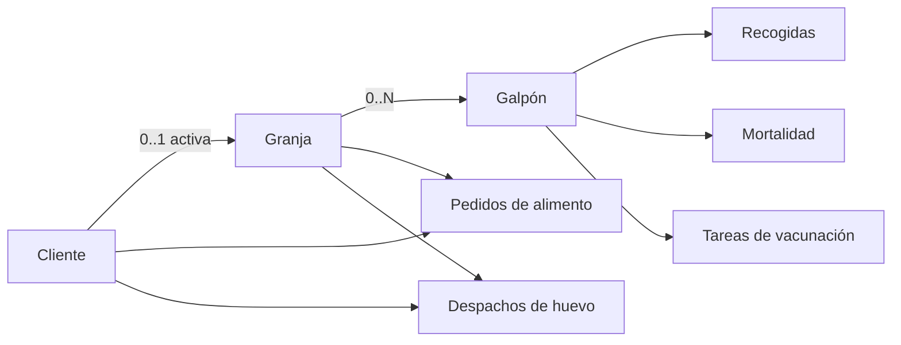
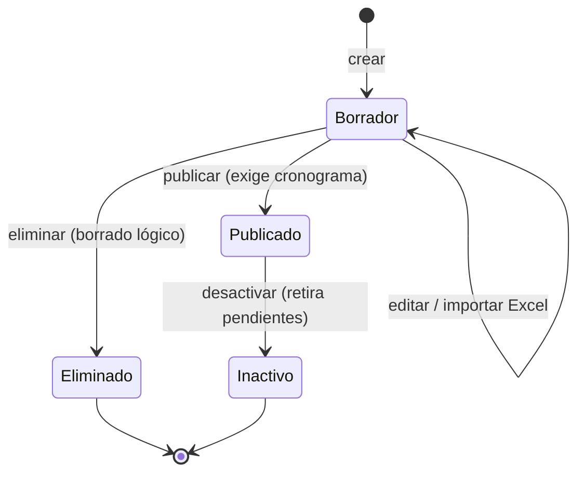
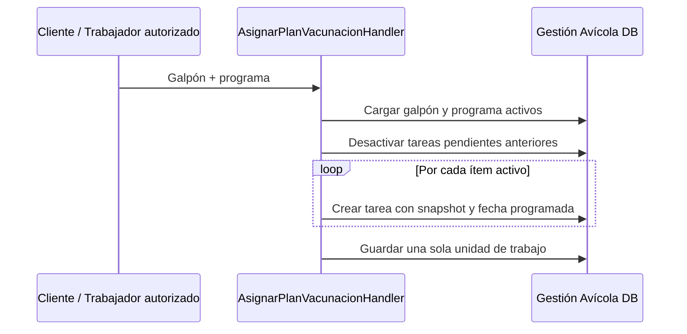
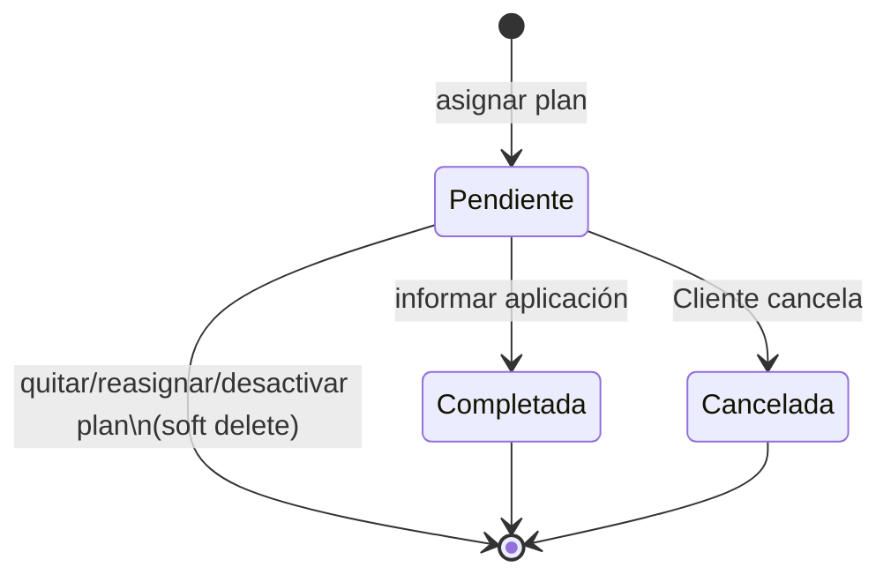

# Gestión avícola

## 1. Modelo estructural

El tenant opera una explotación con una **granja activa** y varios galpones. Un
galpón alberga un lote, con capacidad, inventario y fechas de poblado/descarte.
No existe una entidad `Lote` separada: sus datos pertenecen a `Galpon`.



### Granja

- Nombre obligatorio y único por cliente.
- Solo una activa por cliente, reforzado por índice SQL filtrado.
- Se puede renombrar y desactivar; no se borra físicamente.
- Pedidos y despachos guardan `GranjaId` resuelto por el servidor desde la granja
  activa, no confiado al formulario.

### Galpón e inventario

Invariantes principales:

- número obligatorio y único dentro de la granja;
- capacidad > 0;
- `0 ≤ GallinasActuales ≤ CapacidadMaxima`;
- `FechaNacimientoLote` no futura;
- `FechaDescarteLote` opcional, no futura y no anterior al poblado.

Al reducir capacidad, el nuevo valor no puede quedar por debajo del inventario.
El ajuste manual de inventario está reservado al Cliente; la mortalidad lo ajusta
automáticamente. Corregir el poblado no reescribe las fechas ya materializadas en
tareas de vacunación.

## 2. Permisos estructurales

El Cliente administra la estructura si tiene `GestionAvicola`. El Trabajador con
ProduccionHuevos, Mortalidad o Vacunacion obtiene lectura estructural mediante
`GestionAvicolaEstructura`, pero no administración ni ajuste manual de inventario.
Las consultas EF vuelven a filtrar por tenant y estado activo.

## 3. Catálogo global de vacunación

El Gestor CAISY con `GestorVeterinario` gestiona, desde
Trajano.GestorCaisy, los programas emitidos por CAISY. Un programa
contiene:

- nombre único;
- cantidad de aves > 0;
- observaciones;
- fecha de emisión opcional, derivada de la primera fecha del cronograma;
- ítems con edad en días, vacuna o manejo, modo de aplicación, observaciones y
  fecha opcional.

El cronograma se importa desde Excel y se valida completo: una fila inválida
rechaza la importación sin guardar cambios. La edad no se repite entre ítems
activos. Al reemplazar el cronograma, los ítems anteriores se desactivan; las
tareas ya asignadas conservan su snapshot.

El programa nace como borrador. Solo el borrador se edita, recibe el
cronograma y se elimina (borrado lógico). Publicar exige cronograma; el
publicado es inmutable y es el único que cliente y trabajador ven y asignan.
Desactivar solo aplica a un publicado. El gestor ve borradores, publicados e
inactivos, pero nunca asignaciones por galpón ni tareas; el Administrador de
plataforma ya no interviene en el catálogo.



### Asignación a galpón



La fecha programada se calcula así:

```text
FechaProgramada = ítem.Fecha
                  si el Excel la trajo;
                  en otro caso, FechaNacimientoLote + EdadDia
```

Un galpón tiene a lo sumo un plan vigente, derivado de sus tareas pendientes; no
hay un `ProgramaId` adicional en `Galpon`. Quitar o reasignar desactiva solamente
las pendientes. Completadas y canceladas permanecen como historial sanitario.
Desactivar un programa también desactiva sus pendientes en todos los galpones.

## 4. Ejecución de tareas



Completar registra fecha de aplicación no futura, aves vacunadas opcionales —si
se informan, > 0—, observaciones e id del usuario. Cancelar es exclusivo del
Cliente y admite motivo opcional. Una segunda finalización se rechaza por estado.

La bandeja consulta pendientes del tenant:

- **vencidas y de hoy:** `FechaProgramada <= hoy`;
- **próximas:** desde mañana hasta `hoy + 7 días`.

No hay jobs ni notificaciones push; la consulta es la fuente de verdad.

## 5. Relación con otros procesos

- [Recogida y mortalidad](recogida-huevos-mortalidad.md): producción, bajas,
  inventario y eficiencia.
- [Pedidos de alimento](pedidos-recepcion-alimentos.md): compra compartida del
  tenant y recepción real.
- [Despacho de huevo](despacho-recepcion-huevos.md): venta a CAISY y crédito.
- [Máquinas de estados](maquinas-estados.md): todos los ciclos consolidados.

## 6. Fuentes principales

- `Icarus/src/GestionAvicola/Icarus.GestionAvicola.Domain/Granja.cs`
- `Icarus/src/GestionAvicola/Icarus.GestionAvicola.Domain/Galpon.cs`
- `Icarus/src/GestionAvicola/Icarus.GestionAvicola.Domain/ProgramaVacunacion.cs`
- `Icarus/src/GestionAvicola/Icarus.GestionAvicola.Domain/EstadoProgramaVacunacion.cs`
- `Icarus/src/GestionAvicola/Icarus.GestionAvicola.Domain/TareaVacunacion.cs`
- `Icarus/src/GestionAvicola/Icarus.GestionAvicola.Application/Vacunacion/`
- `Icarus/src/GestionAvicola/Icarus.GestionAvicola.Infrastructure/Persistencia/ConfiguracionGranja.cs`
