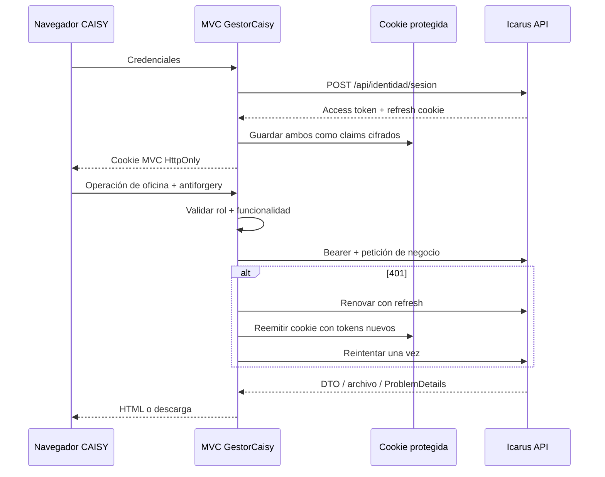

# Trajano.GestorCaisy

## 1. Propósito y frontera

Aplicación de oficina ASP.NET Core MVC para cuentas `GestorCaisy`. Renderiza HTML
en servidor y consume **exclusivamente** `Icarus.Host` mediante HTTP. No tiene
`DbContext`, SQL, service worker, IndexedDB ni caché offline.

## 2. Sesión y seguridad

- Cookie `trajano_gestorcaisy`, protegida con DataProtection, HttpOnly,
  SameSite Lax, esencial, expiración de 8 h y deslizante.
- Access y refresh se guardan como claims cifrados; JavaScript no los lee y no
  se usa localStorage.
- Cookie antiforgery `trajano_gestorcaisy_af`, HttpOnly y SameSite Strict.
- Las mutaciones POST llevan `[ValidateAntiForgeryToken]`.
- Las claves DataProtection se conservan en volumen para mantener sesiones al
  recrear el contenedor.
- Policies MVC exigen rol `GestorCaisy` y bit de funcionalidad; la API repite la
  autorización con el JWT.

| Policy MVC | Controladores |
|---|---|
| `GestorPedidoAlimento` | `PreciosController`, `PedidosController` |
| `GestorRecepcionHuevos` | `PreciosHuevoController`, `RecepcionesHuevoController` |
| `GestorVeterinario` | `ProgramasVacunacionController` |

Tras iniciar sesión se aterriza en la primera sección de la cuenta: alimento,
huevo o vacunación.

## 3. Cliente API

`ApiIcarusClient` resuelve `ApiIcarus:BaseUrl`, crea JSON/multipart, agrega Bearer
y propaga correlación. Ante 401 renueva una vez y reintenta; las rutas de sesión no
se renuevan a sí mismas. Los archivos se copian a memoria para permitir ese
reintento. Los ProblemDetails se transforman en `ErrorApiException` con estado,
título, correlación y validación.

Las llamadas salientes registran una **plantilla** (`/api/pedidos-alimento-caisy/{id}`)
y nunca la URL concreta, query, cuerpo, motivos o nombres de archivo. Los loggers
automáticos de `IHttpClientFactory` se retiran para evitar fugas.

## 4. Precios de alimento

`PreciosController` ofrece:

- historial y detalle;
- importación PDF a borrador;
- edición del borrador;
- publicación con confirmación;
- anulación de publicación futura;
- descarte lógico del borrador con confirmación;
- descarga del documento original.

La API también admite Excel, aunque esta pantalla histórica está centrada en PDF.
Un 404 al repetir descarte se presenta como éxito ya aplicado; un 409 de edición
indica modificación concurrente.

## 5. Pedidos de alimento

`PedidosController` ofrece bandeja global con filtros/paginación y notificaciones,
detalle con historial, y estas operaciones:

- devolver con motivo;
- rechazar con motivo;
- aceptar con entrega estimada;
- cambiar entrega estimada;
- registrar despacho con nota y cantidades;
- descargar recibo PDF;
- mostrar la vista derivada del respaldo del receptor;
- marcar notificaciones como leídas y sondear contador/últimos cinco avisos.

Las pantallas verifican estado antes de mostrar la acción y la API vuelve a
validar. CAISY no edita tipos/cantidades ni ve borradores. No sube fotos al
despachar: la evidencia actual la adjunta el receptor al confirmar.

La vista de crédito del Cliente está retirada: el MVC no llama al endpoint
histórico y siempre representa ese bloque como ausente.

## 6. Precios y recepción de huevo

`PreciosHuevoController` cubre importación Excel, edición, publicación, anulación
futura, descarte, original y corrección de la publicación vigente con
previsualización y motivo.

`RecepcionesHuevoController` cubre:

- bandeja de despachos enviados;
- detalle;
- confirmación de recepción con pantalla y POST antiforgery;
- descarga del recibo PDF posterior;
- notificaciones, contador y marcado de lectura.

No hay negociación ni reconteo por línea. La confirmación es terminal y habilita
el recibo.

## 7. Programas de vacunación

`ProgramasVacunacionController` cubre el catálogo global de programas de
vacunación:

- lista con estado visible (Borrador, Publicado, Inactivo);
- alta y edición de datos básicos del borrador;
- importación del Excel del cronograma, con un error por fila en el resumen
  de validación si alguna fila es inválida (no se guarda nada);
- publicación, eliminación del borrador y desactivación, cada una con su
  página de confirmación.

El gestor nunca ve galpones, clientes ni tareas: los contratos de vacunación no
los llevan y la API responde 403 en las rutas del tenant. No hay campana ni
notificaciones para esta función.

## 8. Errores y observabilidad

El pipeline incluye contexto de petición, un resumen HTTP seguro, manejo de errores
con reejecución, middleware de respuesta segura y filtro de errores API. Los 400/409
esperados vuelven al formulario con mensajes de validación; los 404 se traducen a
no encontrado; los errores inesperados terminan en una página genérica.

La correlación MVC→API usa `DownstreamCorrelationId` en MVC y `CorrelationId` en
API, con `TraceId` compartido. Cada reintento físico tiene su propio id de salto.

## 9. Pruebas de frontera

`Icarus/tests/Trajano.GestorCaisy.Tests/` cubre controladores, sesión, cliente API,
privacidad y flujos. Las pruebas de arquitectura impiden referencias a EF Core o
módulos backend. Las pruebas de integración pueden levantar ambos hosts y medir el
contrato HTTP real.

## 10. Fuentes principales

- `Icarus/src/Apps/Trajano.GestorCaisy/Program.cs`
- `Icarus/src/Apps/Trajano.GestorCaisy/Servicios/ApiIcarusClient.cs`
- `Icarus/src/Apps/Trajano.GestorCaisy/Sesion/SesionCaisyCookie.cs`
- `Icarus/src/Apps/Trajano.GestorCaisy/Controllers/`
- `Icarus/tests/Trajano.GestorCaisy.Tests/`
