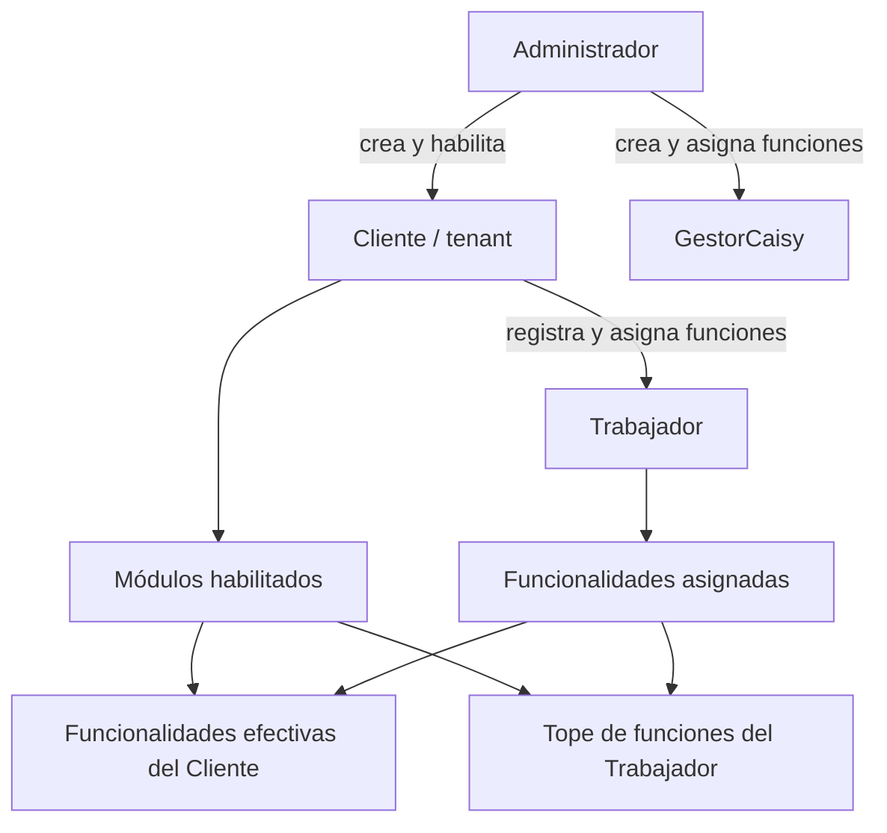
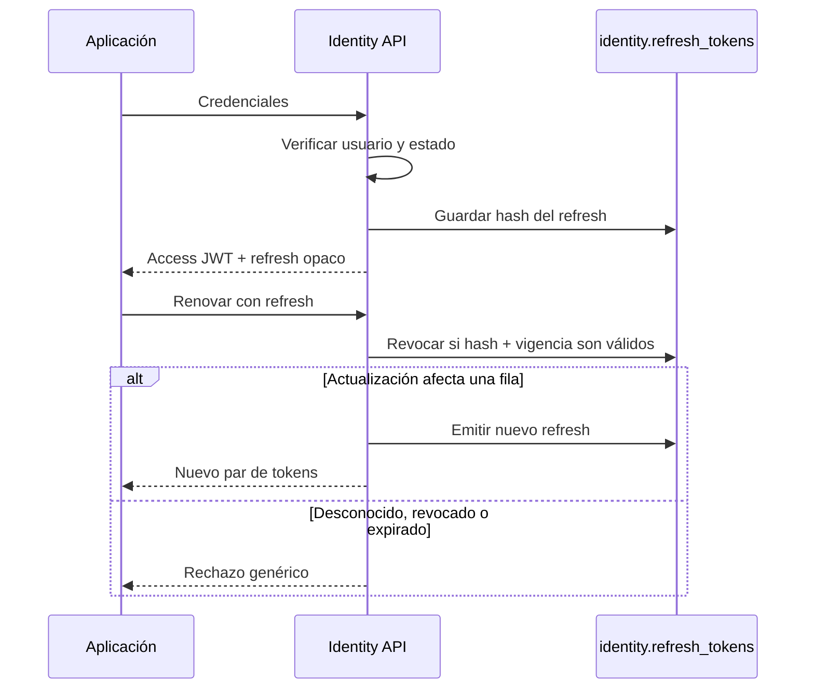
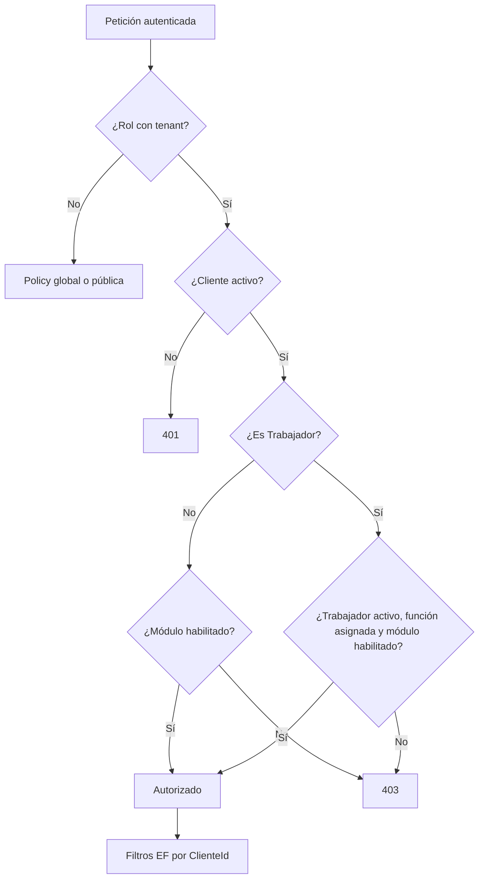

# Identidad, clientes y permisos

## 1. Actores y alcance

| Rol | Tenant | Propósito |
|---|---|---|
| `Administrador` | Sin tenant | Alta/suspensión de clientes, módulos y cuentas CAISY. |
| `Cliente` | Propio `ClienteId` | Administra su empresa y dispone de las funcionalidades de los módulos habilitados. |
| `Trabajador` | Propio `ClienteId` + `TrabajadorId` | Opera únicamente funcionalidades asignadas y vigentes. |
| `GestorCaisy` | Sin tenant | Oficina CAISY; sus facultades se componen con `FuncionalidadesCaisy`. |

El sistema es cerrado: no existe registro público. El Administrador crea las
cuentas y los usuarios inician sesión con credenciales verificadas por ASP.NET
Identity.



## 2. Modelo de identidad

`identity.usuarios` extiende `IdentityUser<Guid>` con:

- `Rol` como columna, sin tablas de roles ASP.NET;
- `ClienteId` y `TrabajadorId` como ids sin FK entre módulos;
- `Activo`;
- bitmask `FuncionalidadesCaisy`.

El usuario técnico vive en Infrastructure; roles, claims y reglas pertenecen a
`Icarus.Identity.Domain`. La separación evita que Identity dependa de Clientes.

### Access token

El JWT HMAC-SHA256 contiene:

| Claim | Significado |
|---|---|
| `sub` | Id del usuario. |
| `rol` | Nombre del rol. |
| `clienteId` | Tenant, cuando aplica. |
| `trabajadorId` | Trabajador asociado, cuando aplica. |
| `funcCaisy` | Bitmask decimal de funciones CAISY, si no es cero. |

Se validan emisor, audiencia, firma y expiración, con un minuto de tolerancia.
La configuración exige `Jwt:Clave` al arrancar. Los valores concretos no forman
parte de esta documentación.

### Refresh token

- Se genera con 64 bytes aleatorios y se entrega al cliente.
- SQL solo conserva **SHA-256**, nunca el valor en claro.
- Al renovar, un `UPDATE` condicional revoca atómicamente el token vigente.
- Una renovación concurrente o repetida obtiene el mismo rechazo genérico.
- Después de revocarlo se emite un nuevo par access/refresh.

Esto evita que dos pestañas puedan reusar con éxito el mismo refresh token.



## 3. Clientes y trabajadores

### Cliente / tenant

Un `Cliente` tiene razón social, identificador fiscal boliviano validado, estado
y módulos habilitados. Suspender conserva la fila y corta el acceso; reactivar lo
restablece. El middleware responde 401 a Cliente/Trabajador autenticados cuyo
tenant falta o está inactivo.

Módulos persistidos como flags:

- `GestionAvicola = 1`
- `ControlAcceso = 2`

### Trabajador

Pertenece siempre a un cliente. Registra nombre, documento, cargo, ingreso, cese,
estado y bitmask de funcionalidades. Documento y datos personales no deben
aparecer en logs ni errores. Cesar o desactivar no elimina sus asignaciones ni el
historial, pero elimina el permiso efectivo.

Funciones asignables al trabajador:

| Funcionalidad | Bit | Capacidad principal |
|---|---:|---|
| `ProduccionHuevos` | 4 | Recogidas y lectura estructural asociada. |
| `Mortalidad` | 8 | Bajas e inventario derivado. |
| `Vacunacion` | 16 | Consulta y ejecución de tareas. |
| `PedidoAlimento` | 256 | Pedidos y recepción de alimento. |
| `DespachoHuevo` | 512 | Preparación y envío de huevo. |

Los bits `Granjas`, `Galpones`, `Alimentacion`, `Despachos` y `Precios` existen
en el modelo general, pero **no son asignables a trabajadores** por
`FuncionalidadesTrabajador`.

## 4. Cálculo del permiso efectivo

Para un Cliente:

```text
permiso = cliente activo
          Y módulo de la funcionalidad habilitado
```

Para un Trabajador:

```text
permiso = cliente activo
          Y trabajador activo y perteneciente al tenant
          Y funcionalidad asignable
          Y funcionalidad asignada al trabajador
          Y módulo correspondiente habilitado en el cliente
```

`VerificadorEntitlement` usa `IgnoreQueryFilters` y comprueba `EstaActivo`
explícitamente para no convertir un filtro de consulta en una decisión de
seguridad ambigua.



La lectura estructural de granjas/galpones usa la policy
`GestionAvicolaEstructura`: basta ProduccionHuevos, Mortalidad o Vacunacion. No
concede administración de estructura ni ajuste manual de inventario.

## 5. Funciones globales CAISY

| Funcionalidad | Bit | Ámbito |
|---|---:|---|
| `GestorPedidoAlimento` | 1 | Precios de alimento y bandeja/despacho de pedidos. |
| `GestorRecepcionHuevos` | 2 | Precios de huevo, recepción y consulta de crédito. |
| `GestorVeterinario` | 4 | Programas de vacunación: borrador, cronograma, publicación y desactivación. |

La policy exige simultáneamente rol `GestorCaisy` y bit en `funcCaisy`. El rol por
sí solo no habilita operaciones. En GestorCaisy se vuelve a comprobar rol y bit
antes de mostrar/ejecutar la UI; la API sigue siendo la autoridad final.

## 6. Aislamiento de datos

Los filtros EF aplican dos conceptos distintos:

1. **tenant:** `ClienteId` del claim;
2. **visibilidad:** `EstaActivo` cuando la entidad admite borrado lógico.

Una cuenta sin tenant —Administrador o GestorCaisy— no queda restringida por el
filtro de tenant; sus policies y repositorios determinan qué operación global
puede hacer. No significa acceso universal a todos los endpoints.

Las entidades globales —programas de vacunación y publicaciones de precios— no
tienen filtro de tenant. Las notificaciones de Gestión Avícola tampoco tienen
filtro global automático: el repositorio debe aplicar explícitamente alcance de
tenant o bandeja CAISY.

## 7. Sesiones de las aplicaciones

- **PWA:** access token solo en memoria; nunca en `localStorage`. La sesión
  offline del trabajador guarda un snapshot sin token ni correo.
- **GestorCaisy:** access y refresh viajan como claims de una cookie protegida
  con DataProtection, HttpOnly; nunca en almacenamiento web.
- **Kiosco:** esquema de cookie separado y restringido, sin sustituir Bearer;
  activación limitada por IP y protección antiforgery.

Ocultar menús o rutas es solamente UX. Cada endpoint vuelve a aplicar la policy y
los repositorios/filtros delimitan los datos.

## 8. Fuentes principales

- `Icarus/src/Identity/Icarus.Identity.Domain/`
- `Icarus/src/Identity/Icarus.Identity.Infrastructure/Autenticacion/`
- `Icarus/src/Clientes/Icarus.Clientes.Domain/`
- `Icarus/src/Clientes/Icarus.Clientes.Infrastructure/Autorizacion/`
- `Icarus/src/Host/Icarus.Host/Servicios/CurrentUserService.cs`
- `Icarus/src/Host/Icarus.Host/Middleware/ClienteActivoMiddleware.cs`
