# Máquinas de estados

Referencia consolidada de los ciclos implementados. «Terminal» significa que el
agregado no ofrece otra transición de negocio. El borrado lógico es una dimensión
independiente: una entidad puede conservar su estado y quedar inactiva.

## 1. Catálogo general

| Objeto | Estados/ciclo | Documento funcional |
|---|---|---|
| PedidoAlimento | Borrador, Solicitado, Rechazado, Aceptado, Despachado, RecibidoConforme, RecibidoConDiferencias | [Alimento](pedidos-recepcion-alimentos.md) |
| NotificacionPreciosAlimentos | Borrador, Publicada, Anulada + inactiva | [Precios de alimento](pedidos-recepcion-alimentos.md) |
| DespachoHuevo | Borrador, Despachado, Recibido | [Huevo](despacho-recepcion-huevos.md) |
| PublicacionPrecioHuevo | Borrador, Publicada, Anulada, Corregida + inactiva | [Precios de huevo](despacho-recepcion-huevos.md) |
| TareaVacunacion | Pendiente, Completada, Cancelada + inactiva | [Vacunación](gestion-avicola.md) |
| Produccion/Mortalidad | Día abierto → sellado; activa/inactiva | [Operación diaria](recogida-huevos-mortalidad.md) |
| Operación offline | Pendiente con/sin backoff → error; eliminada al éxito | [Offline](recogida-huevos-mortalidad.md) |
| SesionKiosco | Vigente, revocada, expirada | [Control de acceso](control-acceso.md) |
| Enrolamiento | SinEnrolar, Vigente, Revocado; Pendiente reservado | [Enrolamiento](control-acceso.md) |
| OperacionEnrolamiento | Confirmada o Fallida, inmutable | [Enrolamiento](control-acceso.md) |
| FlujoMarcacion | Activo, FinalizadoPorExito, FinalizadoPorIncidencia | [Marcación](control-acceso.md) |
| Propuesta de salida | Reservada vigente/vencida; Confirmada/Fallida previstos | [Marcación](control-acceso.md) |
| JornadaAcceso | Abierta, Completa, Incompleta, derivados | [Jornada](control-acceso.md) |
| IncidenciaAcceso | Pendiente, Resuelta, Descartada | [Incidencias](control-acceso.md) |
| Notificación | No leída → leída | [Notificaciones](pedidos-recepcion-alimentos.md) |
| Cliente/Trabajador/estructura | Activo ↔ inactivo según operación | [Permisos](identidad-clientes-permisos.md) |

## 2. Pedido de alimento

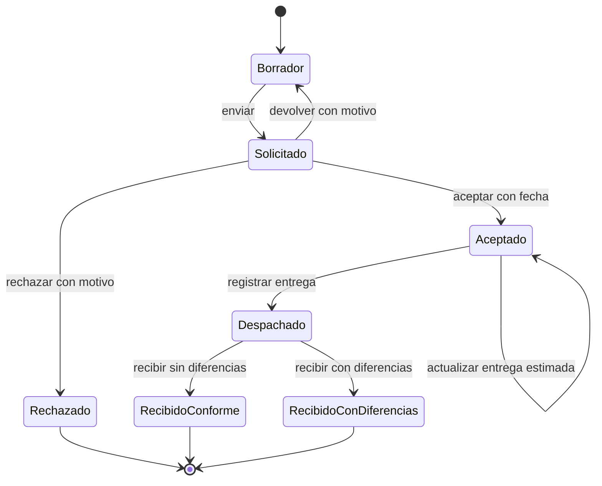

| Origen | Acción | Guardas y efectos |
|---|---|---|
| Borrador | Editar/desactivar | Solo activo y Borrador; edición reemplaza líneas. |
| Borrador | Enviar | Cupo disponible, cantidades granel válidas, precio completo; fecha Bolivia, congelado, historial y aviso CAISY. |
| Solicitado | Devolver | Motivo; mismo pedido vuelve a Borrador y avisa al tenant. |
| Solicitado | Rechazar | Motivo; terminal y aviso al tenant. |
| Solicitado | Aceptar | Fecha ≥ hoy; guarda fecha y avisa. |
| Aceptado | Actualizar entrega | Fecha ≥ hoy; transición reflexiva y aviso. |
| Aceptado | Despachar | Nota y líneas completas; entrega única y aviso. |
| Despachado | Recibir | Foto obligatoria, líneas completas; snapshot, total real y aviso CAISY. |

Cualquier otra transición se rechaza. Reenviar tras devolución conserva la fecha
original y no consume otro cupo en la misma semana.

## 3. Publicación de precios de alimento

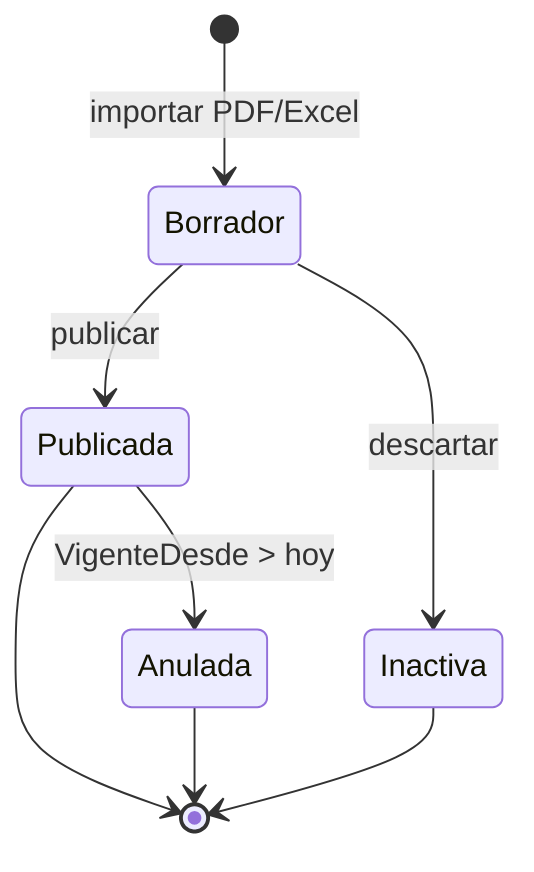

Borrador admite editar y asignar original. Publicar exige detalles y vigencia
activa única. Una Publicada efectiva no se edita ni anula. La vigencia temporal se
resuelve por consulta, no mediante otro estado automático.

## 4. Despacho de huevo

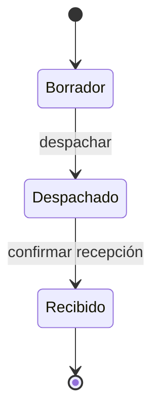

- Borrador: editar/desactivar; tamaños únicos y cantidades válidas.
- Borrador→Despachado: precio vigente completo, foto, fecha Bolivia, congelado e
  historial.
- Despachado→Recibido: reconciliación de precios corregidos, fecha y aviso al
  tenant. No hay reconteo.
- Recibido: terminal; admite recibo y ajustes externos de crédito, no recálculo
  directo de líneas.

## 5. Publicación de precio de huevo

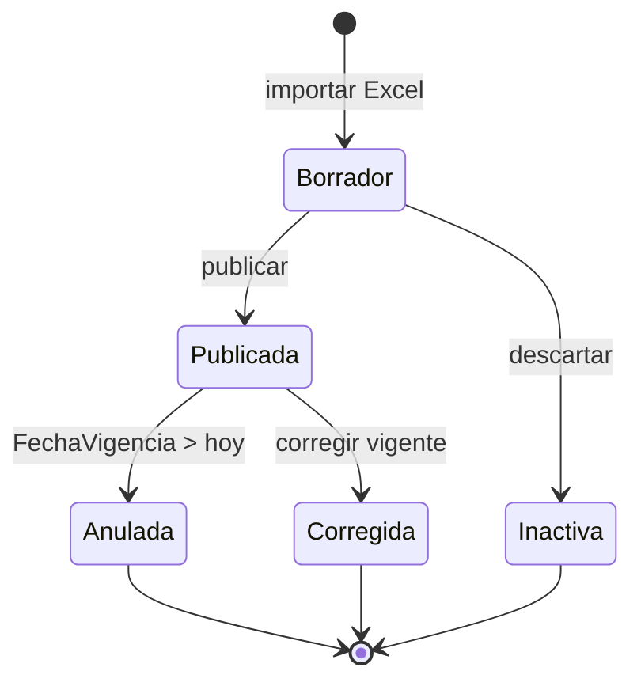

Corregir enlaza `PublicacionCorrectivaId` y motivo. La correctiva pasa de Borrador
a Publicada en la misma transacción. Despachos aún en tránsito se recongelan al
recibir; los Recibido reciben ajustes inmutables.

## 6. Tarea de vacunación

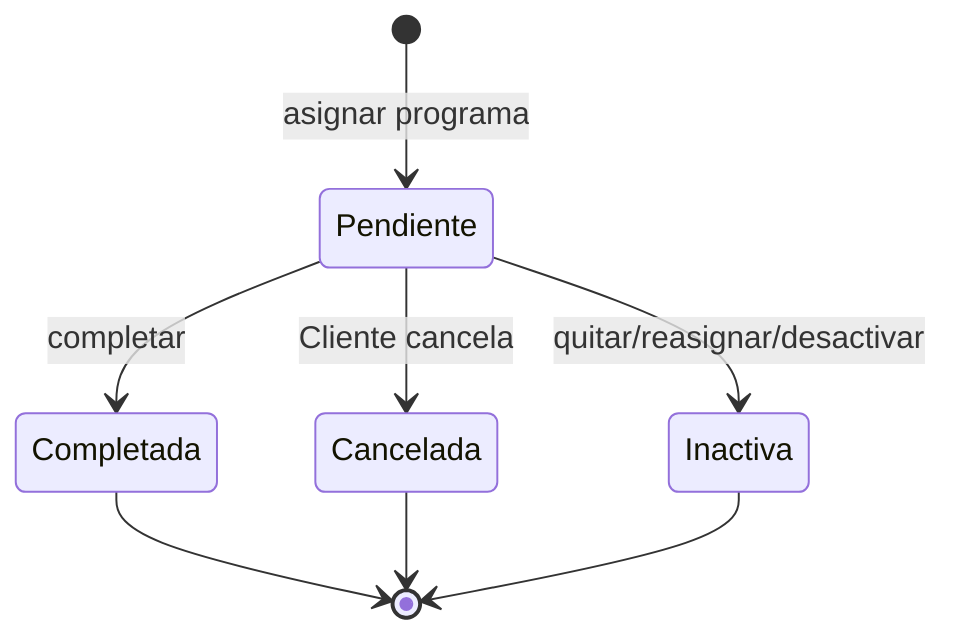

Completar exige fecha no futura, autor y aves > 0 si se informan. Cancelar admite
motivo opcional. Los estados cerrados no reabren. Inactiva es soft delete y no
cambia el estado histórico.

## 7. Registro de producción/mortalidad

No hay enum de estado temporal; se deriva de `Fecha` y reloj UTC del servidor.

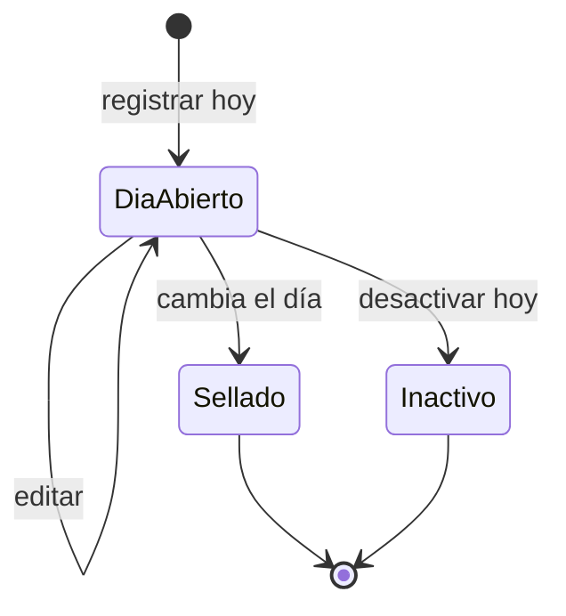

Un registro Sellado no admite edición ni desactivación. Mortalidad además revierte
inventario al desactivar mientras el día está abierto. La idempotencia devuelve el
registro existente antes de aplicar efectos.

## 8. Operación de cola offline

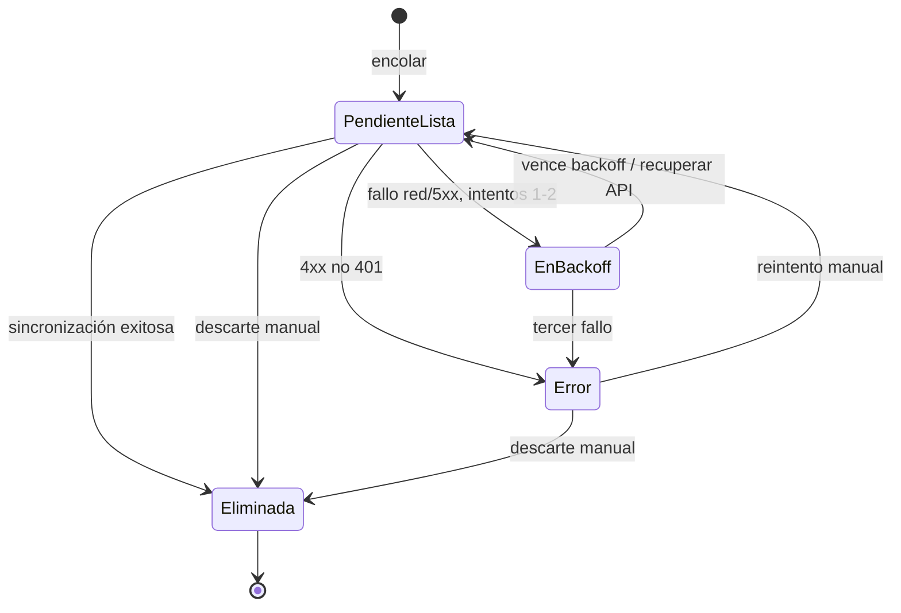

Un 401 pausa el ciclo sin marcar error. La edición de una pendiente conserva su
estado, intentos e idempotencyKey. El motor no procesa dos ciclos simultáneos.

## 9. Sesión de kiosco

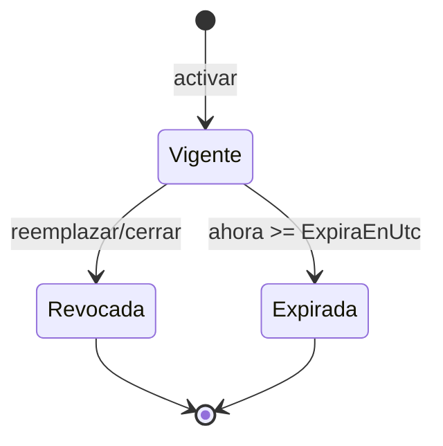

Solo Vigente autentica. No hay renovación offline ni reactivación de una revocada.

## 10. Enrolamiento y operación de enrolamiento

### Configuración

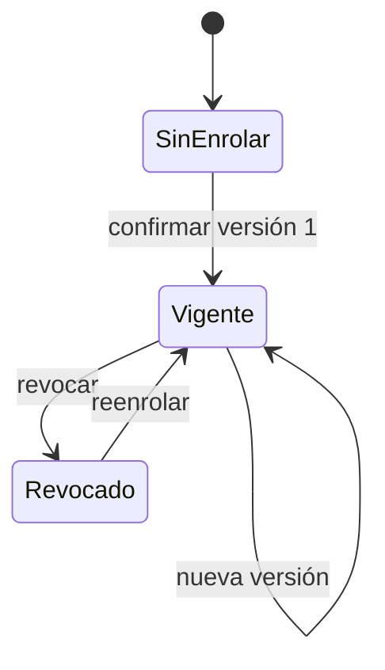

`Pendiente` existe en el enum pero no se asigna en el flujo actual. `Habilitado`
es otro flag: se puede habilitar sin rostro, pero no marcar hasta tener Vigente y
plantilla activa de la misma versión.

### Operación local

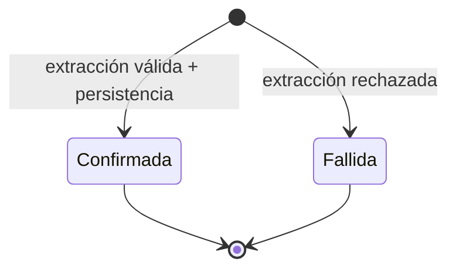

La misma clave reproduce el resultado sin nueva llamada biométrica. No hay
transiciones posteriores.

## 11. Flujo de marcación

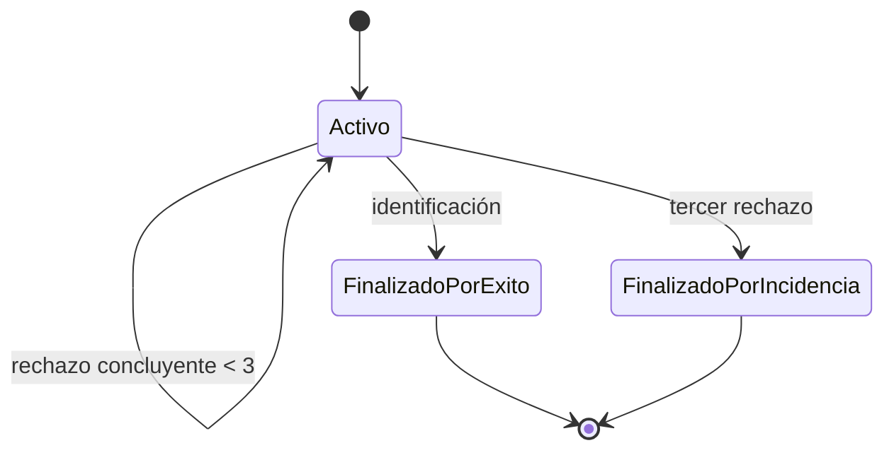

Un error técnico no consume intento. Un flujo cerrado no admite capturas. Éxito de
identificación todavía exige elegibilidad y secuencia válida antes de persistir la
marcación.

## 12. Propuesta de salida

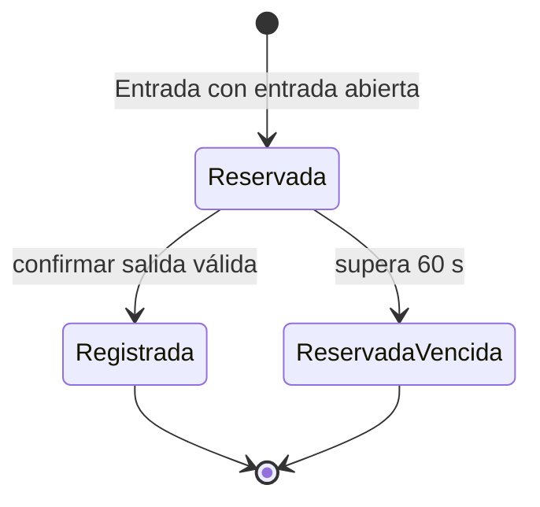

El enum contempla Reservada, Confirmada y Fallida. En la implementación actual, al
confirmar se asigna `JornadaId` pero **no se cambia Estado a Confirmada**: queda
Reservada con jornada enlazada, mientras la marcación sí queda registrada. Este es
un detalle del código vigente, no una transición idealizada.

## 13. Jornada de acceso — estado derivado

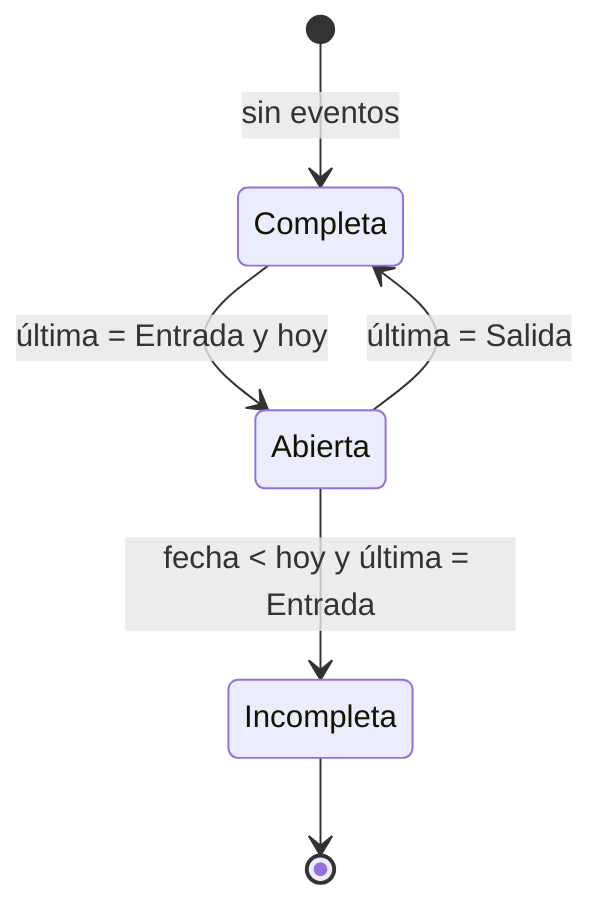

Las correcciones no son otro estado: agregan revisiones y cambian los valores
efectivos. La secuencia siempre alterna Entrada/Salida y evita solapamientos.

## 14. Incidencia de acceso

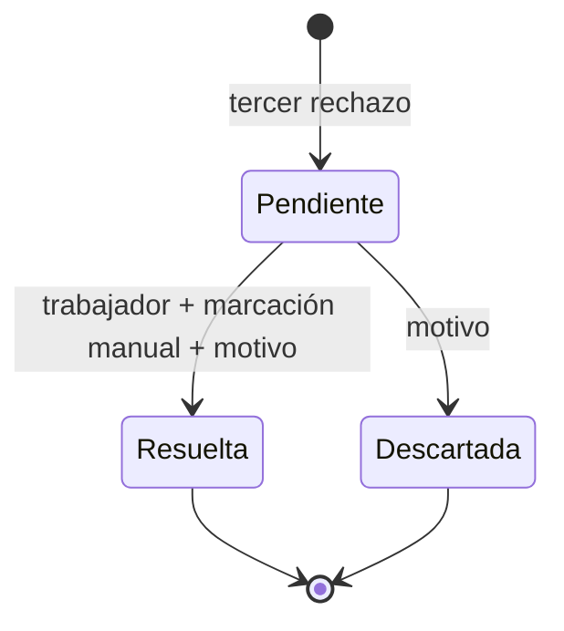

Resolver una Resuelta devuelve su jornada; descartar una Descartada no hace nada.
Los cruces incorrectos producen conflicto. Versión esperada opcional protege la
concurrencia.

## 15. Notificaciones

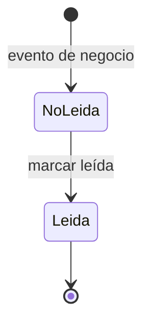

La notificación no cambia el estado del agregado que la originó. Su alcance es
tenant o CAISY y se aplica en repositorio. Los listados calculan contador y ETag;
`since` filtra novedades sin alterar lectura.

## 16. Estados simples y vigencia

| Objeto | Ciclo |
|---|---|
| Cliente | Activo → Suspendido → Reactivado; permisos efectivos solo activo. |
| Trabajador | Activo → Desactivado; cese es fecha independiente; no borra historial. |
| Granja/Galpón | Activo → Inactivo; una granja activa por tenant. |
| ProgramaVacunacion | Activo → Inactivo; desactiva tareas pendientes. |
| PlantillaFacial | Activa → Revocada; sustituida por nueva versión. |
| Publicación de precio | Publicada futura → vigente por fecha → reemplazada por otra, sin job. |
| RefreshToken | Vigente → Revocado o Expirado; rotación atómica, sin reutilización. |
| AjusteCreditoHuevo | Creado inmutable; no se edita ni desactiva. |

## 17. Reglas comunes de reintento

- **Idempotencia por clave:** producción, mortalidad, enrolamiento y marcaciones.
- **Conflicto por estado:** envío/transiciones de pedidos y despachos.
- **Idempotencia natural:** completar/cancelar tarea y resolver/descartar incidencia
  tienen comportamiento específico al repetir, no una clave universal.
- **Concurrencia:** `rowversion` en agregados comerciales y `Version` en acceso.
- **Atomicidad:** historial, notificación y cambio se guardan juntos; archivos se
  guardan antes de mutar el agregado para evitar transiciones a medias.
