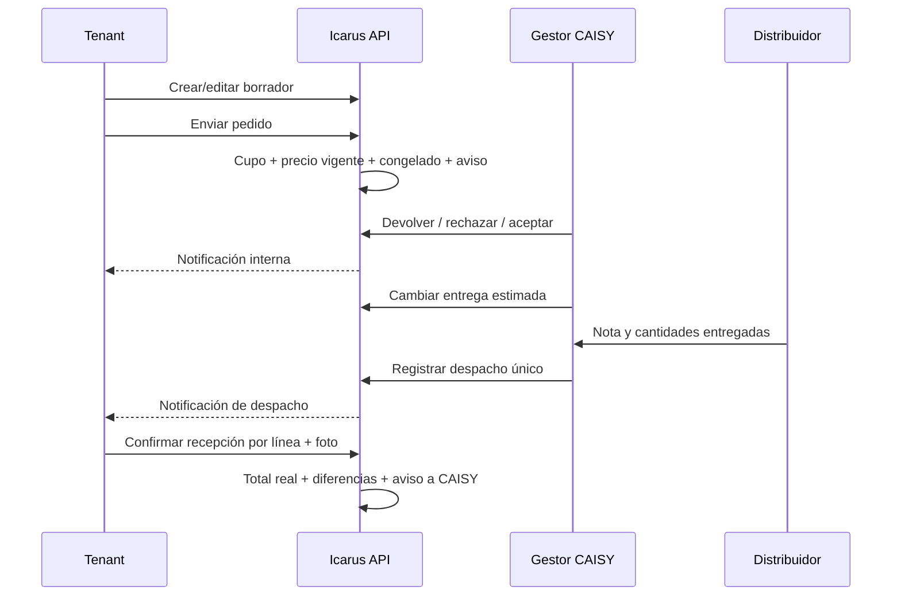
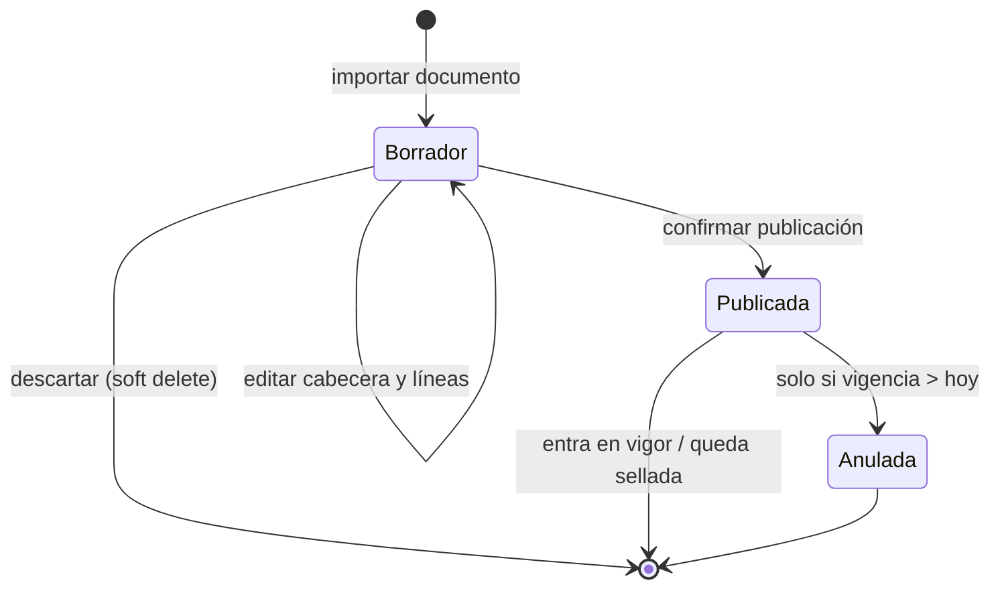
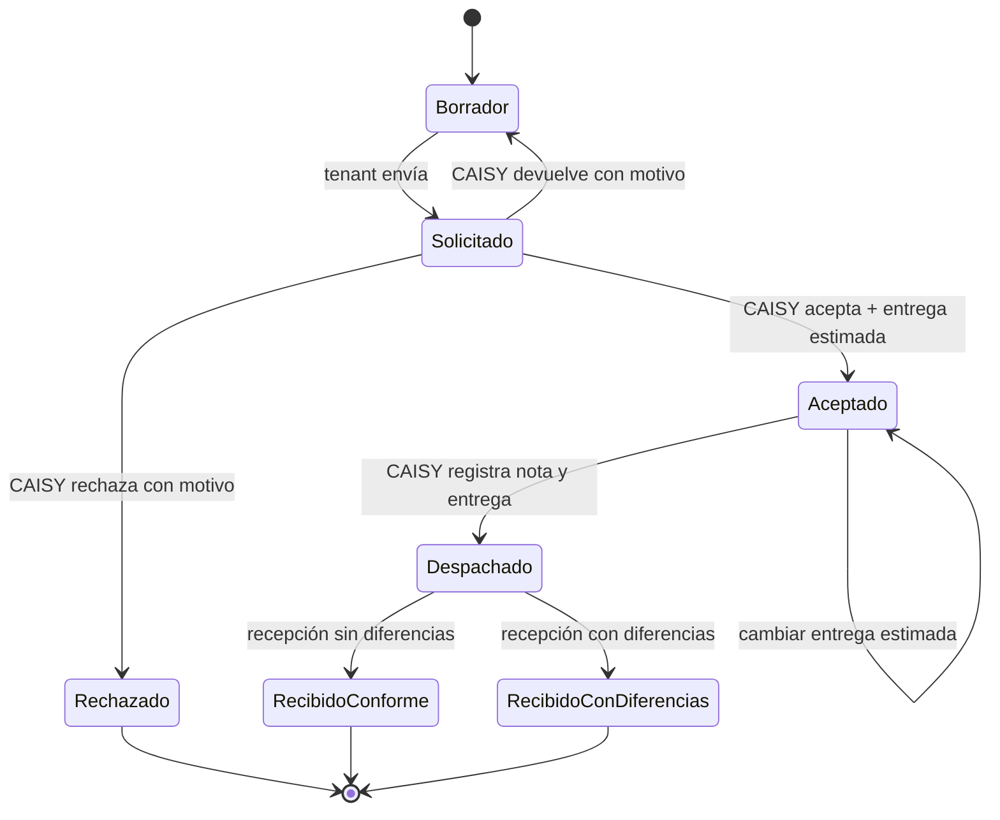

# Pedidos y recepción de alimentos

## 1. Visión del proceso

El pedido es compartido por todo el tenant autorizado: Cliente o Trabajador con
`PedidoAlimento`. El creador queda como auditoría, no como propietario exclusivo.
CAISY lo procesa desde GestorCaisy con `GestorPedidoAlimento`. El flujo es online.



## 2. Catálogo y presentaciones

Tipos: `Preiniciador`, `Iniciador`, `Crecimiento`, `Finalizador`, `PosturaUno` y
`PosturaDos`. Cada uno tiene presentación Bolsa o Granel y un código CAISY
(`SJ-PRE`, `SJ-1B`, `SJ-1G`, etc.).

| Presentación | Cantidad solicitada | Equivalentes de 40 kg |
|---|---|---|
| Bolsa | Bolsas enteras de 40 kg, > 0. | 1 por bolsa. |
| Granel | Toneladas enteras, > 0. | 25 por tonelada. |

Un pedido tiene al menos una línea, una sola presentación, tipos únicos y no
mezcla familias de levante y postura. Al enviar a granel exige al menos 2 t por
tipo y 6 t en total. Cantidades entregadas/recibidas son enteras y admiten cero,
pero deben cubrir exactamente los tipos de la etapa anterior.

## 3. Publicación de precios de alimento

CAISY importa un PDF o Excel. El archivo original se almacena privado y genera un
borrador editable; no se publica automáticamente. Cabecera: fecha de documento,
vigencia, aporte CAISY, fondo y servicios —los tres aportes > 0—. Detalle: tipo,
presentación, precio final por 40 kg, rango de edad opcional y precio actual del
documento informativo.



La vigencia activa es única. La publicación vigente para una fecha es la última
`Publicada` con `VigenteDesde <= fecha`; rige hasta que otra posterior entra en
vigor. Una publicación efectiva no se edita ni anula: se corrige mediante otra
publicación. «Precio Actual» genera contraste/advertencia, pero no bloquea.

## 4. Máquina de estados del pedido



Solo Borrador se edita o desactiva. Todas las salidas verifican estado; un doble
clic o reintento sobre un estado ya cambiado produce conflicto y no repite
historial ni notificación. `rowversion` protege escrituras concurrentes.

## 5. Envío, cupo y congelado

En una transacción explícita se ejecuta:

1. cargar el borrador del tenant;
2. fijar fecha de negocio Bolivia;
3. contar pedidos enviados en la semana ISO con `UPDLOCK, HOLDLOCK`;
4. exigir que no se alcance `PedidosAlimento:MaximoPorSemana` —valor inicial
   documentado: 3, configurable—;
5. resolver publicación vigente y exigir precio para todas las líneas;
6. congelar `PrecioFinalPor40Kg`, `NotificacionPreciosAlimentosId` y subtotal;
7. cambiar a Solicitado y registrar transición;
8. crear una notificación `PedidoSolicitado` o `PedidoReenviado` para CAISY;
9. confirmar la transacción.

Cuentan los pedidos activos fuera de Borrador con `FechaPedido` en la semana de
lunes a domingo. Borradores no consumen cupo. Una devolución vuelve temporalmente
a Borrador; el reenvío del mismo pedido no vuelve a contarlo mientras conserva su
`FechaPedido` original.

El folio visible es `P-000123`; el número se genera con secuencia SQL.

### Crédito al enviar: comportamiento vigente

El saldo **no bloquea ni exige confirmación**. Si el total esperado supera el
saldo, se conserva la marca «Enviado con crédito insuficiente.» en el historial
del pedido y las cifras técnicas en el registro de vuelo. No se envía una alerta
separada de crédito a CAISY. El flag `ConfirmarCreditoInsuficiente` permanece en
el contrato por compatibilidad, pero está inerte.

## 6. Procesamiento por CAISY

| Acción | Origen | Guarda | Efectos |
|---|---|---|---|
| Devolver | Solicitado | Motivo obligatorio. | Vuelve al mismo Borrador; conserva historial y congelados hasta reenvío; avisa al tenant. |
| Rechazar | Solicitado | Motivo obligatorio. | Estado terminal; avisa al tenant. |
| Aceptar | Solicitado | Entrega estimada ≥ hoy Bolivia. | Aceptado; fecha y aviso al tenant. |
| Cambiar entrega | Aceptado | Nueva fecha ≥ hoy Bolivia. | Transición Aceptado→Aceptado y aviso con metadata de fecha. |
| Despachar | Aceptado | Nota y todas las líneas. | Entrega única, estado Despachado y aviso al tenant. |

CAISY no cambia tipos ni cantidades solicitadas. Sus listados excluyen siempre
Borrador, incluso si el filtro pide explícitamente ese estado; el detalle de un
borrador responde como inexistente. La bandeja global muestra folio y granja,
no el autor.

## 7. Despacho y nota de entrega

CAISY informa número y fecha de nota, total neto opcional y cantidad entregada por
cada tipo. La fecha de despacho la fija el servidor en horario Bolivia. Se admite
diferencia entre solicitado y entregado.

```text
TotalDespachado = Σ(equivalentes entregados × precio congelado)
```

El total manual se conserva solo para contraste. En esta etapa no se exige la
foto del distribuidor dentro del agregado; la evidencia obligatoria actual es la
de la copia del receptor al confirmar recepción. La entrega y la nota son únicas.

## 8. Recepción del tenant

Cliente o Trabajador con `PedidoAlimento` informa lo realmente recibido por línea
y adjunta una foto de su copia de la nota. El archivo se guarda primero en el
almacén privado; si falla, no se modifica el pedido. Después, en una unidad de
trabajo:

- se adjuntan original y copia de visualización;
- se comprueba que los tipos coinciden con lo despachado;
- se calculan diferencias `recibido − entregado`;
- se calcula el gasto real;
- se cierra como RecibidoConforme si no hay diferencias o
  RecibidoConDiferencias si existe al menos una;
- se notifica el resultado a CAISY.

```text
TotalRecibido = Σ(equivalentes realmente recibidos × precio congelado)
Diferencia    = CantidadRecibida − CantidadEntregada
```

Las diferencias quedan serializadas como snapshot JSON. El campo
`Recepcion.FechaRecepcion` se inicializa con `Entrega.FechaDespacho`; el agregado no
toma una segunda fecha de reloj al confirmar. Ambos resultados son terminales y
reconocen gasto real; no existe una corrección posterior de recepción.

La descarga exige autorización y pertenencia al pedido. La vista derivada se sirve
inline; el original solo como adjunto. Un documento ajeno responde 404 genérico.

## 9. Balance de alimento

Consulta del tenant por rango de `FechaPedido`, agrupada por tipo. Solo incluye
pedidos activos en RecibidoConforme o RecibidoConDiferencias:

```text
Equivalentes recibidos = Σ(cantidad recibida × factor de presentación)
Gasto                  = Σ(equivalentes recibidos × precio congelado)
Pedidos recibidos      = COUNT de líneas agrupadas en la consulta
```

El precio vigente posterior, lo simplemente pedido/despachado y el total manual de
la nota no participan. El balance se calcula con SQL; no hay una tabla de saldo de
alimento.

## 10. Notificaciones

El sistema conserva notificaciones internas para:

- CAISY: pedido solicitado, reenviado, recepción conforme o con diferencias;
- tenant: pedido devuelto, rechazado, aceptado, entrega estimada actualizada y
  despachado.

Se crean en la misma unidad de trabajo que la transición. Son persistentes; la
interfaz las consulta y permite marcarlas como leídas según su visibilidad.

## 11. Fuentes principales

- `Icarus/src/GestionAvicola/Icarus.GestionAvicola.Domain/PedidoAlimento.cs`
- `Icarus/src/GestionAvicola/Icarus.GestionAvicola.Domain/NotificacionPreciosAlimentos.cs`
- `Icarus/src/GestionAvicola/Icarus.GestionAvicola.Application/PedidosAlimento/ComandosPedidosAlimento.cs`
- `Icarus/src/GestionAvicola/Icarus.GestionAvicola.Application/PreciosAlimentos/ComandosPreciosAlimentos.cs`
- `Icarus/src/GestionAvicola/Icarus.GestionAvicola.Infrastructure/Repositorios/RepositorioPedidosAlimento.cs`
- `Icarus/src/GestionAvicola/Icarus.GestionAvicola.Infrastructure/Repositorios/RepositorioBalanceAlimentos.cs`
