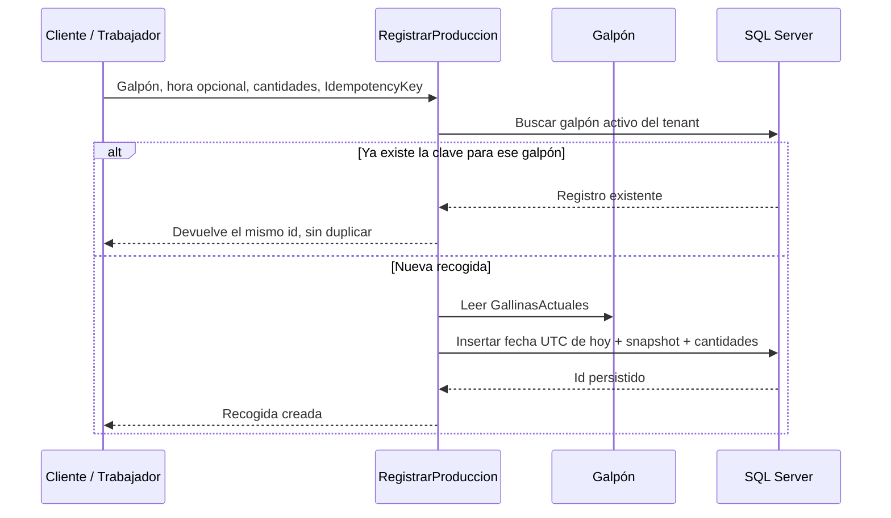
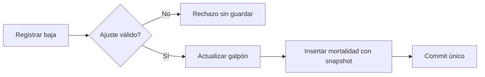
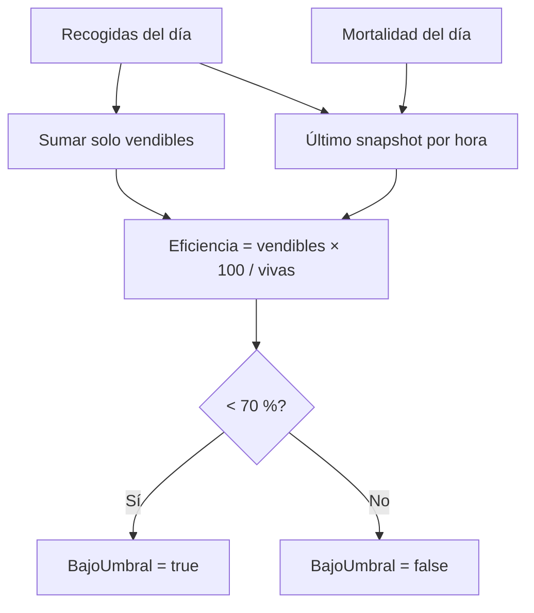
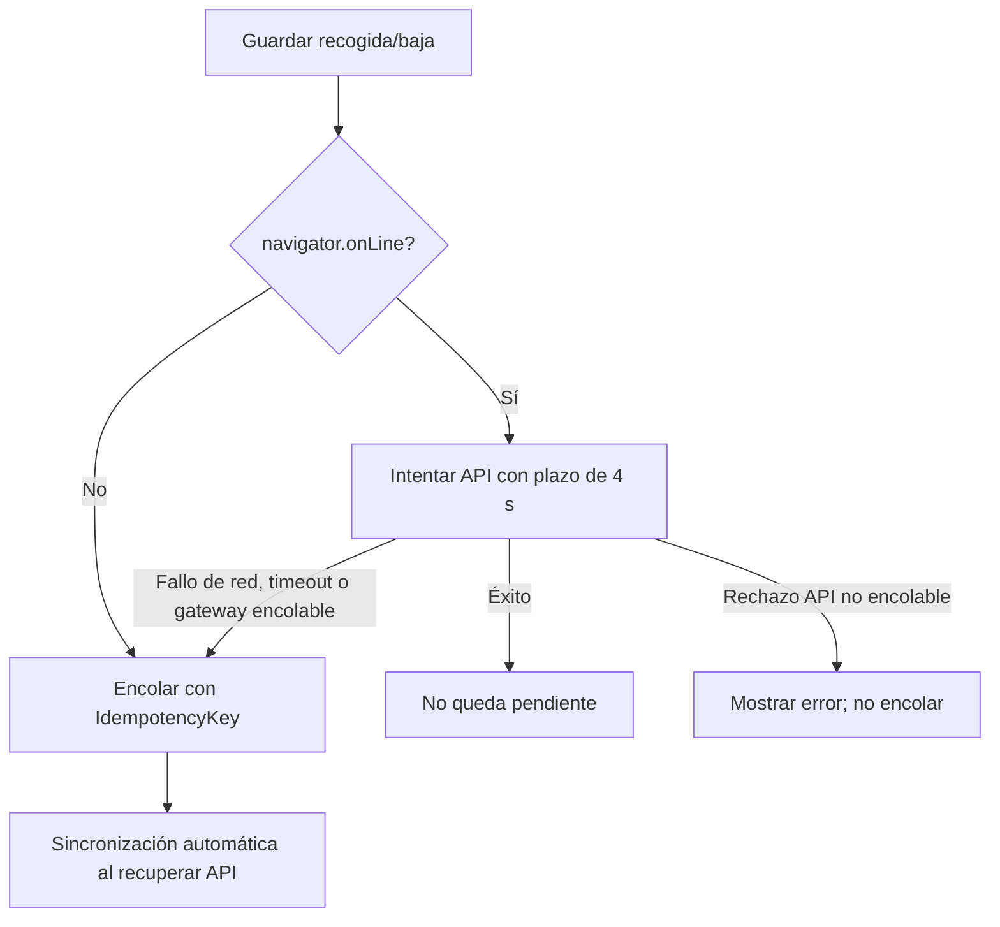

# Recogida de huevos y mortalidad

## 1. Propósito y alcance

El Trabajador —o el Cliente— registra varias recogidas por galpón y día, huevos
vendibles y de descarte, y bajas de gallinas. La fecha la fija el servidor; las
operaciones de alta no aceptan una fecha histórica. Mientras el día siga abierto
se pueden corregir o desactivar registros. Después quedan sellados.

Este es el único flujo de negocio **offline-first** de la PWA. Pedidos de alimento
y despachos de huevo son deliberadamente online.

## 2. Unidades y fórmulas

```text
Huevos vendibles = CantidadMaples × 30 + UnidadesIncompletas
Huevos descarte  = MaplesDescarte × 30 + UnidadesDescarte
```

- Maple = 30 huevos.
- Unidades sueltas: 0..29, tanto vendibles como de descarte.
- Maples: enteros no negativos.
- El descarte se registra aparte y **no suma** a la eficiencia ni al vendible.
- Una recogida guarda `GallinasVivas` como snapshot del galpón en ese momento.

## 3. Recogida online



La implementación actual toma fecha y hora por defecto de `DateTime.UtcNow`. La
hora puede ser informada por la UI; la fecha de persistencia es la del servidor.
El filtro EF impide registrar sobre un galpón ajeno o inactivo.

### Corrección y borrado lógico

Editar cambia hora y cantidades, manteniendo el snapshot de gallinas original.
Desactivar oculta el registro de las consultas normales. Ambas operaciones exigen
que `Fecha` no sea anterior al día actual del servidor; un registro pasado no se
puede editar ni desactivar.

## 4. Mortalidad e inventario

La cantidad de muertas debe ser > 0. El alta descuenta inventario antes de crear
el evento y guarda el nuevo total como snapshot:

```text
nuevas vivas = GallinasActuales − CantidadMuertas
restricción  = 0 ≤ nuevas vivas ≤ CapacidadMaxima
```

| Operación | Efecto en inventario | Snapshot del evento |
|---|---|---|
| Registrar | Resta las muertas. | Vivas después de la baja. |
| Editar | Suma el valor anterior y resta el nuevo. | Vivas después del ajuste. |
| Desactivar | Devuelve las muertas al inventario. | Se conserva el evento inactivo. |

Todo ocurre en la misma unidad de trabajo. La idempotencia evita duplicar tanto el
evento como el ajuste de inventario cuando la PWA reintenta.



## 5. Eficiencia diaria

La eficiencia se calcula al consultar, nunca se persiste:

```text
eficiencia (%) = redondeo(total vendible del día × 100 / gallinas vivas, 2)
bajo umbral    = eficiencia < 70
```

Si no hay gallinas vivas, la eficiencia es 0. Para cada día se usa el snapshot del
último evento —recogida o mortalidad— ordenado por hora. El rango por defecto es
hoy y los seis días anteriores. Solo aparecen días con eventos; si la consulta
incluye hoy y no hubo eventos, se añade hoy con vendible 0, inventario actual y
eficiencia 0/bajo umbral.

El 70 % es una señal derivada para considerar descarte de lote, no una transición
automática ni un estado persistido. El descarte de huevos tampoco altera el
numerador.



## 6. Offline-first en la PWA

### Almacenamiento

IndexedDB `icarus-offline`, versión 1, contiene:

| Store | Contenido |
|---|---|
| `operaciones` | Altas pendientes de producción/mortalidad, intentos y backoff. |
| `cache-lectura` | Granjas, galpones, eventos del día, caché general y sesión offline. |

La cola contiene datos de negocio, nunca tokens ni credenciales. Solo admite los
tipos `produccion.crear` y `mortalidad.crear`.

### Precalentado

Con conectividad se descargan granjas, galpones y, para cada galpón, detalle,
producción y mortalidad del día. Los fallos individuales de detalle/eventos no
abortan todo el precalentado. Las lecturas exitosas actualizan caché; ante fallo
de transporte se sirve la última copia disponible.

### Guardado con cola



Una petición que complete después del timeout puede coexistir con el reintento de
la cola: el mismo `IdempotencyKey` hace que el backend devuelva el registro
existente en lugar de duplicarlo.

### Sincronización y errores

- Una sonda real a `/api/identidad/me` comprueba que el API responde;
  `navigator.onLine` por sí solo no basta.
- Se procesa un lote de hasta 50 operaciones y se evita un segundo ciclo
  simultáneo.
- Éxito: se elimina de la cola y se invalida la caché de TanStack Query.
- 401: se detiene el ciclo para no seguir sin sesión renovable.
- Otros 4xx: la operación pasa a `error` y requiere decisión manual.
- Red/5xx: backoff exponencial de 2 minutos y luego 4; al tercer intento fallido
  pasa a `error`.
- Al recuperar conectividad se elimina el backoff de pendientes; los errores no se
  reintentan automáticamente.
- La UI permite editar el contenido de una operación pendiente conservando su
  idempotencyKey, reintentarla o descartarla.

El coordinador se ejecuta al iniciar la aplicación, al evento `online`, tras
actividad real del API y cada cinco minutos; si la sonda falla con pendientes,
reintenta en 15 segundos.

## 7. Sesión offline del trabajador

Solo el rol Trabajador obtiene un snapshot para abrir la PWA sin red. Caduca a las
12 horas y contiene ids, rol, módulos y funcionalidades; **no contiene access
token, refresh token ni correo**. Otro rol borra ese snapshot para proteger un
dispositivo compartido. La cola conservada se sincroniza en el ciclo inicial tras
un login con red.

## 8. Límites explícitos

- No hay edición/desactivación offline de registros ya sincronizados.
- No hay cola offline para vacunación, pedidos o despachos.
- La eficiencia no se calcula localmente como sustituto del backend.
- El trabajador no ve la página de eficiencia: la ruta está limitada a
  Administrador y Cliente; el backend mantiene su propia autorización.
- Los huevos despachados no descuentan ni validan contra estas recogidas: son
  procesos relacionados por el negocio, pero independientes en el modelo.

## 9. Fuentes principales

- `Icarus/src/GestionAvicola/Icarus.GestionAvicola.Domain/RegistroProduccion.cs`
- `Icarus/src/GestionAvicola/Icarus.GestionAvicola.Domain/RegistroMortalidad.cs`
- `Icarus/src/GestionAvicola/Icarus.GestionAvicola.Application/Produccion/Commands.cs`
- `Icarus/src/GestionAvicola/Icarus.GestionAvicola.Application/Mortalidad/Commands.cs`
- `Icarus/src/GestionAvicola/Icarus.GestionAvicola.Application/Eficiencia/Queries.cs`
- `web/src/features/avicola/offline.ts`
- `web/src/app/offline/coordinador.ts`
- `web/src/lib/offline/`
