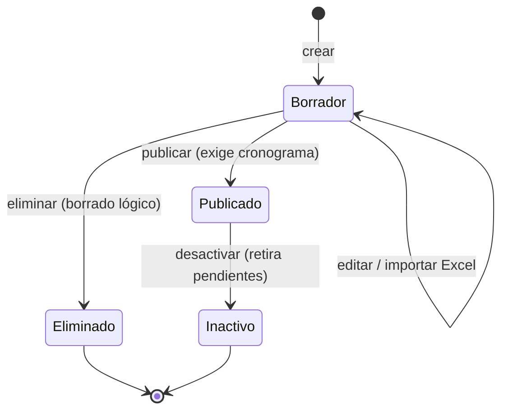

# Gestor veterinario de vacunación — Plan de implementación

> **Para agentes:** ejecutar tarea por tarea con TDD (rojo, verde, limpieza). Los
> pasos usan casillas (`- [ ]`). Spec:
> [`2026-10-30-gestor-veterinario-vacunacion-design.md`](../specs/2026-10-30-gestor-veterinario-vacunacion-design.md).
> Tarea del sistema de agentes: `2026-10-30-gestor-veterinario-vacunacion`.

**Objetivo:** el catálogo global de programas de vacunación pasa del
Administrador de plataforma a la cuenta CAISY con `GestorVeterinario`, en
Trajano.GestorCaisy, con ciclo Borrador → Publicado; cliente y trabajador solo
ven publicados; el gestor nunca ve galpones, clientes ni tareas.

**Arquitectura:** enum de estado en el agregado `ProgramaVacunacion`; queries y
DTOs separados para consumo del tenant y para gestión; grupo de endpoints nuevo
`/programas-vacunacion-caisy` con la política `FuncionalidadCaisy:GestorVeterinario`;
controlador MVC nuevo en GestorCaisy que consume esas rutas por HTTP.

**Stack:** .NET 10, Minimal APIs, MediatR, EF Core (SQL Server), xUnit +
NSubstitute + Testcontainers.MsSql, ASP.NET Core MVC, React + Vitest.

## Restricciones globales

- Español correcto, con acentos y sin voseo, en código, comentarios, vistas y
  documentos. UTF-8 sin BOM.
- Anti-PII: el registro de vuelo solo lleva conteos; nunca nombres de programa,
  vacunas, observaciones ni nombres de archivo.
- El gestor nunca recibe datos de galpones, clientes ni tareas. El filtro EF de
  tenant es permisivo sin `ClienteId`: no agregar endpoints del gestor que
  consulten tareas o galpones.
- No hacer commit ni push: según `docs/ai/agentes/PROTOCOLO.md` el
  desarrollador deja los cambios sin commitear y el orquestador commitea.
- Registrar con la CLI mientras se trabaja, por ejemplo:
  `node quality/tarea.mjs registrar 2026-10-30-gestor-veterinario-vacunacion comando --texto "<comando y resultado>" --rol desarrollador --proveedor <p>`.
- Shell: PowerShell 5.1 (sin `&&`). Las pruebas de integración necesitan Docker.
- Prohibido relajar baselines o umbrales de `quality/`.

## Mapa de archivos

| Acción | Archivo |
|---|---|
| Modificar | `Icarus/src/Identity/Icarus.Identity.Domain/FuncionalidadesCaisy.cs` |
| Crear | `Icarus/src/GestionAvicola/Icarus.GestionAvicola.Domain/EstadoProgramaVacunacion.cs` |
| Modificar | `Icarus/src/GestionAvicola/Icarus.GestionAvicola.Domain/ProgramaVacunacion.cs` |
| Reescribir | `Icarus/src/GestionAvicola/Icarus.GestionAvicola.Application/Vacunacion/IRepositorioProgramasVacunacion.cs` |
| Reescribir | `Icarus/src/GestionAvicola/Icarus.GestionAvicola.Application/Vacunacion/Programas.cs` |
| Modificar | `Icarus/src/GestionAvicola/Icarus.GestionAvicola.Application/Vacunacion/AsignacionPlan.cs` |
| Reescribir | `Icarus/src/GestionAvicola/Icarus.GestionAvicola.Infrastructure/Repositorios/RepositorioProgramasVacunacion.cs` |
| Modificar | `Icarus/src/GestionAvicola/Icarus.GestionAvicola.Infrastructure/Persistencia/ConfiguracionProgramaVacunacion.cs` |
| Crear (EF) | `Icarus/src/GestionAvicola/Icarus.GestionAvicola.Infrastructure/Migrations/*_EstadoProgramaVacunacion.cs` |
| Modificar | `Icarus/src/Clientes/Icarus.Clientes.Infrastructure/Autorizacion/RequisitoCatalogoVacunacion.cs` |
| Modificar | `Icarus/src/Clientes/Icarus.Clientes.Infrastructure/Autorizacion/PoliticasClientes.cs` |
| Modificar | `Icarus/src/Host/Icarus.Host/Endpoints/GestionAvicolaEndpoints.cs` |
| Crear | `Icarus/src/Host/Icarus.Host/Endpoints/ProgramasVacunacionCaisyEndpoints.cs` |
| Modificar | `Icarus/src/Host/Icarus.Host/Program.cs` |
| Modificar | `Icarus/src/Identity/Icarus.Identity.Infrastructure/SemillaIdentidad.cs` |
| Crear | `crear-usuario-gestor-veterinario.ps1` |
| Modificar | `Icarus/src/Apps/Trajano.GestorCaisy/Autenticacion/ConstantesAutorizacion.cs`, `ReclamosCaisy.cs`, `Program.cs` |
| Modificar | `Icarus/src/Apps/Trajano.GestorCaisy/Servicios/ContratosApi.cs`, `IApiIcarusClient.cs`, `ApiIcarusClient.cs` |
| Crear | `Icarus/src/Apps/Trajano.GestorCaisy/Controllers/ProgramasVacunacionController.cs` |
| Crear | `Icarus/src/Apps/Trajano.GestorCaisy/Models/ProgramasVacunacionVistas.cs` |
| Crear | `Icarus/src/Apps/Trajano.GestorCaisy/Views/ProgramasVacunacion/*.cshtml` |
| Modificar | `Icarus/src/Apps/Trajano.GestorCaisy/Views/Shared/_Layout.cshtml`, `wwwroot/css/estilos.css`, `Controllers/SesionController.cs` |
| Eliminar | `web/src/features/admin/vacunacion/AdminVacunacionPage.tsx` y su `.test.tsx` |
| Modificar | `web/src/app/router.tsx`, `paginasDiferidas.tsx`, `navegacion.tsx`, `navegacion.test.tsx`, `web/src/features/avicola/api.ts`, `api.test.ts` |
| Pruebas | ver cada tarea |
| Documentos | Tarea 13 |

---

### Tarea 1: Funcionalidad `GestorVeterinario`

**Archivos:**
- Modificar: `Icarus/src/Identity/Icarus.Identity.Domain/FuncionalidadesCaisy.cs`
- Prueba: `Icarus/tests/Icarus.UnitTests/Identity/FuncionalidadesCaisyTests.cs`

- [ ] **Paso 1: prueba en rojo.** En `FuncionalidadesCaisyTests.cs` agregar
  `[InlineData("GestorVeterinario")]` a `SoloSeAdmitenFuncionalidadesDefinidas`
  y esta prueba nueva:

```csharp
    [Fact]
    public void GestorVeterinarioTieneElBitCuatroYSeCombinaConLasDemas()
    {
        Assert.Equal(4, (int)FuncionalidadesCaisy.GestorVeterinario);

        var combinadas = ReglasFuncionalidadesCaisy.Combinar(["GestorRecepcionHuevos", "GestorVeterinario"]);

        Assert.Equal(6, (int)combinadas);
    }
```

- [ ] **Paso 2:** `dotnet test Icarus/tests/Icarus.UnitTests --filter "FullyQualifiedName~FuncionalidadesCaisyTests"` → falla de compilación (`GestorVeterinario` no existe).
- [ ] **Paso 3: implementación.** En el enum, después de `GestorRecepcionHuevos = 2,`:

```csharp
    // Spec 2026-10-30-gestor-veterinario-vacunacion: prepara y publica los
    // programas de vacunación del catálogo global.
    GestorVeterinario = 4,
```

- [ ] **Paso 4:** repetir el comando del paso 2 → verde. La política
  `FuncionalidadCaisy:GestorVeterinario` se registra sola (bucle sobre el enum
  en `Icarus.Identity.Infrastructure/DependencyInjection.cs`) y
  `RequisitoFuncionalidadCaisy` acepta el bit nuevo porque calcula la máscara
  válida desde el enum. No hace falta migración de Identity: la columna es un
  entero sin restricción.

---

### Tarea 2: Estado del `ProgramaVacunacion` en el dominio

**Archivos:**
- Crear: `Icarus/src/GestionAvicola/Icarus.GestionAvicola.Domain/EstadoProgramaVacunacion.cs`
- Modificar: `Icarus/src/GestionAvicola/Icarus.GestionAvicola.Domain/ProgramaVacunacion.cs`
- Prueba: `Icarus/tests/Icarus.UnitTests/GestionAvicola/ProgramaVacunacionTests.cs`

- [ ] **Paso 1: pruebas en rojo.** En `ProgramaVacunacionTests.cs`:

  1. En `CtorValidoAsignaYNaceActivo` agregar al final:

```csharp
        Assert.Equal(EstadoProgramaVacunacion.Borrador, programa.Estado);
        Assert.False(programa.EsAsignable);
```

  2. Reemplazar `DesactivarMarcaInactivoSinBorrar` por el bloque siguiente
     (incluye el ayudante `ProgramaPublicado`):

```csharp
    private static ProgramaVacunacion ProgramaPublicado()
    {
        var programa = CrearPrograma();
        programa.ReemplazarCronograma([new DatosItemPlanVacunacion(3, "BIO COCCIVET R", null, null)]);
        programa.Publicar();
        return programa;
    }

    [Fact]
    public void PublicarConCronogramaLoVuelveAsignable()
    {
        var programa = ProgramaPublicado();

        Assert.Equal(EstadoProgramaVacunacion.Publicado, programa.Estado);
        Assert.True(programa.EsAsignable);
    }

    [Fact]
    public void PublicarSinCronogramaLanzaReglaNegocio()
    {
        var programa = CrearPrograma();

        var ex = Assert.Throws<ReglaNegocioException>(programa.Publicar);

        Assert.Equal("El programa debe tener un cronograma antes de publicarse.", ex.Message);
        Assert.Equal(EstadoProgramaVacunacion.Borrador, programa.Estado);
    }

    [Fact]
    public void PublicarDosVecesLanzaReglaNegocio()
    {
        var programa = ProgramaPublicado();

        var ex = Assert.Throws<ReglaNegocioException>(programa.Publicar);

        Assert.Equal("El programa ya está publicado.", ex.Message);
    }

    [Fact]
    public void PublicarUnBorradorEliminadoLanzaReglaNegocio()
    {
        var programa = CrearPrograma();
        programa.ReemplazarCronograma([new DatosItemPlanVacunacion(3, "A", null, null)]);
        programa.EliminarBorrador();

        var ex = Assert.Throws<ReglaNegocioException>(programa.Publicar);

        Assert.Equal("Un borrador eliminado no se puede publicar.", ex.Message);
    }

    [Fact]
    public void UnPublicadoEsInmutable()
    {
        var programa = ProgramaPublicado();

        Assert.Equal("Un programa publicado ya no es editable.",
            Assert.Throws<ReglaNegocioException>(() => programa.ActualizarDatos("OTRO", 10, null)).Message);
        Assert.Equal("Un programa publicado ya no es editable.",
            Assert.Throws<ReglaNegocioException>(() => programa.ReemplazarCronograma(
                [new DatosItemPlanVacunacion(7, "GUMBORO", null, null)])).Message);
        Assert.Equal("Un programa publicado ya no es editable.",
            Assert.Throws<ReglaNegocioException>(() => programa.EstablecerFechaEmision(Hoy)).Message);
        Assert.Equal("Un programa publicado ya no es editable.",
            Assert.Throws<ReglaNegocioException>(programa.AsegurarEditable).Message);
        Assert.Equal("PROGRAMA DE VACUNACION PARA 1000 AVES", programa.Nombre);
    }

    [Fact]
    public void EliminarBorradorLoDejaInactivoYEsInocuoRepetirlo()
    {
        var programa = CrearPrograma();

        programa.EliminarBorrador();
        programa.EliminarBorrador();

        Assert.False(programa.EstaActivo);
        Assert.Equal(EstadoProgramaVacunacion.Borrador, programa.Estado);
        Assert.False(programa.EsAsignable);
    }

    [Fact]
    public void EliminarUnPublicadoLanzaReglaNegocio()
    {
        var programa = ProgramaPublicado();

        var ex = Assert.Throws<ReglaNegocioException>(programa.EliminarBorrador);

        Assert.Equal("Un programa publicado no se elimina: se desactiva.", ex.Message);
        Assert.True(programa.EstaActivo);
    }

    [Fact]
    public void DesactivarUnPublicadoLoDejaInactivoSinBorrarYNoAsignable()
    {
        var programa = ProgramaPublicado();

        programa.Desactivar();
        programa.Desactivar();

        Assert.False(programa.EstaActivo);
        Assert.Equal(EstadoProgramaVacunacion.Publicado, programa.Estado);
        Assert.False(programa.EsAsignable);
        Assert.Single(programa.Items);
    }

    [Fact]
    public void DesactivarUnBorradorLanzaReglaNegocio()
    {
        var programa = CrearPrograma();

        var ex = Assert.Throws<ReglaNegocioException>(programa.Desactivar);

        Assert.Equal("Un borrador no se desactiva: se elimina.", ex.Message);
        Assert.True(programa.EstaActivo);
    }
```

- [ ] **Paso 2:** `dotnet test Icarus/tests/Icarus.UnitTests --filter "FullyQualifiedName~ProgramaVacunacionTests"` → falla de compilación.
- [ ] **Paso 3: implementación.** Crear `EstadoProgramaVacunacion.cs`:

```csharp
namespace Icarus.GestionAvicola.Domain;

// Estados del programa de vacunación (spec 2026-10-30-gestor-veterinario-
// vacunacion). Borrador es editable y eliminable; Publicado es inmutable y es
// el único asignable mientras siga activo. Desactivado no es un estado: es el
// borrado lógico (EstaActivo) de un publicado. Valores estables porque se
// persisten como entero.
public enum EstadoProgramaVacunacion
{
    Borrador = 0,
    Publicado = 1,
}
```

  Reemplazar el contenido de `ProgramaVacunacion.cs` por:

```csharp
using Icarus.BuildingBlocks.Domain;

namespace Icarus.GestionAvicola.Domain;

// Catálogo global de planes de vacunación (spec SP7): lo emite CAISY y lo
// gestiona el Gestor CAISY con GestorVeterinario (spec 2026-10-30); no lleva
// ClienteId. Ciclo Borrador -> Publicado: el borrador se edita, recibe el
// cronograma y se elimina con borrado lógico; el publicado es inmutable, es
// el único asignable y solo admite desactivarse. El papel agrupa varias
// vacunas del mismo día en una fila: la EdadDia no se repite entre ítems
// activos. Las tareas ya materializadas en galpones tienen snapshot y no se
// tocan al cambiar el catálogo.
public sealed class ProgramaVacunacion : AggregateRoot
{
    private const string MensajeNoEditable = "Un programa publicado ya no es editable.";

    private readonly List<ItemPlanVacunacion> _items = [];

    private ProgramaVacunacion()
    {
    }

    public ProgramaVacunacion(string nombre, DateOnly? fechaEmision, int cantidadAves, string? observaciones)
    {
        AsignarDatos(nombre, cantidadAves, observaciones);
        if (fechaEmision is not null)
            EstablecerFechaEmision(fechaEmision.Value);
        EstaActivo = true;
    }

    // Para la semilla y tests que necesitan ids fijos.
    public ProgramaVacunacion(Guid id, string nombre, DateOnly? fechaEmision, int cantidadAves, string? observaciones)
        : this(nombre, fechaEmision, cantidadAves, observaciones) => Id = id;

    public string Nombre { get; private set; } = string.Empty;

    // La fecha de emisión no se pide en el alta: la establece la primera fecha
    // del Excel al importar el cronograma (spec SP7). Null hasta ese momento.
    public DateOnly? FechaEmision { get; private set; }

    public int CantidadAves { get; private set; }

    public string? Observaciones { get; private set; }

    public EstadoProgramaVacunacion Estado { get; private set; } = EstadoProgramaVacunacion.Borrador;

    public bool EstaActivo { get; private set; }

    // Solo un publicado activo se asigna a galpones y lo ven cliente y trabajador.
    public bool EsAsignable => EstaActivo && Estado == EstadoProgramaVacunacion.Publicado;

    public IReadOnlyCollection<ItemPlanVacunacion> Items => _items.AsReadOnly();

    public void ActualizarDatos(string nombre, int cantidadAves, string? observaciones)
    {
        AsegurarEditable();
        AsignarDatos(nombre, cantidadAves, observaciones);
    }

    // La emisión sale del cronograma (primera fecha del Excel), no del editor.
    public void EstablecerFechaEmision(DateOnly fecha)
    {
        AsegurarEditable();
        if (fecha > Hoy())
            throw new ReglaNegocioException("La fecha de emisión no puede ser futura.");
        FechaEmision = fecha;
    }

    public void ReemplazarCronograma(IEnumerable<DatosItemPlanVacunacion> items)
    {
        AsegurarEditable();
        var lista = items.ToList();
        if (lista.Count == 0)
            throw new ReglaNegocioException("El cronograma debe tener al menos un ítem.");
        if (lista.Select(i => i.EdadDia).Distinct().Count() != lista.Count)
            throw new ReglaNegocioException("El cronograma no puede repetir la edad en días entre ítems.");

        foreach (var item in _items.Where(i => i.EstaActivo))
            item.Desactivar();
        foreach (var datos in lista)
            _items.Add(new ItemPlanVacunacion(datos.EdadDia, datos.Vacuna, datos.ModoAplicacion, datos.Observaciones, datos.Fecha));
    }

    // Público para que la importación falle antes de leer el Excel.
    public void AsegurarEditable()
    {
        if (Estado != EstadoProgramaVacunacion.Borrador)
            throw new ReglaNegocioException(MensajeNoEditable);
    }

    // Sin versionado ni vigencia (decisiones 4 y 5): publicar vuelve asignable
    // el borrador y lo sella. Exige cronograma para que todo publicado tenga
    // al menos un ítem activo.
    public void Publicar()
    {
        if (Estado == EstadoProgramaVacunacion.Publicado)
            throw new ReglaNegocioException("El programa ya está publicado.");
        if (!EstaActivo)
            throw new ReglaNegocioException("Un borrador eliminado no se puede publicar.");
        if (!_items.Any(i => i.EstaActivo))
            throw new ReglaNegocioException("El programa debe tener un cronograma antes de publicarse.");
        Estado = EstadoProgramaVacunacion.Publicado;
    }

    // Borrado lógico (glosario, regla transversal 1): el borrador queda
    // inactivo y deja de verse. Es inocuo repetirlo.
    public void EliminarBorrador()
    {
        if (Estado != EstadoProgramaVacunacion.Borrador)
            throw new ReglaNegocioException("Un programa publicado no se elimina: se desactiva.");
        EstaActivo = false;
    }

    // Solo un publicado se desactiva: deja de ser asignable y el handler
    // desactiva sus tareas pendientes en todos los galpones (spec SP7). Es
    // inocuo repetirlo.
    public void Desactivar()
    {
        if (Estado != EstadoProgramaVacunacion.Publicado)
            throw new ReglaNegocioException("Un borrador no se desactiva: se elimina.");
        EstaActivo = false;
    }

    private void AsignarDatos(string nombre, int cantidadAves, string? observaciones)
    {
        if (string.IsNullOrWhiteSpace(nombre))
            throw new ReglaNegocioException("El nombre del programa es obligatorio.");
        if (cantidadAves <= 0)
            throw new ReglaNegocioException("La cantidad de aves debe ser mayor que cero.");

        Nombre = nombre.Trim();
        CantidadAves = cantidadAves;
        Observaciones = string.IsNullOrWhiteSpace(observaciones) ? null : observaciones.Trim();
    }

    private static DateOnly Hoy() => DateOnly.FromDateTime(DateTime.UtcNow);
}
```

- [ ] **Paso 4:** repetir el comando del paso 2 → verde. Nota: hasta la Tarea 3,
  `ProgramasVacunacionHandlerTests.DesactivarDesactivaLasPendientesDelProgramaYGuarda`
  falla (desactiva un borrador). La Tarea 3 reescribe ese archivo; no
  corregirlo aquí.

---

### Tarea 3: Repositorio y handlers de gestión y de consumo

**Archivos:**
- Reescribir: `Icarus/src/GestionAvicola/Icarus.GestionAvicola.Application/Vacunacion/IRepositorioProgramasVacunacion.cs`
- Reescribir: `Icarus/src/GestionAvicola/Icarus.GestionAvicola.Application/Vacunacion/Programas.cs`
- Modificar: `Icarus/src/GestionAvicola/Icarus.GestionAvicola.Application/Vacunacion/AsignacionPlan.cs`
- Reescribir: `Icarus/src/GestionAvicola/Icarus.GestionAvicola.Infrastructure/Repositorios/RepositorioProgramasVacunacion.cs`
- Modificar: `Icarus/src/Host/Icarus.Host/Endpoints/GestionAvicolaEndpoints.cs` (solo la línea del listado, para compilar)
- Pruebas: `ProgramasVacunacionHandlerTests.cs` (reescribir), `AsignacionPlanVacunacionHandlerTests.cs` (modificar), `ContratosGestionVacunacionTests.cs` (crear), todas en `Icarus/tests/Icarus.UnitTests/GestionAvicola/`

- [ ] **Paso 1: pruebas en rojo.** Reemplazar el contenido de
  `ProgramasVacunacionHandlerTests.cs` por:

```csharp
using FluentValidation;
using Icarus.BuildingBlocks.Application.Observability;
using Icarus.BuildingBlocks.Domain;
using Icarus.GestionAvicola.Application;
using Icarus.GestionAvicola.Application.Vacunacion;
using Icarus.GestionAvicola.Domain;
using NSubstitute;
using Xunit;

namespace Icarus.UnitTests.GestionAvicola;

public class ProgramasVacunacionHandlerTests
{
    private static readonly DateOnly Hoy = DateOnly.FromDateTime(DateTime.UtcNow);

    private readonly IRepositorioProgramasVacunacion _programas = Substitute.For<IRepositorioProgramasVacunacion>();
    private readonly IRepositorioTareasVacunacion _tareas = Substitute.For<IRepositorioTareasVacunacion>();
    private readonly IImportadorCronogramaVacunacion _importador = Substitute.For<IImportadorCronogramaVacunacion>();
    private readonly IRegistroVuelo _vuelo = Substitute.For<IRegistroVuelo>();
    private readonly IUnidadTrabajoGestionAvicola _unidad = Substitute.For<IUnidadTrabajoGestionAvicola>();

    private static ProgramaVacunacion Borrador()
    {
        var programa = new ProgramaVacunacion("PLAN CAISY 1000", Hoy.AddDays(-10), 1000, null);
        programa.ReemplazarCronograma([
            new DatosItemPlanVacunacion(10, "B", null, null),
            new DatosItemPlanVacunacion(3, "A", "Agua de bebida", null),
        ]);
        return programa;
    }

    private static ProgramaVacunacion Publicado()
    {
        var programa = Borrador();
        programa.Publicar();
        return programa;
    }

    private void ParaGestion(ProgramaVacunacion programa) =>
        _programas.ObtenerParaGestionAsync(programa.Id, Arg.Any<CancellationToken>()).Returns(programa);

    private void SinProgramaParaGestion() =>
        _programas.ObtenerParaGestionAsync(Arg.Any<Guid>(), Arg.Any<CancellationToken>())
            .Returns((ProgramaVacunacion?)null);

    [Fact]
    public async Task CrearConDatosValidosGuardaUnBorradorYNarra()
    {
        var handler = new CrearProgramaVacunacionHandler(_programas, _vuelo, _unidad);

        var id = await handler.Handle(new("PLAN CAISY 1000", 1000, null), CancellationToken.None);

        Assert.NotEqual(Guid.Empty, id);
        _programas.Received(1).Agregar(Arg.Is<ProgramaVacunacion>(p =>
            p.Nombre == "PLAN CAISY 1000" && p.CantidadAves == 1000 && p.EstaActivo
            && p.Estado == EstadoProgramaVacunacion.Borrador && p.FechaEmision == null));
        await _unidad.Received(1).SaveChangesAsync(Arg.Any<CancellationToken>());
        _vuelo.Received().Decidir(
            Arg.Is<DescriptorOperacionRegistroVuelo>(d => d.Nombre == "avicola.vacunacion.programas.crear"),
            "alta", "aplicada", Arg.Any<IReadOnlyDictionary<string, object?>>());
    }

    [Fact]
    public async Task CrearConNombreDuplicadoLanzaConflict()
    {
        _programas.ExisteNombreAsync("PLAN CAISY 1000", null, Arg.Any<CancellationToken>()).Returns(true);
        var handler = new CrearProgramaVacunacionHandler(_programas, _vuelo, _unidad);

        var ex = await Assert.ThrowsAsync<ConflictException>(() =>
            handler.Handle(new("PLAN CAISY 1000", 1000, null), CancellationToken.None));

        Assert.Equal("No se pudo registrar el programa de vacunación.", ex.Message);
        _programas.DidNotReceive().Agregar(Arg.Any<ProgramaVacunacion>());
    }

    [Fact]
    public async Task ActualizarInexistenteLanzaNotFound()
    {
        SinProgramaParaGestion();
        var handler = new ActualizarProgramaVacunacionHandler(_programas, _vuelo, _unidad);

        var ex = await Assert.ThrowsAsync<NotFoundException>(() =>
            handler.Handle(new(Guid.NewGuid(), "X", 100, null), CancellationToken.None));

        Assert.Equal("Programa de vacunación no encontrado.", ex.Message);
    }

    [Fact]
    public async Task ActualizarConNombreDeOtroProgramaLanzaConflict()
    {
        var programa = Borrador();
        ParaGestion(programa);
        _programas.ExisteNombreAsync("OTRO PLAN", programa.Id, Arg.Any<CancellationToken>()).Returns(true);
        var handler = new ActualizarProgramaVacunacionHandler(_programas, _vuelo, _unidad);

        await Assert.ThrowsAsync<ConflictException>(() =>
            handler.Handle(new(programa.Id, "OTRO PLAN", 100, null), CancellationToken.None));

        Assert.Equal("PLAN CAISY 1000", programa.Nombre);
    }

    [Fact]
    public async Task ActualizarUnBorradorGuarda()
    {
        var programa = Borrador();
        ParaGestion(programa);
        var handler = new ActualizarProgramaVacunacionHandler(_programas, _vuelo, _unidad);

        await handler.Handle(new(programa.Id, "PLAN RENOMBRADO", 2000, "nota"), CancellationToken.None);

        Assert.Equal("PLAN RENOMBRADO", programa.Nombre);
        Assert.Equal(2000, programa.CantidadAves);
        await _unidad.Received(1).SaveChangesAsync(Arg.Any<CancellationToken>());
    }

    [Fact]
    public async Task ActualizarUnPublicadoLanzaReglaNegocioSinGuardar()
    {
        var programa = Publicado();
        ParaGestion(programa);
        var handler = new ActualizarProgramaVacunacionHandler(_programas, _vuelo, _unidad);

        await Assert.ThrowsAsync<ReglaNegocioException>(() =>
            handler.Handle(new(programa.Id, "PLAN RENOMBRADO", 2000, null), CancellationToken.None));

        Assert.Equal("PLAN CAISY 1000", programa.Nombre);
        await _unidad.DidNotReceive().SaveChangesAsync(Arg.Any<CancellationToken>());
    }

    [Fact]
    public async Task ImportarConProgramaInexistenteLanzaNotFound()
    {
        SinProgramaParaGestion();
        var handler = new ImportarCronogramaExcelHandler(_programas, _importador, _vuelo, _unidad);

        await Assert.ThrowsAsync<NotFoundException>(() =>
            handler.Handle(new(Guid.NewGuid(), new MemoryStream()), CancellationToken.None));
    }

    [Fact]
    public async Task ImportarSobreUnPublicadoLanzaReglaNegocioSinLeerElExcel()
    {
        var programa = Publicado();
        ParaGestion(programa);
        var handler = new ImportarCronogramaExcelHandler(_programas, _importador, _vuelo, _unidad);

        await Assert.ThrowsAsync<ReglaNegocioException>(() =>
            handler.Handle(new(programa.Id, new MemoryStream()), CancellationToken.None));

        _importador.DidNotReceive().Importar(Arg.Any<Stream>());
        await _unidad.DidNotReceive().SaveChangesAsync(Arg.Any<CancellationToken>());
    }

    [Fact]
    public async Task ImportarConErroresLanzaValidationYSinGuardarNada()
    {
        var programa = Borrador();
        ParaGestion(programa);
        _importador.Importar(Arg.Any<Stream>()).Returns(new ResultadoImportacionCronograma(
            [],
            [new ErrorFilaImportacion(3, "La edad debe ser un número entero mayor que cero.")]));
        var handler = new ImportarCronogramaExcelHandler(_programas, _importador, _vuelo, _unidad);

        var ex = await Assert.ThrowsAsync<ValidationException>(() =>
            handler.Handle(new(programa.Id, new MemoryStream()), CancellationToken.None));

        Assert.Equal("Fila 3: La edad debe ser un número entero mayor que cero.", ex.Errors.Single().ErrorMessage);
        Assert.Equal("Cronograma", ex.Errors.Single().PropertyName);
        Assert.Equal(2, programa.Items.Count(i => i.EstaActivo));
        await _unidad.DidNotReceive().SaveChangesAsync(Arg.Any<CancellationToken>());
    }

    [Fact]
    public async Task ImportarValidoReemplazaElCronogramaYDevuelveLaCantidad()
    {
        var programa = Borrador();
        ParaGestion(programa);
        _importador.Importar(Arg.Any<Stream>()).Returns(new ResultadoImportacionCronograma(
            [new ItemCronogramaImportado(1, "NEWCASTLE", "Gota ocular", null),
             new ItemCronogramaImportado(3, "BIO COCCIVET R", "Agua de bebida", "Ayuno 2 horas")],
            []));
        var handler = new ImportarCronogramaExcelHandler(_programas, _importador, _vuelo, _unidad);

        var importados = await handler.Handle(new(programa.Id, new MemoryStream()), CancellationToken.None);

        Assert.Equal(2, importados);
        Assert.Equal(4, programa.Items.Count);
        Assert.Equal(2, programa.Items.Count(i => i.EstaActivo));
        _vuelo.Received().Decidir(
            Arg.Is<DescriptorOperacionRegistroVuelo>(d => d.Nombre == "avicola.vacunacion.programas.importar-cronograma"),
            "importacion", "aplicada", Arg.Any<IReadOnlyDictionary<string, object?>>());
        await _unidad.Received(1).SaveChangesAsync(Arg.Any<CancellationToken>());
    }

    [Fact]
    public async Task ImportarConFechaEnElExcelEstableceLaFechaDeEmision()
    {
        var programa = new ProgramaVacunacion("PLAN CAISY 1000", null, 1000, null);
        ParaGestion(programa);
        _importador.Importar(Arg.Any<Stream>()).Returns(new ResultadoImportacionCronograma(
            [new ItemCronogramaImportado(1, "NEWCASTLE", "Gota ocular", null)],
            [], new DateOnly(2026, 8, 6)));
        var handler = new ImportarCronogramaExcelHandler(_programas, _importador, _vuelo, _unidad);

        await handler.Handle(new(programa.Id, new MemoryStream()), CancellationToken.None);

        Assert.Equal(new DateOnly(2026, 8, 6), programa.FechaEmision);
    }

    [Fact]
    public async Task PublicarInexistenteLanzaNotFound()
    {
        SinProgramaParaGestion();
        var handler = new PublicarProgramaVacunacionHandler(_programas, _vuelo, _unidad);

        await Assert.ThrowsAsync<NotFoundException>(() =>
            handler.Handle(new(Guid.NewGuid()), CancellationToken.None));
    }

    [Fact]
    public async Task PublicarUnBorradorConCronogramaLoPublicaYNarraLosItems()
    {
        var programa = Borrador();
        ParaGestion(programa);
        var handler = new PublicarProgramaVacunacionHandler(_programas, _vuelo, _unidad);

        await handler.Handle(new(programa.Id), CancellationToken.None);

        Assert.Equal(EstadoProgramaVacunacion.Publicado, programa.Estado);
        _vuelo.Received().Decidir(
            Arg.Is<DescriptorOperacionRegistroVuelo>(d => d.Nombre == "avicola.vacunacion.programas.publicar"),
            "publicacion", "aplicada",
            Arg.Is<IReadOnlyDictionary<string, object?>>(c => (int)c["ItemsPublicados"]! == 2));
        await _unidad.Received(1).SaveChangesAsync(Arg.Any<CancellationToken>());
    }

    [Fact]
    public async Task PublicarSinCronogramaLanzaReglaNegocioSinGuardar()
    {
        var programa = new ProgramaVacunacion("PLAN VACIO", null, 1000, null);
        ParaGestion(programa);
        var handler = new PublicarProgramaVacunacionHandler(_programas, _vuelo, _unidad);

        await Assert.ThrowsAsync<ReglaNegocioException>(() =>
            handler.Handle(new(programa.Id), CancellationToken.None));

        await _unidad.DidNotReceive().SaveChangesAsync(Arg.Any<CancellationToken>());
    }

    [Fact]
    public async Task EliminarUnBorradorLoDejaInactivoYGuarda()
    {
        var programa = Borrador();
        ParaGestion(programa);
        var handler = new EliminarBorradorProgramaVacunacionHandler(_programas, _vuelo, _unidad);

        await handler.Handle(new(programa.Id), CancellationToken.None);

        Assert.False(programa.EstaActivo);
        _vuelo.Received().Decidir(
            Arg.Is<DescriptorOperacionRegistroVuelo>(d => d.Nombre == "avicola.vacunacion.programas.eliminar-borrador"),
            "eliminacion", "aplicada", Arg.Any<IReadOnlyDictionary<string, object?>?>());
        await _unidad.Received(1).SaveChangesAsync(Arg.Any<CancellationToken>());
    }

    [Fact]
    public async Task EliminarUnPublicadoLanzaReglaNegocioSinGuardar()
    {
        var programa = Publicado();
        ParaGestion(programa);
        var handler = new EliminarBorradorProgramaVacunacionHandler(_programas, _vuelo, _unidad);

        await Assert.ThrowsAsync<ReglaNegocioException>(() =>
            handler.Handle(new(programa.Id), CancellationToken.None));

        Assert.True(programa.EstaActivo);
        await _unidad.DidNotReceive().SaveChangesAsync(Arg.Any<CancellationToken>());
    }

    [Fact]
    public async Task DesactivarInexistenteLanzaNotFound()
    {
        SinProgramaParaGestion();
        var handler = new DesactivarProgramaVacunacionHandler(_programas, _tareas, _vuelo, _unidad);

        await Assert.ThrowsAsync<NotFoundException>(() =>
            handler.Handle(new(Guid.NewGuid()), CancellationToken.None));
    }

    [Fact]
    public async Task DesactivarUnPublicadoDesactivaLasPendientesDelProgramaYGuarda()
    {
        var programa = Publicado();
        ParaGestion(programa);
        _tareas.DesactivarPendientesDeProgramaAsync(programa.Id, Arg.Any<CancellationToken>()).Returns(3);
        var handler = new DesactivarProgramaVacunacionHandler(_programas, _tareas, _vuelo, _unidad);

        await handler.Handle(new(programa.Id), CancellationToken.None);

        Assert.False(programa.EstaActivo);
        await _tareas.Received(1).DesactivarPendientesDeProgramaAsync(programa.Id, Arg.Any<CancellationToken>());
        _vuelo.Received().Decidir(
            Arg.Is<DescriptorOperacionRegistroVuelo>(d => d.Nombre == "avicola.vacunacion.programas.desactivar"),
            "desactivacion", "aplicada",
            Arg.Is<IReadOnlyDictionary<string, object?>>(c => (int)c["TareasPendientesDesactivadas"]! == 3));
        await _unidad.Received(1).SaveChangesAsync(Arg.Any<CancellationToken>());
    }

    [Fact]
    public async Task DesactivarUnBorradorLanzaReglaNegocioSinTocarTareas()
    {
        var programa = Borrador();
        ParaGestion(programa);
        var handler = new DesactivarProgramaVacunacionHandler(_programas, _tareas, _vuelo, _unidad);

        await Assert.ThrowsAsync<ReglaNegocioException>(() =>
            handler.Handle(new(programa.Id), CancellationToken.None));

        await _tareas.DidNotReceive().DesactivarPendientesDeProgramaAsync(Arg.Any<Guid>(), Arg.Any<CancellationToken>());
        await _unidad.DidNotReceive().SaveChangesAsync(Arg.Any<CancellationToken>());
    }

    [Fact]
    public async Task ListarParaElTenantConsultaSoloLosPublicados()
    {
        _programas.ListarPublicadosAsync(Arg.Any<CancellationToken>()).Returns([Publicado()]);
        var handler = new ListarProgramasVacunacionHandler(_programas);

        var lista = await handler.Handle(new(), CancellationToken.None);

        Assert.Equal("PLAN CAISY 1000", Assert.Single(lista).Nombre);
        await _programas.DidNotReceive().ListarParaGestionAsync(Arg.Any<CancellationToken>());
    }

    [Fact]
    public async Task ObtenerParaElTenantUnNoPublicadoLanzaNotFound()
    {
        _programas.ObtenerPublicadoPorIdAsync(Arg.Any<Guid>(), Arg.Any<CancellationToken>())
            .Returns((ProgramaVacunacion?)null);
        var handler = new ObtenerProgramaVacunacionHandler(_programas);

        await Assert.ThrowsAsync<NotFoundException>(() =>
            handler.Handle(new(Guid.NewGuid()), CancellationToken.None));
    }

    [Fact]
    public async Task ObtenerParaElTenantDevuelveItemsActivosOrdenadosPorEdad()
    {
        var programa = Publicado();
        _programas.ObtenerPublicadoPorIdAsync(programa.Id, Arg.Any<CancellationToken>()).Returns(programa);
        var handler = new ObtenerProgramaVacunacionHandler(_programas);

        var detalle = await handler.Handle(new(programa.Id), CancellationToken.None);

        Assert.Equal(2, detalle.Items.Count);
        Assert.Equal(3, detalle.Items[0].EdadDia);
        Assert.Equal(10, detalle.Items[1].EdadDia);
        Assert.Equal("A", detalle.Items[0].Vacuna);
    }

    [Fact]
    public async Task ListarParaGestionMapeaEstadoActividadYCantidadDeItems()
    {
        var borrador = Borrador();
        var desactivado = Publicado();
        desactivado.Desactivar();
        _programas.ListarParaGestionAsync(Arg.Any<CancellationToken>()).Returns([borrador, desactivado]);
        var handler = new ListarProgramasVacunacionGestionHandler(_programas);

        var lista = await handler.Handle(new(), CancellationToken.None);

        Assert.Equal(2, lista.Count);
        Assert.Equal("Borrador", lista[0].Estado);
        Assert.True(lista[0].EstaActivo);
        Assert.Equal(2, lista[0].CantidadItems);
        Assert.Equal("Publicado", lista[1].Estado);
        Assert.False(lista[1].EstaActivo);
    }

    [Fact]
    public async Task ObtenerParaGestionInexistenteLanzaNotFound()
    {
        SinProgramaParaGestion();
        var handler = new ObtenerProgramaVacunacionGestionHandler(_programas);

        await Assert.ThrowsAsync<NotFoundException>(() =>
            handler.Handle(new(Guid.NewGuid()), CancellationToken.None));
    }

    [Fact]
    public async Task ObtenerParaGestionDevuelveEstadoEItemsActivos()
    {
        var programa = Borrador();
        ParaGestion(programa);
        var handler = new ObtenerProgramaVacunacionGestionHandler(_programas);

        var detalle = await handler.Handle(new(programa.Id), CancellationToken.None);

        Assert.Equal("Borrador", detalle.Estado);
        Assert.True(detalle.EstaActivo);
        Assert.Equal(new[] { 3, 10 }, detalle.Items.Select(i => i.EdadDia));
    }
}
```

  En `AsignacionPlanVacunacionHandlerTests.cs`:

  1. Reemplazar en todo el archivo `_programas.ObtenerPorIdAsync` por
     `_programas.ObtenerPublicadoPorIdAsync`.
  2. En `ProgramaDemo()`, antes de `return programa;`, agregar `programa.Publicar();`.
  3. En `AsignarUsaLaFechaDelExcelCuandoElItemLaTrae`, después de
     `programa.ReemplazarCronograma([...]);`, agregar `programa.Publicar();`.
  4. Reemplazar la prueba `AsignarProgramaSinCronogramaLanzaConflict` por:

```csharp
    [Fact]
    public async Task AsignarUnProgramaNoPublicadoLanzaNotFound()
    {
        var galpon = GalponDemo();
        var borrador = new ProgramaVacunacion("PLAN BORRADOR", Hoy.AddDays(-60), 1000, null);
        borrador.ReemplazarCronograma([new DatosItemPlanVacunacion(3, "BIO COCCIVET R", null, null)]);
        _galpones.ObtenerPorIdAsync(galpon.Id, Arg.Any<CancellationToken>()).Returns(galpon);
        // Defensa en profundidad: aunque el repositorio lo devolviera, un
        // borrador no es asignable.
        _programas.ObtenerPublicadoPorIdAsync(borrador.Id, Arg.Any<CancellationToken>()).Returns(borrador);

        var ex = await Assert.ThrowsAsync<NotFoundException>(() =>
            HandlerAsignar().Handle(new(galpon.Id, borrador.Id), CancellationToken.None));

        Assert.Equal("Programa de vacunación no encontrado.", ex.Message);
        _tareas.DidNotReceive().Agregar(Arg.Any<TareaVacunacion>());
        await _tareas.DidNotReceive().DesactivarPendientesDeGalponAsync(Arg.Any<Guid>(), Arg.Any<CancellationToken>());
    }
```

  Crear `ContratosGestionVacunacionTests.cs`:

```csharp
using System.Reflection;
using Icarus.GestionAvicola.Application.Vacunacion;
using Xunit;

namespace Icarus.UnitTests.GestionAvicola;

// Decisión 7 del spec 2026-10-30: el gestor veterinario ve el catálogo
// completo pero nunca asignaciones por galpón ni tareas. Este test vuelve
// ejecutable la decisión: ningún DTO de gestión expone datos del tenant.
public class ContratosGestionVacunacionTests
{
    private static readonly string[] PalabrasProhibidas =
        ["Galpon", "Cliente", "Tarea", "Trabajador", "Granja", "Asignacion"];

    [Theory]
    [InlineData(typeof(ProgramaVacunacionGestionResumen))]
    [InlineData(typeof(ProgramaVacunacionGestionDetalle))]
    [InlineData(typeof(ItemPlanVacunacionResumen))]
    public void LosContratosDelGestorNoExponenDatosDelTenant(Type tipo)
    {
        foreach (var propiedad in tipo.GetProperties(BindingFlags.Public | BindingFlags.Instance))
        {
            Assert.DoesNotContain(
                PalabrasProhibidas,
                palabra => propiedad.Name.Contains(palabra, StringComparison.OrdinalIgnoreCase));
        }
    }
}
```

- [ ] **Paso 2:** `dotnet test Icarus/tests/Icarus.UnitTests --filter "FullyQualifiedName~Vacunacion"` → falla de compilación (métodos y tipos nuevos inexistentes).
- [ ] **Paso 3: implementación.** Reemplazar el contenido de
  `IRepositorioProgramasVacunacion.cs` por:

```csharp
using Icarus.GestionAvicola.Domain;

namespace Icarus.GestionAvicola.Application.Vacunacion;

// Catálogo global (sin tenant, spec SP7). Dos audiencias (spec 2026-10-30):
// el tenant (cliente y trabajador con Vacunacion) solo ve publicados activos;
// el Gestor CAISY con GestorVeterinario ve todo salvo los borradores
// eliminados. El filtro del contexto es solo EstaActivo.
public interface IRepositorioProgramasVacunacion
{
    void Agregar(ProgramaVacunacion programa);

    // Los ítems nuevos del último ReemplazarCronograma se registran como Added
    // explícitamente (spec SP7): con clave Guid generada en el dominio, el
    // DetectChanges de EF Core no distingue "nuevo" de "existente".
    void AgregarItem(ItemPlanVacunacion item);

    // Tenant: publicado y activo, con sus ítems activos.
    Task<ProgramaVacunacion?> ObtenerPublicadoPorIdAsync(Guid id, CancellationToken cancellationToken = default);

    Task<IReadOnlyList<ProgramaVacunacion>> ListarPublicadosAsync(CancellationToken cancellationToken = default);

    // Gestor: borradores activos, publicados activos e inactivos, con todos
    // sus ítems (también los reemplazados). Nunca los borradores eliminados.
    Task<ProgramaVacunacion?> ObtenerParaGestionAsync(Guid id, CancellationToken cancellationToken = default);

    Task<IReadOnlyList<ProgramaVacunacion>> ListarParaGestionAsync(CancellationToken cancellationToken = default);

    // Unicidad incluyendo inactivos (spec SP7): el soft delete no libera el nombre.
    Task<bool> ExisteNombreAsync(string nombre, Guid? excluyendoId = null, CancellationToken cancellationToken = default);

    // Nombres del catálogo (incluidos inactivos) para decorar tareas: el
    // historial sanitario no pierde el nombre aunque el programa se desactive.
    Task<IReadOnlyDictionary<Guid, string>> ObtenerNombresAsync(CancellationToken cancellationToken = default);
}

public sealed record ItemPlanVacunacionResumen(
    Guid Id, int EdadDia, string Vacuna, string? ModoAplicacion, string? Observaciones, DateOnly? Fecha);

// Contratos del tenant: sin cambios de forma respecto de SP7.
public sealed record ProgramaVacunacionResumen(
    Guid Id, string Nombre, DateOnly? FechaEmision, int CantidadAves, string? Observaciones, bool EstaActivo);

public sealed record ProgramaVacunacionDetalle(
    Guid Id, string Nombre, DateOnly? FechaEmision, int CantidadAves, string? Observaciones,
    bool EstaActivo, IReadOnlyList<ItemPlanVacunacionResumen> Items);

// Contratos del gestor: nunca llevan datos de galpones, clientes ni tareas
// (ContratosGestionVacunacionTests).
public sealed record ProgramaVacunacionGestionResumen(
    Guid Id, string Nombre, DateOnly? FechaEmision, int CantidadAves, string Estado, bool EstaActivo,
    int CantidadItems);

public sealed record ProgramaVacunacionGestionDetalle(
    Guid Id, string Nombre, DateOnly? FechaEmision, int CantidadAves, string? Observaciones,
    string Estado, bool EstaActivo, IReadOnlyList<ItemPlanVacunacionResumen> Items);
```

  Reemplazar el contenido de `Programas.cs` por:

```csharp
using FluentValidation;
using FluentValidation.Results;
using Icarus.BuildingBlocks.Application.Observability;
using Icarus.BuildingBlocks.Domain;
using Icarus.GestionAvicola.Domain;
using MediatR;

namespace Icarus.GestionAvicola.Application.Vacunacion;

// Catálogo global de programas de vacunación (spec SP7 y spec 2026-10-30-
// gestor-veterinario-vacunacion). La gestión es del Gestor CAISY con
// GestorVeterinario; el tenant solo consulta publicados activos. Ningún
// handler decide por el rol: lo decide la política del endpoint. Registro de
// vuelo: solo cantidades, nunca nombres de programa o vacuna ni observaciones.
public sealed record CrearProgramaVacunacionCommand(string Nombre, int CantidadAves, string? Observaciones)
    : IRequest<Guid>, IOperacionRegistrable
{
    public DescriptorOperacionRegistroVuelo Registro { get; } = new(
        "avicola.vacunacion.programas.crear",
        new Dictionary<string, DatoRegistroVuelo> { ["CantidadAves"] = DatoRegistroVuelo.Entero });
}

public sealed record ActualizarProgramaVacunacionCommand(Guid ProgramaId, string Nombre, int CantidadAves, string? Observaciones)
    : IRequest, IOperacionRegistrable
{
    public DescriptorOperacionRegistroVuelo Registro { get; } = new(
        "avicola.vacunacion.programas.actualizar",
        new Dictionary<string, DatoRegistroVuelo> { ["CantidadAves"] = DatoRegistroVuelo.Entero });
}

public sealed record ImportarCronogramaExcelCommand(Guid ProgramaId, Stream Contenido)
    : IRequest<int>, IOperacionRegistrable
{
    public DescriptorOperacionRegistroVuelo Registro { get; } = new(
        "avicola.vacunacion.programas.importar-cronograma",
        new Dictionary<string, DatoRegistroVuelo> { ["ItemsImportados"] = DatoRegistroVuelo.Entero });
}

public sealed record PublicarProgramaVacunacionCommand(Guid ProgramaId) : IRequest, IOperacionRegistrable
{
    public DescriptorOperacionRegistroVuelo Registro { get; } = new(
        "avicola.vacunacion.programas.publicar",
        new Dictionary<string, DatoRegistroVuelo> { ["ItemsPublicados"] = DatoRegistroVuelo.Entero });
}

public sealed record EliminarBorradorProgramaVacunacionCommand(Guid ProgramaId) : IRequest, IOperacionRegistrable
{
    public DescriptorOperacionRegistroVuelo Registro { get; } = new(
        "avicola.vacunacion.programas.eliminar-borrador", new Dictionary<string, DatoRegistroVuelo>());
}

public sealed record DesactivarProgramaVacunacionCommand(Guid ProgramaId) : IRequest, IOperacionRegistrable
{
    public DescriptorOperacionRegistroVuelo Registro { get; } = new(
        "avicola.vacunacion.programas.desactivar",
        new Dictionary<string, DatoRegistroVuelo> { ["TareasPendientesDesactivadas"] = DatoRegistroVuelo.Entero });
}

// Tenant (cliente y trabajador con Vacunacion): solo publicados activos.
public sealed record ListarProgramasVacunacionQuery : IRequest<IReadOnlyList<ProgramaVacunacionResumen>>;

public sealed record ObtenerProgramaVacunacionQuery(Guid ProgramaId) : IRequest<ProgramaVacunacionDetalle>;

// Gestor: catálogo completo salvo borradores eliminados.
public sealed record ListarProgramasVacunacionGestionQuery
    : IRequest<IReadOnlyList<ProgramaVacunacionGestionResumen>>;

public sealed record ObtenerProgramaVacunacionGestionQuery(Guid ProgramaId)
    : IRequest<ProgramaVacunacionGestionDetalle>;

public sealed class CrearProgramaVacunacionValidator : AbstractValidator<CrearProgramaVacunacionCommand>
{
    public CrearProgramaVacunacionValidator()
    {
        RuleFor(x => x.Nombre).NotEmpty().MaximumLength(200);
        RuleFor(x => x.CantidadAves).GreaterThan(0);
        RuleFor(x => x.Observaciones).MaximumLength(1000);
    }
}

public sealed class ActualizarProgramaVacunacionValidator : AbstractValidator<ActualizarProgramaVacunacionCommand>
{
    public ActualizarProgramaVacunacionValidator()
    {
        RuleFor(x => x.Nombre).NotEmpty().MaximumLength(200);
        RuleFor(x => x.CantidadAves).GreaterThan(0);
        RuleFor(x => x.Observaciones).MaximumLength(1000);
    }
}

public sealed class CrearProgramaVacunacionHandler(
    IRepositorioProgramasVacunacion programas, IRegistroVuelo registroVuelo,
    IUnidadTrabajoGestionAvicola unidadTrabajo)
    : IRequestHandler<CrearProgramaVacunacionCommand, Guid>
{
    public async Task<Guid> Handle(CrearProgramaVacunacionCommand request, CancellationToken cancellationToken)
    {
        if (await programas.ExisteNombreAsync(request.Nombre.Trim(), null, cancellationToken))
            throw new ConflictException("No se pudo registrar el programa de vacunación.");
        var programa = new ProgramaVacunacion(request.Nombre, null, request.CantidadAves, request.Observaciones);
        programas.Agregar(programa);
        registroVuelo.Decidir(
            DescriptorOperacionRegistroVuelo.Crear("avicola.vacunacion.programas.crear",
                ("CantidadAves", DatoRegistroVuelo.Entero)),
            "alta", "aplicada",
            new Dictionary<string, object?> { ["CantidadAves"] = programa.CantidadAves });
        await unidadTrabajo.SaveChangesAsync(cancellationToken);
        return programa.Id;
    }
}

public sealed class ActualizarProgramaVacunacionHandler(
    IRepositorioProgramasVacunacion programas, IRegistroVuelo registroVuelo,
    IUnidadTrabajoGestionAvicola unidadTrabajo)
    : IRequestHandler<ActualizarProgramaVacunacionCommand>
{
    public async Task Handle(ActualizarProgramaVacunacionCommand request, CancellationToken cancellationToken)
    {
        var programa = await programas.ObtenerParaGestionAsync(request.ProgramaId, cancellationToken)
            ?? throw new NotFoundException("Programa de vacunación", request.ProgramaId);
        programa.AsegurarEditable();
        if (await programas.ExisteNombreAsync(request.Nombre.Trim(), programa.Id, cancellationToken))
            throw new ConflictException("No se pudo actualizar el programa de vacunación.");
        programa.ActualizarDatos(request.Nombre, request.CantidadAves, request.Observaciones);
        registroVuelo.Decidir(
            DescriptorOperacionRegistroVuelo.Crear("avicola.vacunacion.programas.actualizar",
                ("CantidadAves", DatoRegistroVuelo.Entero)),
            "edicion", "aplicada",
            new Dictionary<string, object?> { ["CantidadAves"] = programa.CantidadAves });
        await unidadTrabajo.SaveChangesAsync(cancellationToken);
    }
}

// Atomicidad (spec SP7): una fila inválida rechaza la importación completa
// con la lista de errores por número de fila (ValidationException -> 400 con
// `errors.Cronograma`), sin guardar nada. Un publicado se rechaza antes de
// leer el archivo.
public sealed class ImportarCronogramaExcelHandler(
    IRepositorioProgramasVacunacion programas, IImportadorCronogramaVacunacion importador,
    IRegistroVuelo registroVuelo, IUnidadTrabajoGestionAvicola unidadTrabajo)
    : IRequestHandler<ImportarCronogramaExcelCommand, int>
{
    public async Task<int> Handle(ImportarCronogramaExcelCommand request, CancellationToken cancellationToken)
    {
        var programa = await programas.ObtenerParaGestionAsync(request.ProgramaId, cancellationToken)
            ?? throw new NotFoundException("Programa de vacunación", request.ProgramaId);
        programa.AsegurarEditable();
        var resultado = importador.Importar(request.Contenido);
        if (resultado.Errores.Count > 0)
            throw new ValidationException(resultado.Errores.Select(e =>
                new ValidationFailure("Cronograma", $"Fila {e.Fila}: {e.Mensaje}")));
        programa.ReemplazarCronograma(resultado.Items.Select(i =>
            new DatosItemPlanVacunacion(i.EdadDia, i.Vacuna, i.ModoAplicacion, i.Observaciones, i.Fecha)));
        // La fecha de emisión es la primera fecha del Excel (spec SP7): no se
        // pide en el alta ni en la edición.
        if (resultado.PrimeraFecha is { } primeraFecha)
            programa.EstablecerFechaEmision(primeraFecha);
        // Los ítems nuevos llevan clave Guid generada en el dominio: se registran
        // como Added explícitamente (el DetectChanges de EF Core los marcaría
        // Modified por asumir que ya existen).
        foreach (var item in programa.Items.Where(i => i.EstaActivo))
            programas.AgregarItem(item);
        registroVuelo.Decidir(
            DescriptorOperacionRegistroVuelo.Crear("avicola.vacunacion.programas.importar-cronograma",
                ("ItemsImportados", DatoRegistroVuelo.Entero)),
            "importacion", "aplicada",
            new Dictionary<string, object?> { ["ItemsImportados"] = resultado.Items.Count });
        await unidadTrabajo.SaveChangesAsync(cancellationToken);
        return resultado.Items.Count;
    }
}

public sealed class PublicarProgramaVacunacionHandler(
    IRepositorioProgramasVacunacion programas, IRegistroVuelo registroVuelo,
    IUnidadTrabajoGestionAvicola unidadTrabajo)
    : IRequestHandler<PublicarProgramaVacunacionCommand>
{
    public async Task Handle(PublicarProgramaVacunacionCommand request, CancellationToken cancellationToken)
    {
        var programa = await programas.ObtenerParaGestionAsync(request.ProgramaId, cancellationToken)
            ?? throw new NotFoundException("Programa de vacunación", request.ProgramaId);
        programa.Publicar();
        registroVuelo.Decidir(
            DescriptorOperacionRegistroVuelo.Crear("avicola.vacunacion.programas.publicar",
                ("ItemsPublicados", DatoRegistroVuelo.Entero)),
            "publicacion", "aplicada",
            new Dictionary<string, object?> { ["ItemsPublicados"] = programa.Items.Count(i => i.EstaActivo) });
        await unidadTrabajo.SaveChangesAsync(cancellationToken);
    }
}

// Borrado lógico de un borrador (glosario, regla transversal 1). Un segundo
// intento no lo encuentra (ObtenerParaGestionAsync excluye los eliminados) y
// responde 404: la aplicación de oficina lo trata como éxito ya aplicado.
public sealed class EliminarBorradorProgramaVacunacionHandler(
    IRepositorioProgramasVacunacion programas, IRegistroVuelo registroVuelo,
    IUnidadTrabajoGestionAvicola unidadTrabajo)
    : IRequestHandler<EliminarBorradorProgramaVacunacionCommand>
{
    public async Task Handle(EliminarBorradorProgramaVacunacionCommand request, CancellationToken cancellationToken)
    {
        var programa = await programas.ObtenerParaGestionAsync(request.ProgramaId, cancellationToken)
            ?? throw new NotFoundException("Programa de vacunación", request.ProgramaId);
        programa.EliminarBorrador();
        registroVuelo.Decidir(
            DescriptorOperacionRegistroVuelo.Crear("avicola.vacunacion.programas.eliminar-borrador"),
            "eliminacion", "aplicada");
        await unidadTrabajo.SaveChangesAsync(cancellationToken);
    }
}

public sealed class DesactivarProgramaVacunacionHandler(
    IRepositorioProgramasVacunacion programas, IRepositorioTareasVacunacion tareas,
    IRegistroVuelo registroVuelo, IUnidadTrabajoGestionAvicola unidadTrabajo)
    : IRequestHandler<DesactivarProgramaVacunacionCommand>
{
    public async Task Handle(DesactivarProgramaVacunacionCommand request, CancellationToken cancellationToken)
    {
        var programa = await programas.ObtenerParaGestionAsync(request.ProgramaId, cancellationToken)
            ?? throw new NotFoundException("Programa de vacunación", request.ProgramaId);
        // La guarda de estado va primero: un borrador no toca ninguna tarea.
        programa.Desactivar();
        // Un programa desactivado deja de ser vigente donde estaba asignado:
        // sus tareas pendientes se desactivan en todos los galpones; las
        // completadas y canceladas quedan como historial sanitario (spec SP7).
        // El conteo solo va al registro de vuelo: el gestor no lo ve.
        var desactivadas = await tareas.DesactivarPendientesDeProgramaAsync(programa.Id, cancellationToken);
        registroVuelo.Decidir(
            DescriptorOperacionRegistroVuelo.Crear("avicola.vacunacion.programas.desactivar",
                ("TareasPendientesDesactivadas", DatoRegistroVuelo.Entero)),
            "desactivacion", "aplicada",
            new Dictionary<string, object?> { ["TareasPendientesDesactivadas"] = desactivadas });
        await unidadTrabajo.SaveChangesAsync(cancellationToken);
    }
}

public sealed class ListarProgramasVacunacionHandler(IRepositorioProgramasVacunacion programas)
    : IRequestHandler<ListarProgramasVacunacionQuery, IReadOnlyList<ProgramaVacunacionResumen>>
{
    public async Task<IReadOnlyList<ProgramaVacunacionResumen>> Handle(
        ListarProgramasVacunacionQuery request, CancellationToken cancellationToken)
    {
        var lista = await programas.ListarPublicadosAsync(cancellationToken);
        return lista.Select(p => new ProgramaVacunacionResumen(
            p.Id, p.Nombre, p.FechaEmision, p.CantidadAves, p.Observaciones, p.EstaActivo)).ToList();
    }
}

public sealed class ObtenerProgramaVacunacionHandler(IRepositorioProgramasVacunacion programas)
    : IRequestHandler<ObtenerProgramaVacunacionQuery, ProgramaVacunacionDetalle>
{
    public async Task<ProgramaVacunacionDetalle> Handle(
        ObtenerProgramaVacunacionQuery request, CancellationToken cancellationToken)
    {
        // Un borrador o un desactivado responden el mismo 404 genérico.
        var programa = await programas.ObtenerPublicadoPorIdAsync(request.ProgramaId, cancellationToken)
            ?? throw new NotFoundException("Programa de vacunación", request.ProgramaId);
        return new ProgramaVacunacionDetalle(
            programa.Id, programa.Nombre, programa.FechaEmision, programa.CantidadAves,
            programa.Observaciones, programa.EstaActivo, ProyeccionProgramasVacunacion.ItemsActivos(programa));
    }
}

public sealed class ListarProgramasVacunacionGestionHandler(IRepositorioProgramasVacunacion programas)
    : IRequestHandler<ListarProgramasVacunacionGestionQuery, IReadOnlyList<ProgramaVacunacionGestionResumen>>
{
    public async Task<IReadOnlyList<ProgramaVacunacionGestionResumen>> Handle(
        ListarProgramasVacunacionGestionQuery request, CancellationToken cancellationToken)
    {
        var lista = await programas.ListarParaGestionAsync(cancellationToken);
        return lista.Select(p => new ProgramaVacunacionGestionResumen(
            p.Id, p.Nombre, p.FechaEmision, p.CantidadAves, p.Estado.ToString(), p.EstaActivo,
            p.Items.Count(i => i.EstaActivo))).ToList();
    }
}

public sealed class ObtenerProgramaVacunacionGestionHandler(IRepositorioProgramasVacunacion programas)
    : IRequestHandler<ObtenerProgramaVacunacionGestionQuery, ProgramaVacunacionGestionDetalle>
{
    public async Task<ProgramaVacunacionGestionDetalle> Handle(
        ObtenerProgramaVacunacionGestionQuery request, CancellationToken cancellationToken)
    {
        var programa = await programas.ObtenerParaGestionAsync(request.ProgramaId, cancellationToken)
            ?? throw new NotFoundException("Programa de vacunación", request.ProgramaId);
        return new ProgramaVacunacionGestionDetalle(
            programa.Id, programa.Nombre, programa.FechaEmision, programa.CantidadAves, programa.Observaciones,
            programa.Estado.ToString(), programa.EstaActivo, ProyeccionProgramasVacunacion.ItemsActivos(programa));
    }
}

internal static class ProyeccionProgramasVacunacion
{
    public static IReadOnlyList<ItemPlanVacunacionResumen> ItemsActivos(ProgramaVacunacion programa) =>
        programa.Items.Where(i => i.EstaActivo).OrderBy(i => i.EdadDia)
            .Select(i => new ItemPlanVacunacionResumen(i.Id, i.EdadDia, i.Vacuna, i.ModoAplicacion, i.Observaciones, i.Fecha))
            .ToList();
}
```

  En `AsignacionPlan.cs`, reemplazar desde `// ObtenerPorIdAsync respeta EstaActivo` hasta el
  `throw new ConflictException("No se pudo asignar el plan de vacunación.");` incluido por:

```csharp
        // Solo un publicado activo es asignable (spec 2026-10-30). El
        // repositorio ya lo filtra; la segunda comprobación es defensa en
        // profundidad. Borrador, desactivado e inexistente: el mismo 404.
        var programa = await programas.ObtenerPublicadoPorIdAsync(request.ProgramaId, cancellationToken)
            ?? throw new NotFoundException("Programa de vacunación", request.ProgramaId);
        if (!programa.EsAsignable)
            throw new NotFoundException("Programa de vacunación", request.ProgramaId);
        // Publicar exige cronograma: un publicado siempre tiene ítems activos.
        var items = programa.Items.Where(i => i.EstaActivo).ToList();
```

  Reemplazar el contenido de `RepositorioProgramasVacunacion.cs` por:

```csharp
using Icarus.GestionAvicola.Application.Vacunacion;
using Icarus.GestionAvicola.Domain;
using Icarus.GestionAvicola.Infrastructure.Persistencia;
using Microsoft.EntityFrameworkCore;

namespace Icarus.GestionAvicola.Infrastructure.Repositorios;

public sealed class RepositorioProgramasVacunacion(GestionAvicolaDbContext db) : IRepositorioProgramasVacunacion
{
    public void Agregar(ProgramaVacunacion programa) => db.ProgramasVacunacion.Add(programa);

    public void AgregarItem(ItemPlanVacunacion item) => db.ItemsPlanVacunacion.Add(item);

    // Tenant: el filtro global ya exige EstaActivo en programa e ítems.
    public async Task<ProgramaVacunacion?> ObtenerPublicadoPorIdAsync(
        Guid id, CancellationToken cancellationToken = default) =>
        await db.ProgramasVacunacion.Include(p => p.Items)
            .SingleOrDefaultAsync(p => p.Id == id && p.Estado == EstadoProgramaVacunacion.Publicado, cancellationToken);

    public async Task<IReadOnlyList<ProgramaVacunacion>> ListarPublicadosAsync(
        CancellationToken cancellationToken = default) =>
        await db.ProgramasVacunacion
            .Where(p => p.Estado == EstadoProgramaVacunacion.Publicado)
            .OrderBy(p => p.Nombre)
            .ToListAsync(cancellationToken);

    // Gestor (spec 2026-10-30): se ignora el filtro de activos para ver los
    // publicados desactivados, pero nunca los borradores eliminados.
    public async Task<ProgramaVacunacion?> ObtenerParaGestionAsync(
        Guid id, CancellationToken cancellationToken = default) =>
        await db.ProgramasVacunacion.IgnoreQueryFilters().Include(p => p.Items)
            .SingleOrDefaultAsync(p => p.Id == id
                && (p.EstaActivo || p.Estado == EstadoProgramaVacunacion.Publicado), cancellationToken);

    public async Task<IReadOnlyList<ProgramaVacunacion>> ListarParaGestionAsync(
        CancellationToken cancellationToken = default) =>
        await db.ProgramasVacunacion.IgnoreQueryFilters().Include(p => p.Items)
            .Where(p => p.EstaActivo || p.Estado == EstadoProgramaVacunacion.Publicado)
            .OrderBy(p => p.Nombre)
            .ToListAsync(cancellationToken);

    public async Task<bool> ExisteNombreAsync(
        string nombre, Guid? excluyendoId = null, CancellationToken cancellationToken = default) =>
        await db.ProgramasVacunacion.IgnoreQueryFilters()
            .AnyAsync(p => p.Nombre == nombre && (excluyendoId == null || p.Id != excluyendoId), cancellationToken);

    public async Task<IReadOnlyDictionary<Guid, string>> ObtenerNombresAsync(
        CancellationToken cancellationToken = default) =>
        await db.ProgramasVacunacion.IgnoreQueryFilters()
            .ToDictionaryAsync(p => p.Id, p => p.Nombre, cancellationToken);
}
```

  En `GestionAvicolaEndpoints.cs`, para que compile, cambiar solo el listado:

```csharp
        programasVacunacion.MapGet("/", async (ISender mediator) =>
            Results.Ok(await mediator.Send(new ListarProgramasVacunacionQuery())))
            .RequireAuthorization(PoliticasClientes.CatalogoVacunacion);
```

- [ ] **Paso 4:** `dotnet build Icarus/Icarus.sln` → sin errores ni advertencias nuevas.
  `dotnet test Icarus/tests/Icarus.UnitTests` → verde (incluye
  `ProgramaVacunacionTests`, `ConsultasTareasVacunacionHandlerTests` y
  `EjecucionTareasVacunacionHandlerTests`, que no cambian).

---

### Tarea 4: Persistencia y migración de los datos existentes

**Archivos:**
- Modificar: `Icarus/src/GestionAvicola/Icarus.GestionAvicola.Infrastructure/Persistencia/ConfiguracionProgramaVacunacion.cs`
- Crear (generada y editada): `Icarus/src/GestionAvicola/Icarus.GestionAvicola.Infrastructure/Migrations/<marca>_EstadoProgramaVacunacion.cs` y su `.Designer.cs`; se actualiza `GestionAvicolaDbContextModelSnapshot.cs`.

- [ ] **Paso 1:** en `ConfiguracionProgramaVacunacion.Configure`, después de
  `builder.Property(p => p.FechaEmision)...;` agregar:

```csharp
        // Estado del ciclo (spec 2026-10-30), persistido como entero estable.
        builder.Property(p => p.Estado).HasConversion<int>();
        builder.Ignore(p => p.EsAsignable);
```

- [ ] **Paso 2:** generar la migración (en PowerShell, desde la raíz):

```powershell
dotnet tool restore
dotnet ef migrations add EstadoProgramaVacunacion --project Icarus/src/GestionAvicola/Icarus.GestionAvicola.Infrastructure --startup-project Icarus/src/GestionAvicola/Icarus.GestionAvicola.Infrastructure
```

- [ ] **Paso 3:** revisar que `Up` solo agregue la columna `Estado` (`int`, no
  nula, `defaultValue: 0`) en `gestion_avicola.programas_vacunacion` y que el
  snapshot solo cambie esa propiedad. Editar `Up` para que, **después** del
  `AddColumn`, quede:

```csharp
            // Datos existentes (decisión 9 del spec 2026-10-30): son datos de
            // prueba. Los programas con cronograma activo pasan a Publicado y
            // siguen asignables; los que no tienen ítems quedan en Borrador
            // (los inactivos equivalen a borradores eliminados). Así todo
            // publicado tiene cronograma y las tareas ya materializadas
            // siguen apuntando a programas publicados.
            migrationBuilder.Sql("""
                UPDATE p SET p.Estado = 1
                FROM gestion_avicola.programas_vacunacion AS p
                WHERE EXISTS (
                    SELECT 1 FROM gestion_avicola.programas_vacunacion_items AS i
                    WHERE i.ProgramaVacunacionId = p.Id AND i.EstaActivo = 1);
                """);
```

  `Down` queda como lo genera EF (`DropColumn`).

- [ ] **Paso 4:** `dotnet build Icarus/Icarus.sln` → verde. La migración se
  ejecuta contra SQL Server real en la Tarea 6 (las pruebas de integración
  aplican todas las migraciones al arrancar).

---

### Tarea 5: La política de lectura del catálogo deja fuera al Administrador

**Archivos:**
- Modificar: `Icarus/src/Clientes/Icarus.Clientes.Infrastructure/Autorizacion/RequisitoCatalogoVacunacion.cs`
- Modificar: `Icarus/src/Clientes/Icarus.Clientes.Infrastructure/Autorizacion/PoliticasClientes.cs` (solo comentario)
- Prueba: `Icarus/tests/Icarus.UnitTests/Clientes/ManejadorCatalogoVacunacionTests.cs`

- [ ] **Paso 1: prueba en rojo.** Reemplazar `AdministradorSinClientePasa` por:

```csharp
    [Fact]
    public async Task AdministradorSinClienteNoPasa()
    {
        _usuario.EstaAutenticado.Returns(true);
        _usuario.Rol.Returns("Administrador");

        Assert.False(await Autoriza());
    }

    [Fact]
    public async Task GestorCaisySinClienteNoPasa()
    {
        _usuario.EstaAutenticado.Returns(true);
        _usuario.Rol.Returns("GestorCaisy");

        Assert.False(await Autoriza());
    }
```

- [ ] **Paso 2:** `dotnet test Icarus/tests/Icarus.UnitTests --filter "FullyQualifiedName~ManejadorCatalogoVacunacionTests"` → `AdministradorSinClienteNoPasa` en rojo.
- [ ] **Paso 3: implementación.** En `RequisitoCatalogoVacunacion.cs`, reemplazar
  el comentario de cabecera por:

```csharp
// Lectura del catálogo global de programas de vacunación (spec SP7 y spec
// 2026-10-30-gestor-veterinario-vacunacion): la pasa solo quien tiene la
// funcionalidad Vacunacion (cliente por el módulo, trabajador por
// asignación). El Administrador de plataforma ya no la pasa: el catálogo lo
// gestiona el Gestor CAISY por sus propias rutas.
```

  y en `HandleRequirementAsync` eliminar el bloque
  `if (string.Equals(_usuario.Rol, "Administrador", ...)) { ... }`, de modo que
  el método quede:

```csharp
    protected override async Task HandleRequirementAsync(
        AuthorizationHandlerContext context, RequisitoCatalogoVacunacion requisito)
    {
        if (!_usuario.EstaAutenticado || _usuario.ClienteId is not { } clienteId)
            return;
        var cancelacion = context.Resource is HttpContext http
            ? http.RequestAborted
            : CancellationToken.None;
        if (await _entitlement.TieneFuncionalidadAsync(
                clienteId, _usuario.TrabajadorId, Funcionalidades.Vacunacion, cancelacion))
            context.Succeed(requisito);
    }
```

  En `PoliticasClientes.cs`, cambiar el comentario de `CatalogoVacunacion` por:
  `// Lectura del catálogo de vacunación: funcionalidad Vacunacion (spec SP7 y`
  `// spec 2026-10-30). Se registra en AddClientesInfraestructura.`

- [ ] **Paso 4:** repetir el comando del paso 2 → verde.

---

### Tarea 6: Endpoints del gestor y del tenant, con pruebas de integración

**Archivos:**
- Modificar: `Icarus/src/Host/Icarus.Host/Endpoints/GestionAvicolaEndpoints.cs`
- Crear: `Icarus/src/Host/Icarus.Host/Endpoints/ProgramasVacunacionCaisyEndpoints.cs`
- Modificar: `Icarus/src/Host/Icarus.Host/Program.cs`
- Reescribir: `Icarus/tests/Icarus.IntegrationTests/VacunacionEndpointsTests.cs`

- [ ] **Paso 1: pruebas en rojo.** Reemplazar el contenido de
  `VacunacionEndpointsTests.cs` por:

```csharp
using System.Net;
using System.Net.Http.Headers;
using System.Net.Http.Json;
using System.Text.Json;
using ClosedXML.Excel;
using Icarus.Identity.Infrastructure;
using Xunit;

namespace Icarus.IntegrationTests;

// Flujo de vacunación de punta a punta (spec SP7 y spec 2026-10-30): el Gestor
// CAISY con GestorVeterinario prepara y publica el catálogo global, el
// cliente asigna/quita planes publicados y cancela, el trabajador con la
// funcionalidad Vacunacion ve la notificación y completa. El Administrador ya
// no participa del catálogo y el gestor nunca alcanza galpones ni tareas.
[Collection(IntegracionCollection.Nombre)]
public class VacunacionEndpointsTests
{
    private const string RutaGestion = "/api/programas-vacunacion-caisy";
    private static readonly DateOnly Hoy = DateOnly.FromDateTime(DateTime.UtcNow);
    private readonly IdentityFactory _factory;

    public VacunacionEndpointsTests(IdentityFactory factory) => _factory = factory;

    private async Task<string> LoginComo(string email)
    {
        using var cliente = _factory.CreateClient();
        var respuesta = await cliente.PostAsJsonAsync("/api/identidad/sesion",
            new { email, contrasena = IdentityFactory.ContrasenaDePrueba });
        Assert.Equal(HttpStatusCode.OK, respuesta.StatusCode);
        var cuerpo = await respuesta.Content.ReadFromJsonAsync<JsonElement>();
        return cuerpo.GetProperty("accessToken").GetString()!;
    }

    private static HttpRequestMessage Autenticado(HttpMethod metodo, string url, string token, object? cuerpo = null)
    {
        var pedido = new HttpRequestMessage(metodo, url)
        {
            Headers = { Authorization = new AuthenticationHeaderValue("Bearer", token) },
        };
        if (cuerpo is not null) pedido.Content = JsonContent.Create(cuerpo);
        return pedido;
    }

    private async Task<HttpResponseMessage> Enviar(HttpMethod metodo, string url, string token, object? cuerpo = null)
    {
        using var cliente = _factory.CreateClient();
        return await cliente.SendAsync(Autenticado(metodo, url, token, cuerpo));
    }

    // Las cuentas CAISY las crea el Administrador, igual que el script
    // crear-usuario-gestor-veterinario.ps1.
    private async Task<string> CrearCuentaCaisy(params string[] funcionalidades)
    {
        var admin = await LoginComo(SemillaIdentidad.EmailAdmin);
        var email = $"caisy-{Guid.NewGuid():N}@icarus.test";
        var alta = await Enviar(HttpMethod.Post, "/api/usuarios-caisy/", admin, new
        {
            email,
            contrasena = IdentityFactory.ContrasenaDePrueba,
            funcionalidades,
        });
        Assert.Equal(HttpStatusCode.Created, alta.StatusCode);
        return await LoginComo(email);
    }

    private Task<string> CrearGestorVeterinario() => CrearCuentaCaisy("GestorVeterinario");

    private async Task<(Guid ClienteId, string Token)> CrearClienteAvicola()
    {
        var admin = await LoginComo(SemillaIdentidad.EmailAdmin);
        var email = $"avicola-{Guid.NewGuid():N}@icarus.test";
        var alta = await Enviar(HttpMethod.Post, "/api/clientes", admin, new
        {
            razonSocial = "Avícola de Prueba S.A.C.",
            identificadorFiscal = $"3{Random.Shared.Next(100000000, 999999999)}",
            email,
            contrasena = IdentityFactory.ContrasenaDePrueba,
        });
        Assert.Equal(HttpStatusCode.Created, alta.StatusCode);
        var id = (await alta.Content.ReadFromJsonAsync<JsonElement>()).GetProperty("id").GetGuid();
        var modulos = await Enviar(HttpMethod.Put, $"/api/clientes/{id}/modulos", admin,
            new { modulos = new[] { "GestionAvicola" } });
        Assert.Equal(HttpStatusCode.NoContent, modulos.StatusCode);
        return (id, await LoginComo(email));
    }

    private async Task<string> CrearTrabajador(Guid clienteId, string[] funcionalidades, string tokenCliente)
    {
        var email = $"trabajador-{Guid.NewGuid():N}@icarus.test";
        var alta = await Enviar(HttpMethod.Post, $"/api/clientes/{clienteId}/trabajadores", tokenCliente, new
        {
            nombre = "Nombre Ficticio",
            documentoIdentidad = $"8{Random.Shared.Next(10000000, 99999999)}",
            cargo = "Operario",
            fechaIngreso = "2026-01-15",
            email,
            contrasena = IdentityFactory.ContrasenaDePrueba,
        });
        Assert.Equal(HttpStatusCode.Created, alta.StatusCode);
        var trabajadorId = (await alta.Content.ReadFromJsonAsync<JsonElement>()).GetProperty("id").GetGuid();
        var asignar = await Enviar(HttpMethod.Put,
            $"/api/clientes/{clienteId}/trabajadores/{trabajadorId}/funcionalidades", tokenCliente,
            new { funcionalidades });
        Assert.Equal(HttpStatusCode.NoContent, asignar.StatusCode);
        return await LoginComo(email);
    }

    private async Task<Guid> CrearGalpon(string tokenCliente, DateOnly nacimientoLote)
    {
        var granja = await Enviar(HttpMethod.Post, "/api/granjas", tokenCliente,
            new { nombre = $"Granja {Guid.NewGuid():N}" });
        Assert.Equal(HttpStatusCode.Created, granja.StatusCode);
        var granjaId = (await granja.Content.ReadFromJsonAsync<JsonElement>()).GetProperty("id").GetGuid();
        var galpon = await Enviar(HttpMethod.Post, $"/api/granjas/{granjaId}/galpones", tokenCliente, new
        {
            numero = "1", capacidadMaxima = 5000, gallinasActuales = 1000,
            fechaNacimientoLote = nacimientoLote.ToString("yyyy-MM-dd"),
        });
        Assert.Equal(HttpStatusCode.Created, galpon.StatusCode);
        return (await galpon.Content.ReadFromJsonAsync<JsonElement>()).GetProperty("id").GetGuid();
    }

    private static MultipartFormDataContent ExcelCronograma(params (int Edad, string Vacuna)[] items) =>
        ExcelCronogramaDesde(items, new DateOnly?[items.Length]);

    private static MultipartFormDataContent ExcelCronogramaDesde((int Edad, string Vacuna)[] items, DateOnly inicio) =>
        ExcelCronogramaDesde(items, Enumerable.Repeat<DateOnly?>(inicio, items.Length).ToArray());

    private static MultipartFormDataContent ExcelCronogramaDesde((int Edad, string Vacuna)[] items, DateOnly?[] fechas)
    {
        using var libro = new XLWorkbook();
        var hoja = libro.AddWorksheet("Plan");
        hoja.Cell(1, 1).Value = "FECHA";
        hoja.Cell(1, 2).Value = "EDAD";
        hoja.Cell(1, 3).Value = "VACUNA";
        hoja.Cell(1, 4).Value = "MODO DE APLICACION";
        hoja.Cell(1, 5).Value = "OBSERVACIONES";
        var fila = 2;
        for (var i = 0; i < items.Length; i++)
        {
            if (i < fechas.Length && fechas[i] is { } fecha)
                hoja.Cell(fila, 1).Value = fecha.ToDateTime(TimeOnly.MinValue);
            hoja.Cell(fila, 2).Value = items[i].Edad;
            hoja.Cell(fila, 3).Value = items[i].Vacuna;
            fila++;
        }
        using var memoria = new MemoryStream();
        libro.SaveAs(memoria);
        var contenido = new MultipartFormDataContent();
        contenido.Add(new ByteArrayContent(memoria.ToArray()), "archivo", "cronograma.xlsx");
        return contenido;
    }

    private async Task<Guid> CrearBorrador(string gestor)
    {
        var alta = await Enviar(HttpMethod.Post, RutaGestion, gestor, new
        {
            nombre = $"PLAN {Guid.NewGuid():N}",
            cantidadAves = 1000,
            observaciones = (string?)null,
        });
        Assert.Equal(HttpStatusCode.Created, alta.StatusCode);
        return (await alta.Content.ReadFromJsonAsync<JsonElement>()).GetProperty("id").GetGuid();
    }

    private async Task<HttpResponseMessage> ImportarCronograma(string gestor, Guid programaId, MultipartFormDataContent contenido)
    {
        using var cliente = _factory.CreateClient();
        var importar = new HttpRequestMessage(HttpMethod.Post, $"{RutaGestion}/{programaId}/cronograma-excel")
        {
            Headers = { Authorization = new AuthenticationHeaderValue("Bearer", gestor) },
            Content = contenido,
        };
        return await cliente.SendAsync(importar);
    }

    private async Task<Guid> CrearProgramaPublicado(string gestor, params (int Edad, string Vacuna)[] items)
    {
        var programaId = await CrearBorrador(gestor);
        Assert.Equal(HttpStatusCode.OK, (await ImportarCronograma(gestor, programaId, ExcelCronograma(items))).StatusCode);
        Assert.Equal(HttpStatusCode.NoContent,
            (await Enviar(HttpMethod.Post, $"{RutaGestion}/{programaId}/publicar", gestor)).StatusCode);
        return programaId;
    }

    private static async Task<JsonElement> Json(HttpResponseMessage respuesta) =>
        await respuesta.Content.ReadFromJsonAsync<JsonElement>();

    [Fact]
    public async Task FlujoCompletoGestorClienteTrabajador()
    {
        var gestor = await CrearGestorVeterinario();
        var programaId = await CrearProgramaPublicado(gestor, (3, "BIO COCCIVET R"), (10, "NEWCASTLE"));
        var (clienteId, tokenCliente) = await CrearClienteAvicola();

        // Cliente: galpón con lote de 3 días y asignación del plan publicado.
        var galponId = await CrearGalpon(tokenCliente, Hoy.AddDays(-3));
        var asignar = await Enviar(HttpMethod.Post, $"/api/galpones/{galponId}/plan-vacunacion", tokenCliente, new { programaId });
        Assert.Equal(HttpStatusCode.NoContent, asignar.StatusCode);

        // Notificación: la del día 3 vence hoy; la del día 10 entra en próximas.
        var notificacion = await Enviar(HttpMethod.Get, "/api/vacunacion/tareas", tokenCliente);
        Assert.Equal(HttpStatusCode.OK, notificacion.StatusCode);
        var cuerpo = await Json(notificacion);
        var vencida = cuerpo.GetProperty("vencidasYHoy").EnumerateArray().Single();
        Assert.Equal("BIO COCCIVET R", vencida.GetProperty("vacuna").GetString());
        Assert.Equal(Hoy.ToString("yyyy-MM-dd"), vencida.GetProperty("fechaProgramada").GetString());
        Assert.Equal("NEWCASTLE", cuerpo.GetProperty("proximas").EnumerateArray().Single().GetProperty("vacuna").GetString());

        // Trabajador con Vacunacion: ve la notificación y completa la tarea.
        var tokenTrabajador = await CrearTrabajador(clienteId, ["vacunacion"], tokenCliente);
        Assert.Equal(HttpStatusCode.OK, (await Enviar(HttpMethod.Get, "/api/vacunacion/tareas", tokenTrabajador)).StatusCode);
        var tareaId = vencida.GetProperty("id").GetGuid();
        var completar = await Enviar(HttpMethod.Post, $"/api/vacunacion/tareas/{tareaId}/completar", tokenTrabajador,
            new { fechaAplicacion = (string?)null, avesVacunadas = 950, observaciones = (string?)null });
        Assert.Equal(HttpStatusCode.NoContent, completar.StatusCode);

        // Segunda vez: 409 por estado (idempotencia natural, spec SP7).
        var repetir = await Enviar(HttpMethod.Post, $"/api/vacunacion/tareas/{tareaId}/completar", tokenTrabajador, new { });
        Assert.Equal(HttpStatusCode.Conflict, repetir.StatusCode);

        // Historial del galpón: la completada y la pendiente, con su estado.
        var tareas = (await Json(await Enviar(HttpMethod.Get, $"/api/galpones/{galponId}/vacunacion/tareas", tokenCliente)))
            .EnumerateArray().ToList();
        Assert.Equal(2, tareas.Count);
        Assert.Equal("Completada", tareas.Single(t => t.GetProperty("id").GetGuid() == tareaId).GetProperty("estado").GetString());

        // Reasignar otro plan: la pendiente anterior se desactiva y la
        // completada queda en el historial (nada se borra físicamente).
        var otroProgramaId = await CrearProgramaPublicado(gestor, (5, "GUMBORO"));
        var reasignar = await Enviar(HttpMethod.Post, $"/api/galpones/{galponId}/plan-vacunacion", tokenCliente,
            new { programaId = otroProgramaId });
        Assert.Equal(HttpStatusCode.NoContent, reasignar.StatusCode);
        var tareasTras = (await Json(await Enviar(HttpMethod.Get, $"/api/galpones/{galponId}/vacunacion/tareas", tokenCliente)))
            .EnumerateArray().ToList();
        Assert.Equal(2, tareasTras.Count);
        Assert.Contains(tareasTras, t => t.GetProperty("vacuna").GetString() == "GUMBORO");
        Assert.Contains(tareasTras, t => t.GetProperty("estado").GetString() == "Completada");

        // Quitar el plan: desactiva las pendientes, conserva el historial.
        Assert.Equal(HttpStatusCode.NoContent,
            (await Enviar(HttpMethod.Delete, $"/api/galpones/{galponId}/plan-vacunacion", tokenCliente)).StatusCode);
        var tareasFinales = (await Json(await Enviar(HttpMethod.Get, $"/api/galpones/{galponId}/vacunacion/tareas", tokenCliente)))
            .EnumerateArray().ToList();
        Assert.Single(tareasFinales);
        Assert.Equal("Completada", tareasFinales[0].GetProperty("estado").GetString());
    }

    [Fact]
    public async Task CicloDelBorradorYDelPublicadoEnLaGestion()
    {
        var gestor = await CrearGestorVeterinario();
        var programaId = await CrearBorrador(gestor);

        // Un borrador sin cronograma no se publica ni se desactiva.
        Assert.Equal(HttpStatusCode.BadRequest,
            (await Enviar(HttpMethod.Post, $"{RutaGestion}/{programaId}/publicar", gestor)).StatusCode);
        Assert.Equal(HttpStatusCode.BadRequest,
            (await Enviar(HttpMethod.Post, $"{RutaGestion}/{programaId}/desactivar", gestor)).StatusCode);

        // El borrador se edita y recibe el cronograma.
        var nombre = $"PLAN EDITADO {Guid.NewGuid():N}";
        Assert.Equal(HttpStatusCode.NoContent, (await Enviar(HttpMethod.Put, $"{RutaGestion}/{programaId}", gestor,
            new { nombre, cantidadAves = 2000, observaciones = "Lote de recría" })).StatusCode);
        Assert.Equal(HttpStatusCode.OK,
            (await ImportarCronograma(gestor, programaId, ExcelCronograma((3, "BIO COCCIVET R")))).StatusCode);
        var borrador = await Json(await Enviar(HttpMethod.Get, $"{RutaGestion}/{programaId}", gestor));
        Assert.Equal("Borrador", borrador.GetProperty("estado").GetString());
        Assert.Equal(nombre, borrador.GetProperty("nombre").GetString());
        Assert.Equal(1, borrador.GetProperty("items").GetArrayLength());

        // Publicado: inmutable, no se elimina ni se publica otra vez.
        Assert.Equal(HttpStatusCode.NoContent,
            (await Enviar(HttpMethod.Post, $"{RutaGestion}/{programaId}/publicar", gestor)).StatusCode);
        Assert.Equal("Publicado",
            (await Json(await Enviar(HttpMethod.Get, $"{RutaGestion}/{programaId}", gestor))).GetProperty("estado").GetString());
        Assert.Equal(HttpStatusCode.BadRequest, (await Enviar(HttpMethod.Put, $"{RutaGestion}/{programaId}", gestor,
            new { nombre, cantidadAves = 10, observaciones = (string?)null })).StatusCode);
        Assert.Equal(HttpStatusCode.BadRequest,
            (await ImportarCronograma(gestor, programaId, ExcelCronograma((7, "GUMBORO")))).StatusCode);
        Assert.Equal(HttpStatusCode.BadRequest,
            (await Enviar(HttpMethod.Delete, $"{RutaGestion}/{programaId}", gestor)).StatusCode);
        Assert.Equal(HttpStatusCode.BadRequest,
            (await Enviar(HttpMethod.Post, $"{RutaGestion}/{programaId}/publicar", gestor)).StatusCode);

        // Desactivar: el gestor lo sigue viendo, inactivo.
        Assert.Equal(HttpStatusCode.NoContent,
            (await Enviar(HttpMethod.Post, $"{RutaGestion}/{programaId}/desactivar", gestor)).StatusCode);
        var desactivado = await Json(await Enviar(HttpMethod.Get, $"{RutaGestion}/{programaId}", gestor));
        Assert.Equal("Publicado", desactivado.GetProperty("estado").GetString());
        Assert.False(desactivado.GetProperty("estaActivo").GetBoolean());

        // Otro borrador se elimina: desaparece y el reintento responde 404.
        var otroId = await CrearBorrador(gestor);
        Assert.Equal(HttpStatusCode.NoContent, (await Enviar(HttpMethod.Delete, $"{RutaGestion}/{otroId}", gestor)).StatusCode);
        Assert.Equal(HttpStatusCode.NotFound, (await Enviar(HttpMethod.Get, $"{RutaGestion}/{otroId}", gestor)).StatusCode);
        Assert.Equal(HttpStatusCode.NotFound, (await Enviar(HttpMethod.Delete, $"{RutaGestion}/{otroId}", gestor)).StatusCode);
    }

    [Fact]
    public async Task ElGestorVeElCatalogoCompletoYElTenantSoloLosPublicados()
    {
        var gestor = await CrearGestorVeterinario();
        var borradorId = await CrearBorrador(gestor);
        var publicadoId = await CrearProgramaPublicado(gestor, (3, "BIO COCCIVET R"));
        var desactivadoId = await CrearProgramaPublicado(gestor, (3, "BIO COCCIVET R"));
        Assert.Equal(HttpStatusCode.NoContent,
            (await Enviar(HttpMethod.Post, $"{RutaGestion}/{desactivadoId}/desactivar", gestor)).StatusCode);
        var eliminadoId = await CrearBorrador(gestor);
        Assert.Equal(HttpStatusCode.NoContent, (await Enviar(HttpMethod.Delete, $"{RutaGestion}/{eliminadoId}", gestor)).StatusCode);

        var deGestion = (await Json(await Enviar(HttpMethod.Get, RutaGestion, gestor))).EnumerateArray().ToList();
        JsonElement Fila(Guid id) => deGestion.Single(p => p.GetProperty("id").GetGuid() == id);
        Assert.Equal("Borrador", Fila(borradorId).GetProperty("estado").GetString());
        Assert.Equal(0, Fila(borradorId).GetProperty("cantidadItems").GetInt32());
        Assert.Equal("Publicado", Fila(publicadoId).GetProperty("estado").GetString());
        Assert.Equal(1, Fila(publicadoId).GetProperty("cantidadItems").GetInt32());
        Assert.False(Fila(desactivadoId).GetProperty("estaActivo").GetBoolean());
        Assert.DoesNotContain(deGestion, p => p.GetProperty("id").GetGuid() == eliminadoId);

        var (clienteId, tokenCliente) = await CrearClienteAvicola();
        var tokenTrabajador = await CrearTrabajador(clienteId, ["vacunacion"], tokenCliente);
        foreach (var token in new[] { tokenCliente, tokenTrabajador })
        {
            var visibles = (await Json(await Enviar(HttpMethod.Get, "/api/vacunacion/programas", token)))
                .EnumerateArray().Select(p => p.GetProperty("id").GetGuid()).ToList();
            Assert.Contains(publicadoId, visibles);
            Assert.DoesNotContain(borradorId, visibles);
            Assert.DoesNotContain(desactivadoId, visibles);
            Assert.DoesNotContain(eliminadoId, visibles);
            Assert.Equal(HttpStatusCode.OK, (await Enviar(HttpMethod.Get, $"/api/vacunacion/programas/{publicadoId}", token)).StatusCode);
            Assert.Equal(HttpStatusCode.NotFound, (await Enviar(HttpMethod.Get, $"/api/vacunacion/programas/{borradorId}", token)).StatusCode);
            Assert.Equal(HttpStatusCode.NotFound, (await Enviar(HttpMethod.Get, $"/api/vacunacion/programas/{desactivadoId}", token)).StatusCode);
        }

        // Un borrador no es asignable: 404 genérico.
        var galponId = await CrearGalpon(tokenCliente, Hoy.AddDays(-3));
        var asignarBorrador = await Enviar(HttpMethod.Post, $"/api/galpones/{galponId}/plan-vacunacion", tokenCliente,
            new { programaId = borradorId });
        Assert.Equal(HttpStatusCode.NotFound, asignarBorrador.StatusCode);
    }

    [Fact]
    public async Task DesactivarProgramaQuitaElPlanVigenteDeLosGalpones()
    {
        var gestor = await CrearGestorVeterinario();
        var programaId = await CrearProgramaPublicado(gestor, (3, "BIO COCCIVET R"), (10, "NEWCASTLE"));
        var (_, tokenCliente) = await CrearClienteAvicola();
        var galponId = await CrearGalpon(tokenCliente, Hoy.AddDays(-3));
        Assert.Equal(HttpStatusCode.NoContent, (await Enviar(HttpMethod.Post,
            $"/api/galpones/{galponId}/plan-vacunacion", tokenCliente, new { programaId })).StatusCode);

        var antes = await Json(await Enviar(HttpMethod.Get, "/api/vacunacion/tareas", tokenCliente));
        Assert.Equal(2, antes.GetProperty("vencidasYHoy").GetArrayLength() + antes.GetProperty("proximas").GetArrayLength());

        // El gestor desactiva el programa: deja de ser vigente donde estaba asignado.
        Assert.Equal(HttpStatusCode.NoContent,
            (await Enviar(HttpMethod.Post, $"{RutaGestion}/{programaId}/desactivar", gestor)).StatusCode);

        Assert.Empty((await Json(await Enviar(HttpMethod.Get, $"/api/galpones/{galponId}/vacunacion/tareas", tokenCliente)))
            .EnumerateArray());
        var despues = await Json(await Enviar(HttpMethod.Get, "/api/vacunacion/tareas", tokenCliente));
        Assert.Equal(0, despues.GetProperty("vencidasYHoy").GetArrayLength() + despues.GetProperty("proximas").GetArrayLength());
    }

    [Fact]
    public async Task ImportarExcelEstableceLaFechaDeEmisionConLaPrimeraFecha()
    {
        var gestor = await CrearGestorVeterinario();
        var programaId = await CrearBorrador(gestor);
        Assert.Equal(JsonValueKind.Null,
            (await Json(await Enviar(HttpMethod.Get, $"{RutaGestion}/{programaId}", gestor))).GetProperty("fechaEmision").ValueKind);

        var importar = await ImportarCronograma(gestor, programaId,
            ExcelCronogramaDesde([(3, "BIO COCCIVET R"), (10, "NEWCASTLE")], new DateOnly(2026, 8, 6)));
        Assert.Equal(HttpStatusCode.OK, importar.StatusCode);
        Assert.Equal(2, (await Json(importar)).GetProperty("itemsImportados").GetInt32());

        var programa = await Json(await Enviar(HttpMethod.Get, $"{RutaGestion}/{programaId}", gestor));
        Assert.Equal("2026-08-06", programa.GetProperty("fechaEmision").GetString());
    }

    [Fact]
    public async Task AsignarPlanUsaLaFechaProgramadaDelExcel()
    {
        var gestor = await CrearGestorVeterinario();
        var programaId = await CrearBorrador(gestor);
        var fechas = new DateOnly?[] { new DateOnly(2026, 8, 6), new DateOnly(2026, 8, 8) };
        Assert.Equal(HttpStatusCode.OK, (await ImportarCronograma(gestor, programaId,
            ExcelCronogramaDesde([(3, "BIO COCCIVET R"), (10, "NEWCASTLE")], fechas))).StatusCode);
        Assert.Equal(HttpStatusCode.NoContent,
            (await Enviar(HttpMethod.Post, $"{RutaGestion}/{programaId}/publicar", gestor)).StatusCode);

        // Galpón con un lote distinto al del plan: la tarea usa la fecha del Excel.
        var (_, tokenCliente) = await CrearClienteAvicola();
        var galponId = await CrearGalpon(tokenCliente, new DateOnly(2025, 9, 1));
        Assert.Equal(HttpStatusCode.NoContent, (await Enviar(HttpMethod.Post,
            $"/api/galpones/{galponId}/plan-vacunacion", tokenCliente, new { programaId })).StatusCode);

        var lista = (await Json(await Enviar(HttpMethod.Get, $"/api/galpones/{galponId}/vacunacion/tareas", tokenCliente)))
            .EnumerateArray().ToList();
        Assert.Equal("2026-08-06",
            lista.Single(t => t.GetProperty("edadDia").GetInt32() == 3).GetProperty("fechaProgramada").GetString());
        Assert.Equal("2026-08-08",
            lista.Single(t => t.GetProperty("edadDia").GetInt32() == 10).GetProperty("fechaProgramada").GetString());
    }

    [Fact]
    public async Task ImportacionConFilaInvalidaNoGuardaNadaYDevuelveElErrorPorFila()
    {
        var gestor = await CrearGestorVeterinario();
        var programaId = await CrearBorrador(gestor);

        using var libro = new XLWorkbook();
        var hoja = libro.AddWorksheet("Plan");
        hoja.Cell(1, 1).Value = "FECHA";
        hoja.Cell(1, 2).Value = "EDAD";
        hoja.Cell(1, 3).Value = "VACUNA";
        hoja.Cell(2, 2).Value = "no-numero";
        hoja.Cell(2, 3).Value = "GUMBORO";
        using var memoria = new MemoryStream();
        libro.SaveAs(memoria);
        var contenido = new MultipartFormDataContent();
        contenido.Add(new ByteArrayContent(memoria.ToArray()), "archivo", "malo.xlsx");

        var respuesta = await ImportarCronograma(gestor, programaId, contenido);

        Assert.Equal(HttpStatusCode.BadRequest, respuesta.StatusCode);
        var errores = (await Json(respuesta)).GetProperty("errors").GetProperty("Cronograma")
            .EnumerateArray().Select(e => e.GetString()).ToList();
        Assert.Contains("Fila 2: La edad debe ser un número entero mayor que cero.", errores);
        Assert.Equal(0, (await Json(await Enviar(HttpMethod.Get, $"{RutaGestion}/{programaId}", gestor)))
            .GetProperty("items").GetArrayLength());
    }

    [Fact]
    public async Task ElAdministradorYaNoGestionaNiConsultaElCatalogo()
    {
        var admin = await LoginComo(SemillaIdentidad.EmailAdmin);

        Assert.Equal(HttpStatusCode.Forbidden, (await Enviar(HttpMethod.Post, RutaGestion, admin,
            new { nombre = "PLAN", cantidadAves = 100, observaciones = (string?)null })).StatusCode);
        Assert.Equal(HttpStatusCode.Forbidden, (await Enviar(HttpMethod.Get, RutaGestion, admin)).StatusCode);
        Assert.Equal(HttpStatusCode.Forbidden, (await Enviar(HttpMethod.Get, "/api/vacunacion/programas", admin)).StatusCode);
        // Las rutas de escritura del catálogo bajo /vacunacion/programas ya no existen.
        var crearViejo = await Enviar(HttpMethod.Post, "/api/vacunacion/programas", admin,
            new { nombre = "PLAN", cantidadAves = 100, observaciones = (string?)null });
        Assert.False(crearViejo.IsSuccessStatusCode);
        var desactivarViejo = await Enviar(HttpMethod.Delete, $"/api/vacunacion/programas/{Guid.NewGuid()}", admin);
        Assert.False(desactivarViejo.IsSuccessStatusCode);
    }

    [Fact]
    public async Task ElGestorVeterinarioNuncaAlcanzaGalponesNiTareas()
    {
        var gestor = await CrearGestorVeterinario();
        var programaId = await CrearProgramaPublicado(gestor, (3, "BIO COCCIVET R"));
        var (_, tokenCliente) = await CrearClienteAvicola();
        var galponId = await CrearGalpon(tokenCliente, Hoy.AddDays(-3));
        Assert.Equal(HttpStatusCode.NoContent, (await Enviar(HttpMethod.Post,
            $"/api/galpones/{galponId}/plan-vacunacion", tokenCliente, new { programaId })).StatusCode);
        var tareaId = (await Json(await Enviar(HttpMethod.Get, "/api/vacunacion/tareas", tokenCliente)))
            .GetProperty("vencidasYHoy").EnumerateArray().First().GetProperty("id").GetGuid();

        // El filtro EF de tenant es permisivo sin ClienteId: la política es la
        // única barrera y debe responder 403 en todas estas rutas.
        Assert.Equal(HttpStatusCode.Forbidden, (await Enviar(HttpMethod.Get, "/api/vacunacion/tareas", gestor)).StatusCode);
        Assert.Equal(HttpStatusCode.Forbidden,
            (await Enviar(HttpMethod.Get, $"/api/galpones/{galponId}/vacunacion/tareas", gestor)).StatusCode);
        Assert.Equal(HttpStatusCode.Forbidden, (await Enviar(HttpMethod.Get, $"/api/galpones/{galponId}", gestor)).StatusCode);
        Assert.Equal(HttpStatusCode.Forbidden, (await Enviar(HttpMethod.Post,
            $"/api/galpones/{galponId}/plan-vacunacion", gestor, new { programaId })).StatusCode);
        Assert.Equal(HttpStatusCode.Forbidden,
            (await Enviar(HttpMethod.Delete, $"/api/galpones/{galponId}/plan-vacunacion", gestor)).StatusCode);
        Assert.Equal(HttpStatusCode.Forbidden,
            (await Enviar(HttpMethod.Post, $"/api/vacunacion/tareas/{tareaId}/completar", gestor, new { })).StatusCode);
        Assert.Equal(HttpStatusCode.Forbidden, (await Enviar(HttpMethod.Get, "/api/vacunacion/programas", gestor)).StatusCode);
    }

    [Fact]
    public async Task SinLaFuncionVeterinariaNadieGestionaElCatalogo()
    {
        var (_, tokenCliente) = await CrearClienteAvicola();
        var gestorAlimento = await CrearCuentaCaisy("GestorPedidoAlimento");

        foreach (var token in new[] { tokenCliente, gestorAlimento })
        {
            Assert.Equal(HttpStatusCode.Forbidden, (await Enviar(HttpMethod.Get, RutaGestion, token)).StatusCode);
            Assert.Equal(HttpStatusCode.Forbidden, (await Enviar(HttpMethod.Post, RutaGestion, token,
                new { nombre = "PLAN", cantidadAves = 100, observaciones = (string?)null })).StatusCode);
            Assert.Equal(HttpStatusCode.Forbidden,
                (await Enviar(HttpMethod.Post, $"{RutaGestion}/{Guid.NewGuid()}/desactivar", token)).StatusCode);
        }
    }

    [Fact]
    public async Task TrabajadorSinVacunacionRecibe403()
    {
        var (clienteId, tokenCliente) = await CrearClienteAvicola();
        var tokenTrabajador = await CrearTrabajador(clienteId, ["produccionhuevos"], tokenCliente);

        var respuesta = await Enviar(HttpMethod.Get, "/api/vacunacion/tareas", tokenTrabajador);

        Assert.Equal(HttpStatusCode.Forbidden, respuesta.StatusCode);
    }

    [Fact]
    public async Task TrabajadorNoPuedeAsignarNiCancelar()
    {
        var gestor = await CrearGestorVeterinario();
        var programaId = await CrearProgramaPublicado(gestor, (3, "BIO COCCIVET R"));
        var (clienteId, tokenCliente) = await CrearClienteAvicola();
        var galponId = await CrearGalpon(tokenCliente, Hoy.AddDays(-3));
        await Enviar(HttpMethod.Post, $"/api/galpones/{galponId}/plan-vacunacion", tokenCliente, new { programaId });
        var tareaId = (await Json(await Enviar(HttpMethod.Get, "/api/vacunacion/tareas", tokenCliente)))
            .GetProperty("vencidasYHoy").EnumerateArray().First().GetProperty("id").GetGuid();
        var tokenTrabajador = await CrearTrabajador(clienteId, ["vacunacion"], tokenCliente);

        Assert.Equal(HttpStatusCode.Forbidden, (await Enviar(HttpMethod.Post,
            $"/api/galpones/{galponId}/plan-vacunacion", tokenTrabajador, new { programaId })).StatusCode);
        Assert.Equal(HttpStatusCode.Forbidden, (await Enviar(HttpMethod.Post,
            $"/api/vacunacion/tareas/{tareaId}/cancelar", tokenTrabajador, new { motivo = "no corresponde" })).StatusCode);
    }

    [Fact]
    public async Task TareaDeOtroTenantDevuelve404()
    {
        var gestor = await CrearGestorVeterinario();
        var programaId = await CrearProgramaPublicado(gestor, (3, "BIO COCCIVET R"));
        var (_, tokenA) = await CrearClienteAvicola();
        var (_, tokenB) = await CrearClienteAvicola();
        var galponId = await CrearGalpon(tokenA, Hoy.AddDays(-3));
        await Enviar(HttpMethod.Post, $"/api/galpones/{galponId}/plan-vacunacion", tokenA, new { programaId });
        var tareaId = (await Json(await Enviar(HttpMethod.Get, "/api/vacunacion/tareas", tokenA)))
            .GetProperty("vencidasYHoy").EnumerateArray().First().GetProperty("id").GetGuid();

        Assert.Equal(HttpStatusCode.NotFound,
            (await Enviar(HttpMethod.Post, $"/api/vacunacion/tareas/{tareaId}/completar", tokenB, new { })).StatusCode);
        Assert.Equal(HttpStatusCode.NotFound,
            (await Enviar(HttpMethod.Get, $"/api/galpones/{galponId}/vacunacion/tareas", tokenB)).StatusCode);
    }

    [Fact]
    public async Task SinTokenDevuelve401()
    {
        using var cliente = _factory.CreateClient();
        Assert.Equal(HttpStatusCode.Unauthorized, (await cliente.GetAsync("/api/vacunacion/tareas")).StatusCode);
        Assert.Equal(HttpStatusCode.Unauthorized, (await cliente.GetAsync(RutaGestion)).StatusCode);
    }
}
```

- [ ] **Paso 2:** con Docker corriendo,
  `dotnet test Icarus/tests/Icarus.IntegrationTests --filter "FullyQualifiedName~VacunacionEndpointsTests"`
  → en rojo (las rutas `/programas-vacunacion-caisy` no existen: 404/405).
- [ ] **Paso 3: implementación.** En `GestionAvicolaEndpoints.cs`, reemplazar el
  bloque que va desde `// Catálogo global de programas (spec SP7): escritura solo`
  hasta el cierre del `MapPost("/{id:guid}/cronograma-excel", ...)...DisableAntiforgery();`
  incluido por:

```csharp
        // Catálogo global de programas (spec SP7 y spec 2026-10-30): el tenant
        // solo consulta los publicados activos. La gestión vive en
        // ProgramasVacunacionCaisyEndpoints, reservada al Gestor CAISY con
        // GestorVeterinario; el Administrador ya no participa.
        var programasVacunacion = app.MapGroup("/vacunacion/programas");
        programasVacunacion.MapGet("/", async (ISender mediator) =>
            Results.Ok(await mediator.Send(new ListarProgramasVacunacionQuery())))
            .RequireAuthorization(PoliticasClientes.CatalogoVacunacion);
        programasVacunacion.MapGet("/{id:guid}", async (Guid id, ISender mediator) =>
            Results.Ok(await mediator.Send(new ObtenerProgramaVacunacionQuery(id))))
            .RequireAuthorization(PoliticasClientes.CatalogoVacunacion);
```

  y eliminar al final del archivo los records `CrearProgramaVacunacionRequest`
  y `ActualizarProgramaVacunacionRequest`.

  Crear `ProgramasVacunacionCaisyEndpoints.cs`:

```csharp
using Icarus.GestionAvicola.Application.Vacunacion;
using Icarus.Identity.Domain;
using Icarus.Identity.Infrastructure.Autenticacion;
using MediatR;
using Microsoft.AspNetCore.Http;
using Microsoft.AspNetCore.Mvc;

namespace Icarus.Host.Endpoints;

// Catálogo global de programas de vacunación (spec 2026-10-30-gestor-
// veterinario-vacunacion): reservado a las cuentas CAISY con
// GestorVeterinario. Ciclo Borrador -> Publicado; el Administrador de
// plataforma ya no participa. Este grupo solo toca el catálogo: el gestor no
// tiene tenant y el filtro EF de tenant es permisivo sin ClienteId, así que
// nunca debe exponer galpones, clientes ni tareas. Sin contenido del Excel en
// los logs (anti-PII): solo ids técnicos y conteos.
public static class ProgramasVacunacionCaisyEndpoints
{
    private const long TamanoMaximoExcel = 5 * 1024 * 1024;

    public static IEndpointRouteBuilder MapProgramasVacunacionCaisy(this IEndpointRouteBuilder app)
    {
        var politica = PoliticasAutorizacion.FuncionalidadCaisy(FuncionalidadesCaisy.GestorVeterinario);
        var grupo = app.MapGroup("/programas-vacunacion-caisy").RequireAuthorization(politica);

        grupo.MapGet("/", async (ISender mediator, CancellationToken cancellationToken) =>
            Results.Ok(await mediator.Send(new ListarProgramasVacunacionGestionQuery(), cancellationToken)));

        grupo.MapGet("/{id:guid}", async (Guid id, ISender mediator, CancellationToken cancellationToken) =>
            Results.Ok(await mediator.Send(new ObtenerProgramaVacunacionGestionQuery(id), cancellationToken)));

        grupo.MapPost("/", async (DatosProgramaVacunacionRequest cuerpo, ISender mediator,
            CancellationToken cancellationToken) =>
        {
            var id = await mediator.Send(
                new CrearProgramaVacunacionCommand(cuerpo.Nombre, cuerpo.CantidadAves, cuerpo.Observaciones),
                cancellationToken);
            return Results.Created($"/programas-vacunacion-caisy/{id}", new { id });
        });

        grupo.MapPut("/{id:guid}", async (Guid id, DatosProgramaVacunacionRequest cuerpo, ISender mediator,
            CancellationToken cancellationToken) =>
        {
            await mediator.Send(
                new ActualizarProgramaVacunacionCommand(id, cuerpo.Nombre, cuerpo.CantidadAves, cuerpo.Observaciones),
                cancellationToken);
            return Results.NoContent();
        });

        // Reemplaza el cronograma del borrador. Sin antiforgery: la
        // autenticación es Bearer, no cookie. El límite explícito protege la
        // memoria del Host.
        grupo.MapPost("/{id:guid}/cronograma-excel", async Task<IResult> (
            Guid id, IFormFile? archivo, ISender mediator, CancellationToken cancellationToken) =>
        {
            if (archivo is null || archivo.Length == 0)
                return Results.BadRequest(new { error = "Falta el archivo Excel." });
            if (archivo.Length > TamanoMaximoExcel)
                return Results.StatusCode(StatusCodes.Status413PayloadTooLarge);
            if (!string.Equals(Path.GetExtension(archivo.FileName), ".xlsx", StringComparison.OrdinalIgnoreCase))
                return Results.BadRequest(new { error = "Solo se acepta un archivo XLSX." });
            await using var contenido = archivo.OpenReadStream();
            var importados = await mediator.Send(new ImportarCronogramaExcelCommand(id, contenido), cancellationToken);
            return Results.Ok(new { itemsImportados = importados });
        }).DisableAntiforgery().WithMetadata(new RequestSizeLimitAttribute(TamanoMaximoExcel));

        grupo.MapPost("/{id:guid}/publicar", async (Guid id, ISender mediator, CancellationToken cancellationToken) =>
        {
            await mediator.Send(new PublicarProgramaVacunacionCommand(id), cancellationToken);
            return Results.NoContent();
        });

        // Borrado lógico de un borrador (glosario): un publicado responde 400.
        grupo.MapDelete("/{id:guid}", async (Guid id, ISender mediator, CancellationToken cancellationToken) =>
        {
            await mediator.Send(new EliminarBorradorProgramaVacunacionCommand(id), cancellationToken);
            return Results.NoContent();
        });

        // Solo un publicado: desactiva sus tareas pendientes en todos los galpones.
        grupo.MapPost("/{id:guid}/desactivar", async (Guid id, ISender mediator, CancellationToken cancellationToken) =>
        {
            await mediator.Send(new DesactivarProgramaVacunacionCommand(id), cancellationToken);
            return Results.NoContent();
        });

        return app;
    }

    private sealed record DatosProgramaVacunacionRequest(string Nombre, int CantidadAves, string? Observaciones);
}
```

  En `Icarus/src/Host/Icarus.Host/Program.cs`, después de `api.MapPreciosHuevo();`
  agregar `api.MapProgramasVacunacionCaisy();`.

- [ ] **Paso 4:** repetir el comando del paso 2 → verde. Luego
  `dotnet test Icarus/tests/Icarus.IntegrationTests` completo → verde (la
  migración de la Tarea 4 se aplica aquí contra SQL Server real).

---

### Tarea 7: Cuentas del gestor veterinario

**Archivos:**
- Modificar: `Icarus/src/Identity/Icarus.Identity.Infrastructure/SemillaIdentidad.cs`
- Crear: `crear-usuario-gestor-veterinario.ps1` (raíz del repositorio)

- [ ] **Paso 1:** en `SemillaIdentidad.cs`:

  1. Cambiar el comentario de las cuentas CAISY por
     `// Cuentas de oficina de CAISY, solo Development: las mismas que`
     `// crear-usuario-caisy.ps1, crear-usuario-gestor-recepcion-huevos.ps1 y`
     `// crear-usuario-gestor-veterinario.ps1 levantan a mano contra la VPS.`
     `// En local ya no hace falta correrlos.`
  2. Agregar debajo de `EmailGestorRecepcionHuevos`:
     `public const string EmailGestorVeterinario = "gve@icarus.test";`
  3. En `SembrarDesarrolloAsync`, después de la cuenta de recepción de huevo:

```csharp
        await CrearCuentaCaisySiNoExiste(usuarios, EmailGestorVeterinario,
            FuncionalidadesCaisy.GestorVeterinario, contrasenaPrueba);
```

  4. Agregar `EmailGestorVeterinario` al arreglo de `AlinearContrasena`
     (después de `EmailGestorRecepcionHuevos`).

- [ ] **Paso 2:** crear `crear-usuario-gestor-veterinario.ps1` con el contenido
  de `crear-usuario-gestor-recepcion-huevos.ps1` y estos cambios exactos:
  - Cabecera:

```powershell
# Alta de una cuenta CAISY con la funcionalidad GestorVeterinario (spec
# 2026-10-30-gestor-veterinario-vacunacion) en cualquier entorno de
# Trajano-Icarus: stack PC local, VPS, etc.
#
# EN DESARROLLO YA NO HACE FALTA: la semilla crea gve@icarus.test
# (GestorVeterinario) al arrancar en ASPNETCORE_ENVIRONMENT=Development,
# incluido el stack PC. El bootstrap de producción NO crea esta cuenta: en la
# VPS este script es la vía de alta.
#
# GestorVeterinario es la función de oficina que prepara y publica los
# programas de vacunación desde Trajano.GestorCaisy (`/ProgramasVacunacion`).
# Las cuentas CAISY solo las crea el Administrador de plataforma y nunca desde
# la aplicación de oficina. Este script hace el login del admin, llama a
# POST /api/usuarios-caisy y reporta el resultado. No guarda credenciales: las
# pide de forma interactiva si no llegan por parámetro.
#
# Uso:
#   .\crear-usuario-gestor-veterinario.ps1 -BaseUrl https://localhost -Email veterinario@caisy.test -Inseguro
#   .\crear-usuario-gestor-veterinario.ps1 -BaseUrl https://icarusv2.trajano.online -Email veterinario@caisy.com
#
# -Inseguro acepta el certificado autofirmado de Caddy del stack PC local; no
# lo uses contra la VPS (allí el certificado es válido).
```

  - Quitar la línea de ejemplo con IP fija (`# Usar este comando, hay que cambiar la ip...`).
  - `[string[]]$Funcionalidades = @('GestorVeterinario'),`
  - Mensaje de éxito: `"Cuenta de gestor veterinario creada: $Email (id $($creada.id)) en $base"`.
  - Guardar en UTF-8 sin BOM, igual que el script de origen (el gate de
    mojibake de la Tarea 13 lo revisa).

- [ ] **Paso 3:** `dotnet build Icarus/Icarus.sln` → verde. Comprobar la sintaxis
  del script sin ejecutarlo contra ningún entorno:

```powershell
$errores = $null; [System.Management.Automation.Language.Parser]::ParseFile((Resolve-Path ./crear-usuario-gestor-veterinario.ps1), [ref]$null, [ref]$errores) | Out-Null; $errores.Count
```

  → `0`.

---

### Tarea 8: Autorización en Trajano.GestorCaisy

**Archivos:**
- Modificar: `Icarus/src/Apps/Trajano.GestorCaisy/Autenticacion/ConstantesAutorizacion.cs`
- Modificar: `Icarus/src/Apps/Trajano.GestorCaisy/Autenticacion/ReclamosCaisy.cs`
- Modificar: `Icarus/src/Apps/Trajano.GestorCaisy/Program.cs`
- Crear: `Icarus/tests/Trajano.GestorCaisy.Tests/Autenticacion/ReclamosCaisyTests.cs`

- [ ] **Paso 1: pruebas en rojo.** Crear `ReclamosCaisyTests.cs`:

```csharp
using System.Security.Claims;
using Trajano.GestorCaisy.Autenticacion;

namespace Trajano.GestorCaisy.Tests.Autenticacion;

public class ReclamosCaisyTests
{
    private static ClaimsPrincipal Usuario(string rol, int? funcCaisy)
    {
        var claims = new List<Claim> { new("rol", rol) };
        if (funcCaisy is { } valor)
            claims.Add(new Claim("funcCaisy", valor.ToString()));
        return new ClaimsPrincipal(new ClaimsIdentity(claims, "prueba"));
    }

    [Theory]
    [InlineData(4, true)]
    [InlineData(7, true)]
    [InlineData(3, false)]
    [InlineData(0, false)]
    public void TieneGestorVeterinarioSegunElBitCuatro(int funcCaisy, bool esperado)
    {
        Assert.Equal(esperado, ReclamosCaisy.TieneGestorVeterinario(Usuario("GestorCaisy", funcCaisy)));
    }

    [Fact]
    public void UnRolAjenoNoTieneGestorVeterinarioAunqueTraigaElBit()
    {
        Assert.False(ReclamosCaisy.TieneGestorVeterinario(Usuario("Cliente", 4)));
    }

    [Theory]
    [InlineData(1, "Precios")]
    [InlineData(2, "PreciosHuevo")]
    [InlineData(4, "ProgramasVacunacion")]
    [InlineData(6, "PreciosHuevo")]
    [InlineData(0, "Precios")]
    public void ControladorInicialEsLaPrimeraSeccionDisponible(int funcCaisy, string esperado)
    {
        Assert.Equal(esperado, ReclamosCaisy.ControladorInicial(Usuario("GestorCaisy", funcCaisy)));
    }

    [Theory]
    [InlineData(4, true)]
    [InlineData(2, true)]
    [InlineData(0, false)]
    public void TieneAlgunaFuncionalidadIncluyeLaVeterinaria(int funcCaisy, bool esperado)
    {
        Assert.Equal(esperado, ReclamosCaisy.TieneAlgunaFuncionalidad(Usuario("GestorCaisy", funcCaisy)));
    }
}
```

- [ ] **Paso 2:** `dotnet test Icarus/tests/Trajano.GestorCaisy.Tests --filter "FullyQualifiedName~ReclamosCaisyTests"` → falla de compilación.
- [ ] **Paso 3: implementación.** En `ConstantesAutorizacion.cs`, después de
  `PoliticaGestorRecepcionHuevos`:

```csharp
    // Bitmask FuncionalidadesCaisy del backend: GestorVeterinario = 4.
    public const int BitGestorVeterinario = 4;

    public const string PoliticaGestorVeterinario = "GestorVeterinario";
```

  Reemplazar el contenido de `ReclamosCaisy.cs` por:

```csharp
using System.Security.Claims;

namespace Trajano.GestorCaisy.Autenticacion;

// Comprobación compartida de rol y funcionalidad: la usa la política de
// autorización, el menú de la barra lateral y el aterrizaje tras iniciar
// sesión (un menú limitado por función no sustituye la autorización del
// servidor, solo la complementa).
public static class ReclamosCaisy
{
    public static bool TieneGestorPedidoAlimento(ClaimsPrincipal usuario) =>
        TieneFuncionalidad(usuario, ConstantesAutorizacion.BitGestorPedidoAlimento);

    public static bool TieneGestorRecepcionHuevos(ClaimsPrincipal usuario) =>
        TieneFuncionalidad(usuario, ConstantesAutorizacion.BitGestorRecepcionHuevos);

    public static bool TieneGestorVeterinario(ClaimsPrincipal usuario) =>
        TieneFuncionalidad(usuario, ConstantesAutorizacion.BitGestorVeterinario);

    public static bool TieneAlgunaFuncionalidad(ClaimsPrincipal usuario) =>
        TieneGestorPedidoAlimento(usuario)
        || TieneGestorRecepcionHuevos(usuario)
        || TieneGestorVeterinario(usuario);

    // Primera sección que la cuenta puede usar (spec 2026-10-30): sin esto
    // una cuenta solo veterinaria aterrizaría en «Acceso restringido». Sin
    // ninguna funcionalidad se conserva Precios y la política la manda a
    // /Sesion/Denegado.
    public static string ControladorInicial(ClaimsPrincipal usuario)
    {
        if (TieneGestorPedidoAlimento(usuario))
            return "Precios";
        if (TieneGestorRecepcionHuevos(usuario))
            return "PreciosHuevo";
        if (TieneGestorVeterinario(usuario))
            return "ProgramasVacunacion";
        return "Precios";
    }

    private static bool TieneFuncionalidad(ClaimsPrincipal usuario, int bit) =>
        usuario.HasClaim(c => c.Type == ConstantesAutorizacion.ClaimRol
                && c.Value == ConstantesAutorizacion.RolGestorCaisy)
            && int.TryParse(
                usuario.FindFirst(ConstantesAutorizacion.ClaimFuncionalidadesCaisy)?.Value,
                out var mascara)
            && (mascara & bit) == bit;
}
```

  En `Program.cs` de GestorCaisy, dentro de `AddAuthorization`, después de la
  política de recepción de huevo:

```csharp
    opciones.AddPolicy(
        ConstantesAutorizacion.PoliticaGestorVeterinario, politica =>
            politica.AddRequirements(new RequerimientoRolYFuncionalidad(
                ConstantesAutorizacion.RolGestorCaisy,
                ConstantesAutorizacion.BitGestorVeterinario)));
```

- [ ] **Paso 4:** repetir el comando del paso 2 → verde, y
  `dotnet test Icarus/tests/Trajano.GestorCaisy.Tests` completo → verde.

---

### Tarea 9: Contratos y cliente API de programas de vacunación

**Archivos:**
- Modificar: `Icarus/src/Apps/Trajano.GestorCaisy/Servicios/ContratosApi.cs`
- Modificar: `Icarus/src/Apps/Trajano.GestorCaisy/Servicios/IApiIcarusClient.cs`
- Modificar: `Icarus/src/Apps/Trajano.GestorCaisy/Servicios/ApiIcarusClient.cs`
- Modificar: `Icarus/tests/Trajano.GestorCaisy.Tests/Ayudas/ApiIcarusFalsa.cs`
- Modificar: `Icarus/tests/Trajano.GestorCaisy.Tests/Servicios/ApiIcarusClientTests.cs`
- Crear: `Icarus/tests/Trajano.GestorCaisy.Tests/Servicios/ContratosVacunacionSinTenantTests.cs`

- [ ] **Paso 1: pruebas en rojo.** Agregar al final de la clase
  `ApiIcarusClientTests`:

```csharp
    [Fact]
    public async Task ListarProgramasVacunacionParseaElCatalogoDeGestion()
    {
        _manejador.Responder(HttpStatusCode.OK,
            """[{"id":"6b2e4c46-2f1a-4b7e-9b4b-6ee7f7f2c001","nombre":"PLAN 1000","fechaEmision":"2026-08-06","cantidadAves":1000,"estado":"Borrador","estaActivo":true,"cantidadItems":12}]""");

        var lista = await _cliente.ListarProgramasVacunacionAsync();

        var programa = Assert.Single(lista);
        Assert.Equal("Borrador", programa.Estado);
        Assert.Equal(12, programa.CantidadItems);
        Assert.Equal(new DateOnly(2026, 8, 6), programa.FechaEmision);
        var peticion = _manejador.Peticiones[0];
        Assert.Equal(HttpMethod.Get, peticion.Metodo);
        Assert.Equal($"{BaseApi}programas-vacunacion-caisy/", peticion.Uri.ToString());
        Assert.Equal("Bearer token-actual", peticion.Autorizacion);
    }

    [Fact]
    public async Task CrearProgramaVacunacionPosteaLosDatosYDevuelveElId()
    {
        var idEsperado = Guid.NewGuid();
        _manejador.Responder(HttpStatusCode.Created, $$"""{"id":"{{idEsperado}}"}""");

        var id = await _cliente.CrearProgramaVacunacionAsync(new DatosProgramaVacunacionApi("PLAN 1000", 1000, null));

        Assert.Equal(idEsperado, id);
        var peticion = _manejador.Peticiones[0];
        Assert.Equal(HttpMethod.Post, peticion.Metodo);
        Assert.Equal($"{BaseApi}programas-vacunacion-caisy/", peticion.Uri.ToString());
        Assert.Contains("\"nombre\":\"PLAN 1000\"", peticion.Cuerpo);
        Assert.Contains("\"cantidadAves\":1000", peticion.Cuerpo);
    }

    [Fact]
    public async Task ActualizarProgramaVacunacionHacePutALaRutaDelPrograma()
    {
        _manejador.Responder(HttpStatusCode.NoContent);
        var id = Guid.NewGuid();

        await _cliente.ActualizarProgramaVacunacionAsync(id, new DatosProgramaVacunacionApi("PLAN 2000", 2000, "nota"));

        var peticion = _manejador.Peticiones[0];
        Assert.Equal(HttpMethod.Put, peticion.Metodo);
        Assert.Equal($"{BaseApi}programas-vacunacion-caisy/{id}", peticion.Uri.ToString());
        Assert.Contains("\"observaciones\":\"nota\"", peticion.Cuerpo);
    }

    [Fact]
    public async Task ImportarCronogramaVacunacionEnviaMultipartYDevuelveLaCantidad()
    {
        _manejador.Responder(HttpStatusCode.OK, """{"itemsImportados":5}""");
        var id = Guid.NewGuid();

        var importados = await _cliente.ImportarCronogramaVacunacionAsync(
            id, new MemoryStream("PK planilla"u8.ToArray()), "plan.xlsx");

        Assert.Equal(5, importados);
        var peticion = _manejador.Peticiones[0];
        Assert.Equal(HttpMethod.Post, peticion.Metodo);
        Assert.Equal($"{BaseApi}programas-vacunacion-caisy/{id}/cronograma-excel", peticion.Uri.ToString());
        Assert.StartsWith("multipart/form-data", peticion.TipoDeContenido);
        Assert.Contains("name=archivo", peticion.Cuerpo);
    }

    [Fact]
    public async Task PublicarEliminarYDesactivarProgramaUsanSusRutas()
    {
        _manejador.Responder(HttpStatusCode.NoContent);
        _manejador.Responder(HttpStatusCode.NoContent);
        _manejador.Responder(HttpStatusCode.NoContent);
        var id = Guid.NewGuid();

        await _cliente.PublicarProgramaVacunacionAsync(id);
        await _cliente.EliminarBorradorProgramaVacunacionAsync(id);
        await _cliente.DesactivarProgramaVacunacionAsync(id);

        Assert.Equal(HttpMethod.Post, _manejador.Peticiones[0].Metodo);
        Assert.Equal($"{BaseApi}programas-vacunacion-caisy/{id}/publicar", _manejador.Peticiones[0].Uri.ToString());
        Assert.Equal(HttpMethod.Delete, _manejador.Peticiones[1].Metodo);
        Assert.Equal($"{BaseApi}programas-vacunacion-caisy/{id}", _manejador.Peticiones[1].Uri.ToString());
        Assert.Equal(HttpMethod.Post, _manejador.Peticiones[2].Metodo);
        Assert.Equal($"{BaseApi}programas-vacunacion-caisy/{id}/desactivar", _manejador.Peticiones[2].Uri.ToString());
    }

    [Fact]
    public async Task LosErroresPorFilaDelCronogramaLleganAlLlamador()
    {
        _manejador.Responder(HttpStatusCode.BadRequest,
            """{"title":"Solicitud inválida","errors":{"Cronograma":["Fila 2: La edad debe ser un número entero mayor que cero."]}}""");

        var error = await Assert.ThrowsAsync<ErrorApiException>(() =>
            _cliente.ImportarCronogramaVacunacionAsync(Guid.NewGuid(), new MemoryStream(new byte[] { 1 }), "plan.xlsx"));

        Assert.Equal(400, error.Estado);
        Assert.Equal("Fila 2: La edad debe ser un número entero mayor que cero.",
            Assert.Single(error.ErroresValidacion!["Cronograma"]));
    }
```

  Crear `ContratosVacunacionSinTenantTests.cs`:

```csharp
using System.Reflection;
using Trajano.GestorCaisy.Servicios;

namespace Trajano.GestorCaisy.Tests.Servicios;

// Decisión 7 del spec 2026-10-30: el gestor veterinario nunca ve
// asignaciones por galpón ni tareas. Ningún contrato que consume la
// aplicación de oficina para vacunación expone datos del tenant.
public class ContratosVacunacionSinTenantTests
{
    private static readonly string[] PalabrasProhibidas =
        ["Galpon", "Cliente", "Tarea", "Trabajador", "Granja", "Autor"];

    [Theory]
    [InlineData(typeof(ProgramaVacunacionGestionResumenApi))]
    [InlineData(typeof(ProgramaVacunacionGestionDetalleApi))]
    [InlineData(typeof(ItemProgramaVacunacionApi))]
    public void LosContratosDeVacunacionNoExponenDatosDelTenant(Type tipo)
    {
        foreach (var propiedad in tipo.GetProperties(BindingFlags.Public | BindingFlags.Instance))
        {
            Assert.DoesNotContain(
                PalabrasProhibidas,
                palabra => propiedad.Name.Contains(palabra, StringComparison.OrdinalIgnoreCase));
        }
    }
}
```

- [ ] **Paso 2:** `dotnet test Icarus/tests/Trajano.GestorCaisy.Tests --filter "FullyQualifiedName~ApiIcarusClientTests|FullyQualifiedName~ContratosVacunacionSinTenantTests"` → falla de compilación.
- [ ] **Paso 3: implementación.** Agregar al final de `ContratosApi.cs`:

```csharp
// Programas de vacunación (spec 2026-10-30): espejo de los DTO de gestión del
// backend. El estado viaja como texto (Borrador, Publicado) y la actividad
// aparte: un publicado inactivo se muestra como «Inactivo». Nunca llevan
// datos de galpones, clientes ni tareas.
public sealed record ProgramaVacunacionGestionResumenApi(
    Guid Id, string Nombre, DateOnly? FechaEmision, int CantidadAves, string Estado, bool EstaActivo,
    int CantidadItems);

public sealed record ItemProgramaVacunacionApi(
    Guid Id, int EdadDia, string Vacuna, string? ModoAplicacion, string? Observaciones, DateOnly? Fecha);

public sealed record ProgramaVacunacionGestionDetalleApi(
    Guid Id, string Nombre, DateOnly? FechaEmision, int CantidadAves, string? Observaciones,
    string Estado, bool EstaActivo, IReadOnlyList<ItemProgramaVacunacionApi> Items);

public sealed record DatosProgramaVacunacionApi(string Nombre, int CantidadAves, string? Observaciones);

public sealed record CronogramaImportadoApi(int ItemsImportados);
```

  Agregar al final de `IApiIcarusClient` (antes de la llave de cierre):

```csharp
    // Programas de vacunación (spec 2026-10-30): catálogo global en
    // /programas-vacunacion-caisy, reservado a GestorVeterinario. El
    // cronograma se importa como Excel (.xlsx) sobre un borrador.
    Task<IReadOnlyList<ProgramaVacunacionGestionResumenApi>> ListarProgramasVacunacionAsync(
        CancellationToken token = default);

    Task<ProgramaVacunacionGestionDetalleApi> ObtenerProgramaVacunacionAsync(
        Guid id, CancellationToken token = default);

    Task<Guid> CrearProgramaVacunacionAsync(
        DatosProgramaVacunacionApi datos, CancellationToken token = default);

    Task ActualizarProgramaVacunacionAsync(
        Guid id, DatosProgramaVacunacionApi datos, CancellationToken token = default);

    Task<int> ImportarCronogramaVacunacionAsync(
        Guid id, Stream contenido, string nombreArchivo, CancellationToken token = default);

    Task PublicarProgramaVacunacionAsync(Guid id, CancellationToken token = default);

    Task EliminarBorradorProgramaVacunacionAsync(Guid id, CancellationToken token = default);

    Task DesactivarProgramaVacunacionAsync(Guid id, CancellationToken token = default);
```

  En `ApiIcarusClient.cs`, agregar a `Plantillas`:

```csharp
        public const string ProgramasVacunacion = "/api/programas-vacunacion-caisy/";
        public const string ProgramaVacunacion = "/api/programas-vacunacion-caisy/{id}";
        public const string ProgramaVacunacionCronograma = "/api/programas-vacunacion-caisy/{id}/cronograma-excel";
        public const string ProgramaVacunacionPublicar = "/api/programas-vacunacion-caisy/{id}/publicar";
        public const string ProgramaVacunacionDesactivar = "/api/programas-vacunacion-caisy/{id}/desactivar";
```

  y estos métodos públicos (por ejemplo, después de
  `MarcarNotificacionDespachoHuevoLeidaAsync`):

```csharp
    public async Task<IReadOnlyList<ProgramaVacunacionGestionResumenApi>> ListarProgramasVacunacionAsync(
        CancellationToken token = default)
    {
        using var respuesta = await EnviarConSesionAsync(
            accessToken => PeticionJson(HttpMethod.Get, "programas-vacunacion-caisy/",
                Plantillas.ProgramasVacunacion, accessToken), token);
        await AsegurarExitoAsync(respuesta, token);
        return await respuesta.Content
                .ReadFromJsonAsync<IReadOnlyList<ProgramaVacunacionGestionResumenApi>>(Json, token)
            ?? [];
    }

    public async Task<ProgramaVacunacionGestionDetalleApi> ObtenerProgramaVacunacionAsync(
        Guid id, CancellationToken token = default)
    {
        using var respuesta = await EnviarConSesionAsync(
            accessToken => PeticionJson(HttpMethod.Get, $"programas-vacunacion-caisy/{id}",
                Plantillas.ProgramaVacunacion, accessToken), token);
        await AsegurarExitoAsync(respuesta, token);
        return await respuesta.Content.ReadFromJsonAsync<ProgramaVacunacionGestionDetalleApi>(Json, token)
            ?? throw new ErrorApiException((int)respuesta.StatusCode, "Respuesta ilegible");
    }

    public async Task<Guid> CrearProgramaVacunacionAsync(
        DatosProgramaVacunacionApi datos, CancellationToken token = default)
    {
        using var respuesta = await EnviarConSesionAsync(
            accessToken => PeticionJson(HttpMethod.Post, "programas-vacunacion-caisy/",
                Plantillas.ProgramasVacunacion, accessToken, datos), token);
        await AsegurarExitoAsync(respuesta, token);
        var creado = await respuesta.Content.ReadFromJsonAsync<BorradorImportadoApi>(Json, token)
            ?? throw new ErrorApiException((int)respuesta.StatusCode, "Respuesta de alta ilegible");
        return creado.Id;
    }

    public async Task ActualizarProgramaVacunacionAsync(
        Guid id, DatosProgramaVacunacionApi datos, CancellationToken token = default)
    {
        using var respuesta = await EnviarConSesionAsync(
            accessToken => PeticionJson(HttpMethod.Put, $"programas-vacunacion-caisy/{id}",
                Plantillas.ProgramaVacunacion, accessToken, datos), token);
        await AsegurarExitoAsync(respuesta, token);
    }

    public async Task<int> ImportarCronogramaVacunacionAsync(
        Guid id, Stream contenido, string nombreArchivo, CancellationToken token = default)
    {
        // El Excel se copia a memoria (tope de 5 MB del lado de la API) para
        // que la renovación de sesión pueda reenviar la misma carga.
        using var memoria = new MemoryStream();
        await contenido.CopyToAsync(memoria, token);
        var bytes = memoria.ToArray();
        using var respuesta = await EnviarConSesionAsync(
            accessToken => PeticionMultipart(bytes, nombreArchivo,
                $"programas-vacunacion-caisy/{id}/cronograma-excel",
                Plantillas.ProgramaVacunacionCronograma, accessToken), token);
        await AsegurarExitoAsync(respuesta, token);
        var resultado = await respuesta.Content.ReadFromJsonAsync<CronogramaImportadoApi>(Json, token)
            ?? throw new ErrorApiException((int)respuesta.StatusCode, "Respuesta de importación ilegible");
        return resultado.ItemsImportados;
    }

    public async Task PublicarProgramaVacunacionAsync(Guid id, CancellationToken token = default)
    {
        using var respuesta = await EnviarConSesionAsync(
            accessToken => PeticionJson(HttpMethod.Post, $"programas-vacunacion-caisy/{id}/publicar",
                Plantillas.ProgramaVacunacionPublicar, accessToken), token);
        await AsegurarExitoAsync(respuesta, token);
    }

    public async Task EliminarBorradorProgramaVacunacionAsync(Guid id, CancellationToken token = default)
    {
        using var respuesta = await EnviarConSesionAsync(
            accessToken => PeticionJson(HttpMethod.Delete, $"programas-vacunacion-caisy/{id}",
                Plantillas.ProgramaVacunacion, accessToken), token);
        await AsegurarExitoAsync(respuesta, token);
    }

    public async Task DesactivarProgramaVacunacionAsync(Guid id, CancellationToken token = default)
    {
        using var respuesta = await EnviarConSesionAsync(
            accessToken => PeticionJson(HttpMethod.Post, $"programas-vacunacion-caisy/{id}/desactivar",
                Plantillas.ProgramaVacunacionDesactivar, accessToken), token);
        await AsegurarExitoAsync(respuesta, token);
    }
```

  En `ApiIcarusFalsa.cs`, agregar (propiedades junto a las demás y métodos
  antes de los ayudantes estáticos):

```csharp
    // Programas de vacunación (spec 2026-10-30).
    public List<ProgramaVacunacionGestionResumenApi> ResumenesVacunacion { get; } = [];
    public ProgramaVacunacionGestionDetalleApi? DetalleVacunacionActual { get; set; }
    public Guid IdDeProgramaCreado { get; set; } = Guid.NewGuid();
    public int ItemsImportadosVacunacion { get; set; } = 2;
    public Exception? ErrorDeVacunacion { get; set; }
    public int VecesCrearPrograma { get; private set; }
    public int VecesActualizarPrograma { get; private set; }
    public int VecesImportarCronograma { get; private set; }
    public int VecesPublicarPrograma { get; private set; }
    public int VecesEliminarPrograma { get; private set; }
    public int VecesDesactivarPrograma { get; private set; }
    public DatosProgramaVacunacionApi? UltimosDatosPrograma { get; private set; }
    public byte[]? UltimoCronogramaImportado { get; private set; }

    public Task<IReadOnlyList<ProgramaVacunacionGestionResumenApi>> ListarProgramasVacunacionAsync(
        CancellationToken token = default) =>
        Task.FromResult<IReadOnlyList<ProgramaVacunacionGestionResumenApi>>(ResumenesVacunacion);

    public Task<ProgramaVacunacionGestionDetalleApi> ObtenerProgramaVacunacionAsync(
        Guid id, CancellationToken token = default) =>
        Task.FromResult(DetalleVacunacionActual ?? CrearDetalleVacunacion(id, "Borrador"));

    public Task<Guid> CrearProgramaVacunacionAsync(
        DatosProgramaVacunacionApi datos, CancellationToken token = default)
    {
        VecesCrearPrograma++;
        UltimosDatosPrograma = datos;
        if (ErrorDeVacunacion is not null) throw ErrorDeVacunacion;
        return Task.FromResult(IdDeProgramaCreado);
    }

    public Task ActualizarProgramaVacunacionAsync(
        Guid id, DatosProgramaVacunacionApi datos, CancellationToken token = default)
    {
        VecesActualizarPrograma++;
        UltimosDatosPrograma = datos;
        if (ErrorDeVacunacion is not null) throw ErrorDeVacunacion;
        return Task.CompletedTask;
    }

    public Task<int> ImportarCronogramaVacunacionAsync(
        Guid id, Stream contenido, string nombreArchivo, CancellationToken token = default)
    {
        VecesImportarCronograma++;
        using var memoria = new MemoryStream();
        contenido.CopyTo(memoria);
        UltimoCronogramaImportado = memoria.ToArray();
        if (ErrorDeVacunacion is not null) throw ErrorDeVacunacion;
        return Task.FromResult(ItemsImportadosVacunacion);
    }

    public Task PublicarProgramaVacunacionAsync(Guid id, CancellationToken token = default)
    {
        VecesPublicarPrograma++;
        if (ErrorDeVacunacion is not null) throw ErrorDeVacunacion;
        return Task.CompletedTask;
    }

    public Task EliminarBorradorProgramaVacunacionAsync(Guid id, CancellationToken token = default)
    {
        VecesEliminarPrograma++;
        if (ErrorDeVacunacion is not null) throw ErrorDeVacunacion;
        return Task.CompletedTask;
    }

    public Task DesactivarProgramaVacunacionAsync(Guid id, CancellationToken token = default)
    {
        VecesDesactivarPrograma++;
        if (ErrorDeVacunacion is not null) throw ErrorDeVacunacion;
        return Task.CompletedTask;
    }

    public static ProgramaVacunacionGestionDetalleApi CrearDetalleVacunacion(
        Guid id, string estado, bool estaActivo = true, int cantidadItems = 2) =>
        new(id, "PROGRAMA DE VACUNACION PARA 1000 AVES", new DateOnly(2026, 8, 6), 1000, null,
            estado, estaActivo,
            Enumerable.Range(1, cantidadItems)
                .Select(i => new ItemProgramaVacunacionApi(
                    Guid.NewGuid(), i * 7, $"VACUNA {i}", "Agua de bebida", null, null))
                .ToList());
```

- [ ] **Paso 4:** repetir el comando del paso 2 → verde; luego
  `dotnet test Icarus/tests/Trajano.GestorCaisy.Tests` completo → verde.

---

### Tarea 10: Controlador y vistas de programas de vacunación

**Archivos:**
- Crear: `Icarus/src/Apps/Trajano.GestorCaisy/Models/ProgramasVacunacionVistas.cs`
- Crear: `Icarus/src/Apps/Trajano.GestorCaisy/Controllers/ProgramasVacunacionController.cs`
- Crear en `Icarus/src/Apps/Trajano.GestorCaisy/Views/ProgramasVacunacion/`:
  `Index.cshtml`, `Nuevo.cshtml`, `Editar.cshtml`, `_CamposPrograma.cshtml`,
  `Detalles.cshtml`, `_CronogramaPrograma.cshtml`, `Cronograma.cshtml`,
  `ConfirmarPublicacion.cshtml`, `ConfirmarEliminacion.cshtml`,
  `ConfirmarDesactivacion.cshtml`
- Crear: `Icarus/tests/Trajano.GestorCaisy.Tests/Controladores/ProgramasVacunacionControllerTests.cs`
- Crear: `Icarus/tests/Trajano.GestorCaisy.Tests/Integracion/FlujoProgramasVacunacionTests.cs`

- [ ] **Paso 1: pruebas en rojo.** Crear `ProgramasVacunacionControllerTests.cs`:

```csharp
using Microsoft.AspNetCore.Http;
using Microsoft.AspNetCore.Mvc;
using Microsoft.AspNetCore.Mvc.ViewFeatures;
using NSubstitute;
using Trajano.GestorCaisy.Controllers;
using Trajano.GestorCaisy.Models;
using Trajano.GestorCaisy.Servicios;
using Trajano.GestorCaisy.Tests.Ayudas;

namespace Trajano.GestorCaisy.Tests.Controladores;

public class ProgramasVacunacionControllerTests
{
    private readonly ApiIcarusFalsa _api = new();
    private readonly ProgramasVacunacionController _controlador;

    public ProgramasVacunacionControllerTests()
    {
        _controlador = new ProgramasVacunacionController(_api)
        {
            TempData = new TempDataDictionary(new DefaultHttpContext(), Substitute.For<ITempDataProvider>()),
            ControllerContext = new ControllerContext { HttpContext = new DefaultHttpContext() },
        };
    }

    private static IFormFile Archivo() =>
        new FormFile(new MemoryStream("PK planilla"u8.ToArray()), 0, 11, "archivo", "plan.xlsx");

    [Fact]
    public async Task IndexOrdenaBorradoresPublicadosEInactivosYEtiquetaElEstado()
    {
        _api.ResumenesVacunacion.Add(new(Guid.NewGuid(), "B INACTIVO", null, 1000, "Publicado", false, 3));
        _api.ResumenesVacunacion.Add(new(Guid.NewGuid(), "C PUBLICADO", null, 1000, "Publicado", true, 3));
        _api.ResumenesVacunacion.Add(new(Guid.NewGuid(), "A BORRADOR", null, 1000, "Borrador", true, 0));

        var vista = await _controlador.Index(default);

        var modelo = Assert.IsType<VistaProgramasVacunacion>(((ViewResult)vista).Model);
        Assert.Equal(new[] { "A BORRADOR", "C PUBLICADO", "B INACTIVO" }, modelo.Programas.Select(p => p.Programa.Nombre));
        Assert.Equal(new[] { "Borrador", "Publicado", "Inactivo" }, modelo.Programas.Select(p => p.Etiqueta));
        Assert.Equal("chip--inactivo", modelo.Programas[2].ClaseChip);
    }

    [Fact]
    public async Task DetallesDeUnBorradorConCronogramaPermiteEditarYPublicar()
    {
        var id = Guid.NewGuid();
        _api.DetalleVacunacionActual = ApiIcarusFalsa.CrearDetalleVacunacion(id, "Borrador");

        var vista = await _controlador.Detalles(id, default);

        var modelo = Assert.IsType<VistaDetallesProgramaVacunacion>(((ViewResult)vista).Model);
        Assert.True(modelo.PuedeEditarse);
        Assert.True(modelo.PuedePublicarse);
        Assert.False(modelo.PuedeDesactivarse);
    }

    [Fact]
    public async Task DetallesDeUnBorradorSinCronogramaNoPermitePublicar()
    {
        var id = Guid.NewGuid();
        _api.DetalleVacunacionActual = ApiIcarusFalsa.CrearDetalleVacunacion(id, "Borrador", cantidadItems: 0);

        var vista = await _controlador.Detalles(id, default);

        var modelo = Assert.IsType<VistaDetallesProgramaVacunacion>(((ViewResult)vista).Model);
        Assert.True(modelo.PuedeEditarse);
        Assert.False(modelo.PuedePublicarse);
    }

    [Fact]
    public async Task DetallesDeUnPublicadoSoloPermiteDesactivar()
    {
        var id = Guid.NewGuid();
        _api.DetalleVacunacionActual = ApiIcarusFalsa.CrearDetalleVacunacion(id, "Publicado");

        var vista = await _controlador.Detalles(id, default);

        var modelo = Assert.IsType<VistaDetallesProgramaVacunacion>(((ViewResult)vista).Model);
        Assert.False(modelo.PuedeEditarse);
        Assert.False(modelo.PuedePublicarse);
        Assert.True(modelo.PuedeDesactivarse);
        Assert.Equal("Publicado", modelo.Etiqueta);
    }

    [Fact]
    public async Task DetallesDeUnInactivoNoPermiteNingunaAccion()
    {
        var id = Guid.NewGuid();
        _api.DetalleVacunacionActual = ApiIcarusFalsa.CrearDetalleVacunacion(id, "Publicado", estaActivo: false);

        var vista = await _controlador.Detalles(id, default);

        var modelo = Assert.IsType<VistaDetallesProgramaVacunacion>(((ViewResult)vista).Model);
        Assert.False(modelo.PuedeEditarse || modelo.PuedePublicarse || modelo.PuedeDesactivarse);
        Assert.Equal("Inactivo", modelo.Etiqueta);
    }

    [Fact]
    public async Task NuevoValidoCreaElBorradorYRedirigeAlDetalle()
    {
        var resultado = await _controlador.Nuevo(
            new FormularioProgramaVacunacionVista { Nombre = "PLAN 1000", CantidadAves = 1000 }, default);

        var redireccion = Assert.IsType<RedirectToActionResult>(resultado);
        Assert.Equal(nameof(ProgramasVacunacionController.Detalles), redireccion.ActionName);
        Assert.Equal(_api.IdDeProgramaCreado, redireccion.RouteValues!["id"]);
        Assert.Equal(new DatosProgramaVacunacionApi("PLAN 1000", 1000, null), _api.UltimosDatosPrograma);
    }

    [Fact]
    public async Task NuevoConNombreEnUsoMuestraElErrorEnElCampo()
    {
        _api.ErrorDeVacunacion = new ErrorApiException(409, "Conflicto con el estado actual");

        var resultado = await _controlador.Nuevo(
            new FormularioProgramaVacunacionVista { Nombre = "PLAN 1000", CantidadAves = 1000 }, default);

        Assert.IsType<ViewResult>(resultado);
        Assert.Contains(_controlador.ModelState[nameof(FormularioProgramaVacunacionVista.Nombre)]!.Errors,
            e => e.ErrorMessage.Contains("Ya existe un programa con ese nombre", StringComparison.Ordinal));
    }

    [Fact]
    public async Task EditarUnPublicadoRedirigeAlDetalle()
    {
        var id = Guid.NewGuid();
        _api.DetalleVacunacionActual = ApiIcarusFalsa.CrearDetalleVacunacion(id, "Publicado");

        var resultado = await _controlador.Editar(id, default);

        Assert.Equal(nameof(ProgramasVacunacionController.Detalles),
            Assert.IsType<RedirectToActionResult>(resultado).ActionName);
    }

    [Fact]
    public async Task CronogramaSinArchivoPideElExcel()
    {
        var resultado = await _controlador.Cronograma(Guid.NewGuid(), null, default);

        Assert.IsType<ViewResult>(resultado);
        Assert.Equal(0, _api.VecesImportarCronograma);
        Assert.False(_controlador.ModelState.IsValid);
    }

    [Fact]
    public async Task CronogramaConFilasInvalidasMuestraCadaErrorPorFila()
    {
        _api.ErrorDeVacunacion = new ErrorApiException(400, "Solicitud inválida",
            erroresValidacion: new Dictionary<string, IReadOnlyList<string>>
            {
                ["Cronograma"] =
                [
                    "Fila 2: La edad debe ser un número entero mayor que cero.",
                    "Fila 5: La vacuna es obligatoria.",
                ],
            });

        var resultado = await _controlador.Cronograma(Guid.NewGuid(), Archivo(), default);

        Assert.IsType<ViewResult>(resultado);
        var errores = _controlador.ModelState["Cronograma"]!.Errors.Select(e => e.ErrorMessage).ToList();
        Assert.Contains("Fila 2: La edad debe ser un número entero mayor que cero.", errores);
        Assert.Contains("Fila 5: La vacuna es obligatoria.", errores);
    }

    [Fact]
    public async Task CronogramaValidoInformaLaCantidadYRedirigeAlDetalle()
    {
        var id = Guid.NewGuid();
        _api.ItemsImportadosVacunacion = 9;

        var resultado = await _controlador.Cronograma(id, Archivo(), default);

        Assert.Equal(nameof(ProgramasVacunacionController.Detalles),
            Assert.IsType<RedirectToActionResult>(resultado).ActionName);
        Assert.Equal("Se importaron 9 ítems del cronograma.", _controlador.TempData["Exito"]);
        Assert.NotNull(_api.UltimoCronogramaImportado);
    }

    [Fact]
    public async Task EliminarRepetidoSeTrataComoExitoYaAplicado()
    {
        _api.ErrorDeVacunacion = new ErrorApiException(404);

        var resultado = await _controlador.Eliminar(Guid.NewGuid(), default);

        Assert.Equal(nameof(ProgramasVacunacionController.Index),
            Assert.IsType<RedirectToActionResult>(resultado).ActionName);
        Assert.NotNull(_controlador.TempData["Exito"]);
    }

    [Fact]
    public async Task PublicarRechazadoAvisaYVuelveAlDetalle()
    {
        _api.ErrorDeVacunacion = new ErrorApiException(400, "Error de negocio");

        var resultado = await _controlador.Publicar(Guid.NewGuid(), default);

        Assert.Equal(nameof(ProgramasVacunacionController.Detalles),
            Assert.IsType<RedirectToActionResult>(resultado).ActionName);
        Assert.NotNull(_controlador.TempData["Error"]);
    }

    [Fact]
    public async Task DesactivarAplicaYVuelveAlDetalle()
    {
        var resultado = await _controlador.Desactivar(Guid.NewGuid(), default);

        Assert.Equal(nameof(ProgramasVacunacionController.Detalles),
            Assert.IsType<RedirectToActionResult>(resultado).ActionName);
        Assert.Equal(1, _api.VecesDesactivarPrograma);
    }
}
```

  Crear `FlujoProgramasVacunacionTests.cs`:

```csharp
using System.Net;
using Trajano.GestorCaisy.Servicios;
using Trajano.GestorCaisy.Tests.Ayudas;

namespace Trajano.GestorCaisy.Tests.Integracion;

public class FlujoProgramasVacunacionTests
{
    private const int BitVeterinario = 4;

    [Fact]
    public async Task SinLaFuncionalidadLaSeccionQuedaProhibida()
    {
        using var aplicacion = new AplicacionDePruebas();
        var cliente = await aplicacion.AccederAsync(funcCaisy: 3);

        var respuesta = await cliente.GetAsync("/ProgramasVacunacion");

        Assert.Equal(HttpStatusCode.Redirect, respuesta.StatusCode);
        Assert.Equal("/Sesion/Denegado", respuesta.Headers.Location!.AbsolutePath);
    }

    [Fact]
    public async Task ListaVaciaOfreceCrearElPrimerPrograma()
    {
        using var aplicacion = new AplicacionDePruebas();
        var cliente = await aplicacion.AccederAsync(funcCaisy: BitVeterinario);

        var html = await cliente.GetStringAsync("/ProgramasVacunacion");

        Assert.Contains("Aún no hay programas de vacunación", html);
        Assert.Contains("/ProgramasVacunacion/Nuevo", html);
    }

    [Fact]
    public async Task ListaMuestraEstadosConTexto()
    {
        using var aplicacion = new AplicacionDePruebas();
        var cliente = await aplicacion.AccederAsync(funcCaisy: BitVeterinario);
        aplicacion.Api.ResumenesVacunacion.Add(new(Guid.NewGuid(), "PLAN BORRADOR", null, 1000, "Borrador", true, 0));
        aplicacion.Api.ResumenesVacunacion.Add(new(Guid.NewGuid(), "PLAN VIEJO", new(2026, 8, 6), 1000, "Publicado", false, 4));

        var html = await cliente.GetStringAsync("/ProgramasVacunacion");

        Assert.Contains("PLAN BORRADOR", html);
        Assert.Contains("chip--borrador", html);
        Assert.Contains("Inactivo", html);
        Assert.Contains("06/08/2026", html);
    }

    [Fact]
    public async Task DetalleDeUnBorradorOfreceSusAcciones()
    {
        using var aplicacion = new AplicacionDePruebas();
        var cliente = await aplicacion.AccederAsync(funcCaisy: BitVeterinario);
        var id = Guid.NewGuid();
        aplicacion.Api.DetalleVacunacionActual = ApiIcarusFalsa.CrearDetalleVacunacion(id, "Borrador");

        var html = await cliente.GetStringAsync($"/ProgramasVacunacion/{id}");

        Assert.Contains("VACUNA 1", html);
        Assert.Contains($"/ProgramasVacunacion/{id}/Editar", html);
        Assert.Contains($"/ProgramasVacunacion/{id}/Cronograma", html);
        Assert.Contains($"/ProgramasVacunacion/{id}/Publicar", html);
        Assert.Contains($"/ProgramasVacunacion/{id}/Eliminar", html);
        Assert.DoesNotContain($"/ProgramasVacunacion/{id}/Desactivar", html);
    }

    [Fact]
    public async Task DetalleDeUnPublicadoSoloOfreceDesactivar()
    {
        using var aplicacion = new AplicacionDePruebas();
        var cliente = await aplicacion.AccederAsync(funcCaisy: BitVeterinario);
        var id = Guid.NewGuid();
        aplicacion.Api.DetalleVacunacionActual = ApiIcarusFalsa.CrearDetalleVacunacion(id, "Publicado");

        var html = await cliente.GetStringAsync($"/ProgramasVacunacion/{id}");

        Assert.Contains($"/ProgramasVacunacion/{id}/Desactivar", html);
        Assert.DoesNotContain($"/ProgramasVacunacion/{id}/Editar", html);
        Assert.DoesNotContain($"/ProgramasVacunacion/{id}/Eliminar", html);
    }

    [Fact]
    public async Task ImportarConFilasInvalidasMuestraLosErroresPorFila()
    {
        using var aplicacion = new AplicacionDePruebas();
        var cliente = await aplicacion.AccederAsync(funcCaisy: BitVeterinario);
        var id = Guid.NewGuid();
        aplicacion.Api.ErrorDeVacunacion = new ErrorApiException(400, "Solicitud inválida",
            erroresValidacion: new Dictionary<string, IReadOnlyList<string>>
            {
                ["Cronograma"] =
                [
                    "Fila 2: La edad debe ser un número entero mayor que cero.",
                    "Fila 7: La vacuna es obligatoria.",
                ],
            });
        var token = await AplicacionDePruebas.TokenAntiforgeryAsync(cliente, $"/ProgramasVacunacion/{id}/Cronograma");

        var respuesta = await cliente.PostAsync($"/ProgramasVacunacion/{id}/Cronograma", ContenidoMultiparte(token));

        Assert.Equal(HttpStatusCode.OK, respuesta.StatusCode);
        var html = await respuesta.Content.ReadAsStringAsync();
        Assert.Contains("Fila 2: La edad debe ser un número entero mayor que cero.", html);
        Assert.Contains("Fila 7: La vacuna es obligatoria.", html);
    }

    [Fact]
    public async Task ImportarValidoRedirigeAlDetalle()
    {
        using var aplicacion = new AplicacionDePruebas();
        var cliente = await aplicacion.AccederAsync(funcCaisy: BitVeterinario);
        var id = Guid.NewGuid();
        var token = await AplicacionDePruebas.TokenAntiforgeryAsync(cliente, $"/ProgramasVacunacion/{id}/Cronograma");

        var respuesta = await cliente.PostAsync($"/ProgramasVacunacion/{id}/Cronograma", ContenidoMultiparte(token));

        Assert.Equal(HttpStatusCode.Redirect, respuesta.StatusCode);
        Assert.Equal($"/ProgramasVacunacion/{id}", respuesta.Headers.Location?.OriginalString);
        Assert.Equal(1, aplicacion.Api.VecesImportarCronograma);
    }

    [Fact]
    public async Task LaConfirmacionDeDesactivarAdvierteDelEfectoSobreLasTareas()
    {
        using var aplicacion = new AplicacionDePruebas();
        var cliente = await aplicacion.AccederAsync(funcCaisy: BitVeterinario);
        var id = Guid.NewGuid();
        aplicacion.Api.DetalleVacunacionActual = ApiIcarusFalsa.CrearDetalleVacunacion(id, "Publicado");

        var html = await cliente.GetStringAsync($"/ProgramasVacunacion/{id}/Desactivar");

        Assert.Contains("tareas pendientes", html);
        Assert.Contains("name=\"__RequestVerificationToken\"", html);
    }

    private static MultipartFormDataContent ContenidoMultiparte(string token)
    {
        var contenido = new MultipartFormDataContent();
        contenido.Add(new StringContent(token), "__RequestVerificationToken");
        var archivo = new StreamContent(new MemoryStream("PK\x03\x04 cronograma de prueba"u8.ToArray()));
        archivo.Headers.ContentType = new("application/vnd.openxmlformats-officedocument.spreadsheetml.sheet");
        contenido.Add(archivo, "archivo", "cronograma.xlsx");
        return contenido;
    }
}
```

- [ ] **Paso 2:** `dotnet test Icarus/tests/Trajano.GestorCaisy.Tests --filter "FullyQualifiedName~ProgramasVacunacion"` → falla de compilación.
- [ ] **Paso 3: implementación.** Crear `Models/ProgramasVacunacionVistas.cs`:

```csharp
using System.ComponentModel.DataAnnotations;
using Trajano.GestorCaisy.Servicios;

namespace Trajano.GestorCaisy.Models;

// Estado visible del programa (spec 2026-10-30): un publicado desactivado se
// muestra como «Inactivo». Los borradores eliminados nunca llegan: la API no
// los devuelve. El chip siempre lleva texto, no solo color.
public static class EstadoVisiblePrograma
{
    public static string Etiqueta(string estado, bool estaActivo) => estaActivo ? estado : "Inactivo";

    public static string ClaseChip(string estado, bool estaActivo) =>
        $"chip--{Etiqueta(estado, estaActivo).ToLowerInvariant()}";
}

public sealed record FilaProgramaVacunacionVista(
    ProgramaVacunacionGestionResumenApi Programa, string Etiqueta, string ClaseChip);

public sealed record VistaProgramasVacunacion(IReadOnlyList<FilaProgramaVacunacionVista> Programas)
{
    // Orden de trabajo: borradores, publicados activos e inactivos; dentro de
    // cada grupo, por nombre.
    public static VistaProgramasVacunacion Crear(IReadOnlyList<ProgramaVacunacionGestionResumenApi> programas) =>
        new(programas
            .OrderBy(Orden)
            .ThenBy(p => p.Nombre, StringComparer.OrdinalIgnoreCase)
            .Select(p => new FilaProgramaVacunacionVista(
                p,
                EstadoVisiblePrograma.Etiqueta(p.Estado, p.EstaActivo),
                EstadoVisiblePrograma.ClaseChip(p.Estado, p.EstaActivo)))
            .ToList());

    private static int Orden(ProgramaVacunacionGestionResumenApi programa)
    {
        if (!programa.EstaActivo)
            return 2;
        return programa.Estado == "Borrador" ? 0 : 1;
    }
}

// Acciones habilitadas según el ciclo: solo el borrador activo se edita,
// recibe cronograma y se elimina; publicar exige cronograma; solo un
// publicado activo se desactiva.
public sealed record VistaDetallesProgramaVacunacion(
    ProgramaVacunacionGestionDetalleApi Programa,
    string Etiqueta,
    string ClaseChip,
    bool PuedeEditarse,
    bool PuedePublicarse,
    bool PuedeDesactivarse)
{
    public static VistaDetallesProgramaVacunacion Crear(ProgramaVacunacionGestionDetalleApi programa)
    {
        var esBorrador = programa.EstaActivo && programa.Estado == "Borrador";
        return new VistaDetallesProgramaVacunacion(
            programa,
            EstadoVisiblePrograma.Etiqueta(programa.Estado, programa.EstaActivo),
            EstadoVisiblePrograma.ClaseChip(programa.Estado, programa.EstaActivo),
            PuedeEditarse: esBorrador,
            PuedePublicarse: esBorrador && programa.Items.Count > 0,
            PuedeDesactivarse: programa.EstaActivo && programa.Estado == "Publicado");
    }
}

public sealed class FormularioProgramaVacunacionVista
{
    public Guid? ProgramaId { get; set; }

    [Required(ErrorMessage = "Escriba el nombre del programa.")]
    [StringLength(200, ErrorMessage = "El nombre admite hasta 200 caracteres.")]
    public string Nombre { get; set; } = string.Empty;

    [Required(ErrorMessage = "Indique la cantidad de aves.")]
    [Range(1, int.MaxValue, ErrorMessage = "La cantidad de aves debe ser mayor que cero.")]
    public int? CantidadAves { get; set; }

    [StringLength(1000, ErrorMessage = "Las observaciones admiten hasta 1000 caracteres.")]
    public string? Observaciones { get; set; }

    public DatosProgramaVacunacionApi ADatosApi() =>
        new(Nombre.Trim(), CantidadAves.GetValueOrDefault(),
            string.IsNullOrWhiteSpace(Observaciones) ? null : Observaciones.Trim());

    public static FormularioProgramaVacunacionVista Desde(ProgramaVacunacionGestionDetalleApi programa) => new()
    {
        ProgramaId = programa.Id,
        Nombre = programa.Nombre,
        CantidadAves = programa.CantidadAves,
        Observaciones = programa.Observaciones,
    };
}
```

  Crear `Controllers/ProgramasVacunacionController.cs`:

```csharp
using Microsoft.AspNetCore.Authorization;
using Microsoft.AspNetCore.Mvc;
using Trajano.GestorCaisy.Autenticacion;
using Trajano.GestorCaisy.Models;
using Trajano.GestorCaisy.Servicios;

namespace Trajano.GestorCaisy.Controllers;

// Programas de vacunación (spec 2026-10-30-gestor-veterinario-vacunacion):
// catálogo global reservado a las cuentas CAISY con GestorVeterinario. Ciclo
// Borrador -> Publicado: el borrador se edita, recibe el cronograma por Excel
// (errores por fila) y se elimina; el publicado es inmutable y solo se
// desactiva. Las acciones irreversibles piden confirmación en su propia
// página. El gestor nunca ve galpones, clientes ni tareas.
[Route("ProgramasVacunacion")]
[Authorize(Policy = ConstantesAutorizacion.PoliticaGestorVeterinario)]
public sealed class ProgramasVacunacionController(IApiIcarusClient api) : Controller
{
    private const string MensajeNombreEnUso =
        "Ya existe un programa con ese nombre, incluidos los eliminados o desactivados. Use otro nombre.";

    private const string MensajeBorradorEliminado = "El borrador se eliminó y ya no figura en el catálogo.";

    [HttpGet("")]
    public async Task<IActionResult> Index(CancellationToken token) =>
        View(VistaProgramasVacunacion.Crear(await api.ListarProgramasVacunacionAsync(token)));

    [HttpGet("Nuevo")]
    public IActionResult Nuevo() => View(new FormularioProgramaVacunacionVista());

    [HttpPost("Nuevo")]
    [ValidateAntiForgeryToken]
    public async Task<IActionResult> Nuevo(FormularioProgramaVacunacionVista formulario, CancellationToken token)
    {
        if (!ModelState.IsValid)
            return View(formulario);
        try
        {
            var id = await api.CrearProgramaVacunacionAsync(formulario.ADatosApi(), token);
            TempData["Exito"] = "El programa se creó como borrador; importe su cronograma antes de publicarlo.";
            return RedirectToAction(nameof(Detalles), new { id });
        }
        catch (ErrorApiException error) when (error.Estado == StatusCodes.Status409Conflict)
        {
            ModelState.AddModelError(nameof(formulario.Nombre), MensajeNombreEnUso);
            return View(formulario);
        }
        catch (ErrorApiException error) when (error.Estado == StatusCodes.Status400BadRequest)
        {
            CopiarErroresDeValidacion(error);
            return View(formulario);
        }
    }

    [HttpGet("{id:guid}")]
    public async Task<IActionResult> Detalles(Guid id, CancellationToken token)
    {
        if (!ModelState.IsValid)
            return BadRequest();
        return View(VistaDetallesProgramaVacunacion.Crear(await api.ObtenerProgramaVacunacionAsync(id, token)));
    }

    [HttpGet("{id:guid}/Editar")]
    public async Task<IActionResult> Editar(Guid id, CancellationToken token)
    {
        if (!ModelState.IsValid)
            return BadRequest();
        var vista = VistaDetallesProgramaVacunacion.Crear(await api.ObtenerProgramaVacunacionAsync(id, token));
        if (!vista.PuedeEditarse)
            return RedirectToAction(nameof(Detalles), new { id });
        return View(FormularioProgramaVacunacionVista.Desde(vista.Programa));
    }

    [HttpPost("{id:guid}/Editar")]
    [ValidateAntiForgeryToken]
    public async Task<IActionResult> Editar(
        Guid id, FormularioProgramaVacunacionVista formulario, CancellationToken token)
    {
        formulario.ProgramaId = id;
        if (!ModelState.IsValid)
            return View(formulario);
        try
        {
            await api.ActualizarProgramaVacunacionAsync(id, formulario.ADatosApi(), token);
            TempData["Exito"] = "Los datos del borrador se guardaron.";
            return RedirectToAction(nameof(Detalles), new { id });
        }
        catch (ErrorApiException error) when (error.Estado == StatusCodes.Status409Conflict)
        {
            ModelState.AddModelError(nameof(formulario.Nombre), MensajeNombreEnUso);
            return View(formulario);
        }
        catch (ErrorApiException error) when (error.Estado == StatusCodes.Status400BadRequest)
        {
            CopiarErroresDeValidacion(error);
            return View(formulario);
        }
    }

    [HttpGet("{id:guid}/Cronograma")]
    public async Task<IActionResult> Cronograma(Guid id, CancellationToken token)
    {
        if (!ModelState.IsValid)
            return BadRequest();
        var vista = VistaDetallesProgramaVacunacion.Crear(await api.ObtenerProgramaVacunacionAsync(id, token));
        if (!vista.PuedeEditarse)
            return RedirectToAction(nameof(Detalles), new { id });
        return View(vista);
    }

    // Todo o nada (spec SP7): si una fila es inválida la API no guarda nada y
    // devuelve un mensaje por fila, que se muestra en el resumen de validación.
    [HttpPost("{id:guid}/Cronograma")]
    [ValidateAntiForgeryToken]
    public async Task<IActionResult> Cronograma(Guid id, IFormFile? archivo, CancellationToken token)
    {
        if (!ModelState.IsValid)
            return BadRequest();
        if (archivo is null || archivo.Length == 0)
        {
            ModelState.AddModelError("archivo", "Adjunte el archivo Excel del cronograma.");
            return await VistaCronogramaAsync(id, token);
        }
        try
        {
            await using var contenido = archivo.OpenReadStream();
            var importados = await api.ImportarCronogramaVacunacionAsync(id, contenido, archivo.FileName, token);
            TempData["Exito"] = $"Se importaron {importados} ítems del cronograma.";
            return RedirectToAction(nameof(Detalles), new { id });
        }
        catch (ErrorApiException error) when (error.Estado == StatusCodes.Status413PayloadTooLarge)
        {
            ModelState.AddModelError(string.Empty, "El archivo supera el tamaño máximo permitido (5 MB).");
            return await VistaCronogramaAsync(id, token);
        }
        catch (ErrorApiException error) when (error.Estado == StatusCodes.Status400BadRequest)
        {
            CopiarErroresDeValidacion(error);
            return await VistaCronogramaAsync(id, token);
        }
    }

    [HttpGet("{id:guid}/Publicar")]
    public async Task<IActionResult> ConfirmarPublicacion(Guid id, CancellationToken token)
    {
        if (!ModelState.IsValid)
            return BadRequest();
        var vista = VistaDetallesProgramaVacunacion.Crear(await api.ObtenerProgramaVacunacionAsync(id, token));
        if (!vista.PuedePublicarse)
            return RedirectToAction(nameof(Detalles), new { id });
        return View(vista);
    }

    [HttpPost("{id:guid}/Publicar")]
    [ValidateAntiForgeryToken]
    public async Task<IActionResult> Publicar(Guid id, CancellationToken token)
    {
        if (!ModelState.IsValid)
            return BadRequest();
        try
        {
            await api.PublicarProgramaVacunacionAsync(id, token);
            TempData["Exito"] = "El programa quedó publicado: los clientes ya pueden asignarlo a sus galpones.";
        }
        catch (ErrorApiException error) when (error.Estado is 400 or 409)
        {
            TempData["Error"] = "No se pudo publicar: el programa debe ser un borrador con cronograma importado.";
        }
        return RedirectToAction(nameof(Detalles), new { id });
    }

    [HttpGet("{id:guid}/Eliminar")]
    public async Task<IActionResult> ConfirmarEliminacion(Guid id, CancellationToken token)
    {
        if (!ModelState.IsValid)
            return BadRequest();
        var vista = VistaDetallesProgramaVacunacion.Crear(await api.ObtenerProgramaVacunacionAsync(id, token));
        if (!vista.PuedeEditarse)
            return RedirectToAction(nameof(Detalles), new { id });
        return View(vista);
    }

    [HttpPost("{id:guid}/Eliminar")]
    [ValidateAntiForgeryToken]
    public async Task<IActionResult> Eliminar(Guid id, CancellationToken token)
    {
        if (!ModelState.IsValid)
            return BadRequest();
        try
        {
            await api.EliminarBorradorProgramaVacunacionAsync(id, token);
            TempData["Exito"] = MensajeBorradorEliminado;
            return RedirectToAction(nameof(Index));
        }
        catch (ErrorApiException error) when (error.Estado is 400 or 409)
        {
            TempData["Error"] = "Solo un borrador se puede eliminar; un programa publicado se desactiva.";
            return RedirectToAction(nameof(Detalles), new { id });
        }
        catch (ErrorApiException error) when (error.Estado == StatusCodes.Status404NotFound)
        {
            // Idempotencia: un reintento tras eliminar ya no encuentra el
            // borrador y la API responde 404; se trata como éxito ya aplicado.
            TempData["Exito"] = MensajeBorradorEliminado;
            return RedirectToAction(nameof(Index));
        }
    }

    [HttpGet("{id:guid}/Desactivar")]
    public async Task<IActionResult> ConfirmarDesactivacion(Guid id, CancellationToken token)
    {
        if (!ModelState.IsValid)
            return BadRequest();
        var vista = VistaDetallesProgramaVacunacion.Crear(await api.ObtenerProgramaVacunacionAsync(id, token));
        if (!vista.PuedeDesactivarse)
            return RedirectToAction(nameof(Detalles), new { id });
        return View(vista);
    }

    [HttpPost("{id:guid}/Desactivar")]
    [ValidateAntiForgeryToken]
    public async Task<IActionResult> Desactivar(Guid id, CancellationToken token)
    {
        if (!ModelState.IsValid)
            return BadRequest();
        try
        {
            await api.DesactivarProgramaVacunacionAsync(id, token);
            TempData["Exito"] =
                "El programa quedó inactivo: ya no es asignable y sus tareas pendientes se retiraron de los galpones.";
        }
        catch (ErrorApiException error) when (error.Estado is 400 or 409)
        {
            TempData["Error"] = "Solo un programa publicado y activo se puede desactivar.";
        }
        return RedirectToAction(nameof(Detalles), new { id });
    }

    private async Task<IActionResult> VistaCronogramaAsync(Guid id, CancellationToken token) =>
        View(nameof(Cronograma),
            VistaDetallesProgramaVacunacion.Crear(await api.ObtenerProgramaVacunacionAsync(id, token)));

    private void CopiarErroresDeValidacion(ErrorApiException error)
    {
        if (error.ErroresValidacion is not { } errores)
        {
            ModelState.AddModelError(string.Empty, error.Titulo ?? "La API rechazó la solicitud.");
            return;
        }
        foreach (var (campo, mensajes) in errores)
            foreach (var mensaje in mensajes)
                ModelState.AddModelError(campo, mensaje);
    }
}
```

  Vistas en `Views/ProgramasVacunacion/`.

  `Index.cshtml`:

```cshtml
@model VistaProgramasVacunacion
@{
    ViewData["Titulo"] = "Programas de vacunación";
    ViewData["Seccion"] = "programas-vacunacion";
}
<div class="pagina-cabecera">
    <div>
        <h1>Programas de vacunación</h1>
        <p class="pagina-cabecera__detalle">
            Catálogo global de CAISY. Los clientes solo ven y asignan los programas
            publicados; un borrador se completa con su cronograma antes de publicarse.
        </p>
    </div>
    <a asp-action="Nuevo" class="boton">Nuevo programa</a>
</div>
<partial name="_Avisos" />
@if (Model.Programas.Count == 0)
{
    <section class="tarjeta vacio">
        <h2>Aún no hay programas de vacunación</h2>
        <p>Cree el primer programa como borrador e importe su cronograma desde el Excel de CAISY.</p>
    </section>
}
else
{
    <div class="tarjeta tarjeta--tabla">
        <table class="tabla">
            <thead>
                <tr>
                    <th scope="col">Programa</th>
                    <th scope="col">Estado</th>
                    <th scope="col">Aves</th>
                    <th scope="col">Emisión</th>
                    <th scope="col">Ítems</th>
                    <th scope="col"><span class="solo-lectores">Acciones</span></th>
                </tr>
            </thead>
            <tbody>
                @foreach (var fila in Model.Programas)
                {
                    <tr>
                        <td>@fila.Programa.Nombre</td>
                        <td><span class="chip @fila.ClaseChip">@fila.Etiqueta</span></td>
                        <td>@fila.Programa.CantidadAves</td>
                        <td>@(fila.Programa.FechaEmision?.ToString("dd/MM/yyyy") ?? "—")</td>
                        <td>@fila.Programa.CantidadItems</td>
                        <td><a class="enlace" asp-action="Detalles" asp-route-id="@fila.Programa.Id">Ver</a></td>
                    </tr>
                }
            </tbody>
        </table>
    </div>
}
```

  `_CamposPrograma.cshtml`:

```cshtml
@model FormularioProgramaVacunacionVista
<div class="campo">
    <label asp-for="Nombre">Nombre del programa</label>
    <input asp-for="Nombre" maxlength="200" required />
    <p class="campo__ayuda">Debe ser único en todo el catálogo, incluidos los programas eliminados o desactivados.</p>
</div>
<div class="campo">
    <label asp-for="CantidadAves">Cantidad de aves</label>
    <input asp-for="CantidadAves" type="number" min="1" step="1" required />
    <p class="campo__ayuda">El «PARA 1000 AVES» del encabezado del documento de CAISY.</p>
</div>
<div class="campo">
    <label asp-for="Observaciones">Observaciones</label>
    <textarea asp-for="Observaciones" maxlength="1000" rows="3"></textarea>
</div>
```

  `Nuevo.cshtml`:

```cshtml
@model FormularioProgramaVacunacionVista
@{
    ViewData["Titulo"] = "Nuevo programa";
    ViewData["Seccion"] = "programas-vacunacion";
}
<div class="pagina-cabecera">
    <div>
        <h1>Nuevo programa</h1>
        <p class="pagina-cabecera__detalle">
            El programa se crea como borrador. Después importe su cronograma y
            publíquelo para que los clientes puedan asignarlo.
        </p>
    </div>
</div>
<partial name="_Avisos" />
<section class="tarjeta">
    <div asp-validation-summary="All" class="alerta alerta--error" role="alert"></div>
    <form asp-action="Nuevo" method="post" class="forma">
        <partial name="_CamposPrograma" model="Model" />
        <div class="acciones">
            <button type="submit" class="boton boton--primario">Crear borrador</button>
            <a class="enlace" asp-action="Index">Cancelar</a>
        </div>
    </form>
</section>
```

  `Editar.cshtml`:

```cshtml
@model FormularioProgramaVacunacionVista
@{
    ViewData["Titulo"] = "Editar borrador";
    ViewData["Seccion"] = "programas-vacunacion";
}
<div class="pagina-cabecera">
    <div>
        <h1>Editar borrador</h1>
        <p class="pagina-cabecera__detalle">Un programa publicado ya no se edita.</p>
    </div>
</div>
<partial name="_Avisos" />
<section class="tarjeta">
    <div asp-validation-summary="All" class="alerta alerta--error" role="alert"></div>
    <form asp-action="Editar" asp-route-id="@Model.ProgramaId" method="post" class="forma">
        <partial name="_CamposPrograma" model="Model" />
        <div class="acciones">
            <button type="submit" class="boton boton--primario">Guardar</button>
            <a class="enlace" asp-action="Detalles" asp-route-id="@Model.ProgramaId">Cancelar</a>
        </div>
    </form>
</section>
```

  `_CronogramaPrograma.cshtml`:

```cshtml
@model ProgramaVacunacionGestionDetalleApi
<section class="tarjeta tarjeta--tabla">
    <h2>Cronograma</h2>
    @if (Model.Items.Count == 0)
    {
        <p class="vacio">Aún no tiene cronograma: importe el Excel de CAISY.</p>
    }
    else
    {
        <table class="tabla">
            <thead>
                <tr>
                    <th scope="col">Edad (días)</th>
                    <th scope="col">Fecha</th>
                    <th scope="col">Vacuna o manejo</th>
                    <th scope="col">Modo de aplicación</th>
                    <th scope="col">Observaciones</th>
                </tr>
            </thead>
            <tbody>
                @foreach (var item in Model.Items)
                {
                    <tr>
                        <td>@item.EdadDia</td>
                        <td>@(item.Fecha?.ToString("dd/MM/yyyy") ?? "—")</td>
                        <td>@item.Vacuna</td>
                        <td>@(item.ModoAplicacion ?? "—")</td>
                        <td>@(item.Observaciones ?? "—")</td>
                    </tr>
                }
            </tbody>
        </table>
    }
</section>
```

  `Detalles.cshtml`:

```cshtml
@model VistaDetallesProgramaVacunacion
@{
    var programa = Model.Programa;
    ViewData["Titulo"] = "Programa de vacunación";
    ViewData["Seccion"] = "programas-vacunacion";
}
<div class="pagina-cabecera">
    <div>
        <h1>@programa.Nombre</h1>
        <p class="pagina-cabecera__detalle">
            @if (Model.PuedeEditarse)
            {
                <text>Borrador: solo usted lo ve. Complete el cronograma y publíquelo para que los clientes puedan asignarlo.</text>
            }
            else if (Model.PuedeDesactivarse)
            {
                <text>Publicado: los clientes lo ven y lo asignan a sus galpones. Ya no se edita.</text>
            }
            else
            {
                <text>Inactivo: ya no es asignable. Se conserva para el historial sanitario.</text>
            }
        </p>
    </div>
    <span class="chip @Model.ClaseChip">@Model.Etiqueta</span>
</div>
<partial name="_Avisos" />
<section class="tarjeta">
    <h2>Datos del programa</h2>
    <dl class="ficha">
        <div>
            <dt>Cantidad de aves</dt>
            <dd>@programa.CantidadAves</dd>
        </div>
        <div>
            <dt>Fecha de emisión</dt>
            <dd>@(programa.FechaEmision?.ToString("dd/MM/yyyy") ?? "—")</dd>
        </div>
        <div>
            <dt>Ítems del cronograma</dt>
            <dd>@programa.Items.Count</dd>
        </div>
        <div>
            <dt>Observaciones</dt>
            <dd>@(programa.Observaciones ?? "—")</dd>
        </div>
    </dl>
</section>
<partial name="_CronogramaPrograma" model="programa" />
<section class="tarjeta">
    <div class="acciones">
        @if (Model.PuedePublicarse)
        {
            <a class="boton boton--primario" asp-action="ConfirmarPublicacion" asp-route-id="@programa.Id">Publicar</a>
        }
        @if (Model.PuedeEditarse)
        {
            <a class="boton" asp-action="Cronograma" asp-route-id="@programa.Id">Importar cronograma</a>
            <a class="boton" asp-action="Editar" asp-route-id="@programa.Id">Editar datos</a>
            <a class="boton boton--secundario" asp-action="ConfirmarEliminacion" asp-route-id="@programa.Id">Eliminar borrador</a>
        }
        @if (Model.PuedeEditarse && !Model.PuedePublicarse)
        {
            <p class="campo__ayuda">Importe el cronograma para poder publicar.</p>
        }
        @if (Model.PuedeDesactivarse)
        {
            <a class="boton boton--secundario" asp-action="ConfirmarDesactivacion" asp-route-id="@programa.Id">Desactivar</a>
        }
        <a class="enlace" asp-action="Index">Volver al catálogo</a>
    </div>
</section>
```

  `Cronograma.cshtml`:

```cshtml
@model VistaDetallesProgramaVacunacion
@{
    var programa = Model.Programa;
    ViewData["Titulo"] = "Importar cronograma";
    ViewData["Seccion"] = "programas-vacunacion";
}
<div class="pagina-cabecera">
    <div>
        <h1>Importar cronograma</h1>
        <p class="pagina-cabecera__detalle">
            Cargue el Excel del programa «@programa.Nombre» con las columnas FECHA,
            EDAD, VACUNA, MODO DE APLICACION y OBSERVACIONES. Reemplaza el
            cronograma completo del borrador. Si una fila es inválida no se guarda
            nada y se indica cada fila con error.
        </p>
    </div>
</div>
<partial name="_Avisos" />
<section class="tarjeta">
    <div asp-validation-summary="All" class="alerta alerta--error" role="alert"></div>
    <form asp-action="Cronograma" asp-route-id="@programa.Id" method="post" enctype="multipart/form-data" class="forma">
        <div class="campo">
            <label for="archivo">Archivo Excel del cronograma</label>
            <input type="file" id="archivo" name="archivo" accept=".xlsx,application/vnd.openxmlformats-officedocument.spreadsheetml.sheet" required />
            <p class="campo__ayuda">Tamaño máximo: 5 MB. Solo se acepta .xlsx.</p>
        </div>
        <div class="acciones">
            <button type="submit" class="boton boton--primario">Importar</button>
            <a class="enlace" asp-action="Detalles" asp-route-id="@programa.Id">Cancelar</a>
        </div>
    </form>
</section>
<partial name="_CronogramaPrograma" model="programa" />
```

  `ConfirmarPublicacion.cshtml`:

```cshtml
@model VistaDetallesProgramaVacunacion
@{
    var programa = Model.Programa;
    ViewData["Titulo"] = "Confirmar la publicación";
    ViewData["Seccion"] = "programas-vacunacion";
}
<div class="pagina-cabecera">
    <div>
        <h1>Confirmar la publicación</h1>
        <p class="pagina-cabecera__detalle">
            Al publicar, los clientes podrán asignar este programa a sus galpones.
            Un programa publicado no se edita ni se elimina: para corregirlo se
            desactiva y se publica otro con otro nombre.
        </p>
    </div>
    <span class="chip @Model.ClaseChip">@Model.Etiqueta</span>
</div>
<partial name="_Avisos" />
<section class="tarjeta">
    <dl class="ficha">
        <div><dt>Programa</dt><dd>@programa.Nombre</dd></div>
        <div><dt>Cantidad de aves</dt><dd>@programa.CantidadAves</dd></div>
        <div><dt>Ítems del cronograma</dt><dd>@programa.Items.Count</dd></div>
    </dl>
</section>
<partial name="_CronogramaPrograma" model="programa" />
<section class="tarjeta">
    <form asp-action="Publicar" asp-route-id="@programa.Id" method="post" class="acciones">
        <button type="submit" class="boton boton--primario">Publicar ahora</button>
        <a class="enlace" asp-action="Detalles" asp-route-id="@programa.Id">Cancelar y volver al borrador</a>
    </form>
</section>
```

  `ConfirmarEliminacion.cshtml`:

```cshtml
@model VistaDetallesProgramaVacunacion
@{
    var programa = Model.Programa;
    ViewData["Titulo"] = "Eliminar borrador";
    ViewData["Seccion"] = "programas-vacunacion";
}
<div class="pagina-cabecera">
    <div>
        <h1>Eliminar borrador</h1>
        <p class="pagina-cabecera__detalle">
            El borrador dejará de figurar en el catálogo y no se podrá recuperar.
            Su nombre sigue reservado. La operación queda registrada para la
            auditoría técnica.
        </p>
    </div>
    <span class="chip @Model.ClaseChip">@Model.Etiqueta</span>
</div>
<partial name="_Avisos" />
<section class="tarjeta">
    <dl class="ficha">
        <div><dt>Programa</dt><dd>@programa.Nombre</dd></div>
        <div><dt>Ítems del cronograma</dt><dd>@programa.Items.Count</dd></div>
    </dl>
</section>
<section class="tarjeta">
    <form asp-action="Eliminar" asp-route-id="@programa.Id" method="post" class="acciones">
        <button type="submit" class="boton boton--secundario">Eliminar borrador</button>
        <a class="enlace" asp-action="Detalles" asp-route-id="@programa.Id">Cancelar y volver al borrador</a>
    </form>
</section>
```

  `ConfirmarDesactivacion.cshtml`:

```cshtml
@model VistaDetallesProgramaVacunacion
@{
    var programa = Model.Programa;
    ViewData["Titulo"] = "Desactivar programa";
    ViewData["Seccion"] = "programas-vacunacion";
}
<div class="pagina-cabecera">
    <div>
        <h1>Desactivar programa</h1>
        <p class="pagina-cabecera__detalle">
            El programa dejará de ser asignable y sus tareas pendientes se
            retirarán de todos los galpones donde esté asignado. Las tareas ya
            completadas o canceladas se conservan como historial sanitario. Esta
            acción no se puede deshacer.
        </p>
    </div>
    <span class="chip @Model.ClaseChip">@Model.Etiqueta</span>
</div>
<partial name="_Avisos" />
<section class="tarjeta">
    <dl class="ficha">
        <div><dt>Programa</dt><dd>@programa.Nombre</dd></div>
        <div><dt>Fecha de emisión</dt><dd>@(programa.FechaEmision?.ToString("dd/MM/yyyy") ?? "—")</dd></div>
    </dl>
</section>
<section class="tarjeta">
    <form asp-action="Desactivar" asp-route-id="@programa.Id" method="post" class="acciones">
        <button type="submit" class="boton boton--secundario">Desactivar programa</button>
        <a class="enlace" asp-action="Detalles" asp-route-id="@programa.Id">Cancelar</a>
    </form>
</section>
```

- [ ] **Paso 4:** repetir el comando del paso 2 → verde. Si alguna vista
  produce advertencias de compilación Razor, corregirlas (no suprimirlas).
  Ejecutar `dotnet test Icarus/tests/Trajano.GestorCaisy.Tests` y
  `dotnet test Icarus/tests/Icarus.ArchitectureTests` → verde
  (`GestorCaisyNoDependeDelBackend` cubre el controlador nuevo).

---

### Tarea 11: Menú lateral, estilos y aterrizaje tras iniciar sesión

**Archivos:**
- Modificar: `Icarus/src/Apps/Trajano.GestorCaisy/Views/Shared/_Layout.cshtml`
- Modificar: `Icarus/src/Apps/Trajano.GestorCaisy/wwwroot/css/estilos.css`
- Modificar: `Icarus/src/Apps/Trajano.GestorCaisy/Controllers/SesionController.cs`
- Pruebas: `Icarus/tests/Trajano.GestorCaisy.Tests/Integracion/LayoutTests.cs`, `FlujoSesionTests.cs`

- [ ] **Paso 1: pruebas en rojo.** Agregar a `LayoutTests`:

```csharp
    [Fact]
    public async Task ElGestorVeterinarioVeElGrupoSanidadSinCampana()
    {
        using var aplicacion = new AplicacionDePruebas();
        var cliente = await aplicacion.AccederAsync(funcCaisy: 4);

        var html = await cliente.GetStringAsync("/ProgramasVacunacion");

        Assert.Contains("lateral__grupo--sanidad", html);
        Assert.Contains("lateral__grupo-titulo\">Sanidad</span>", html);
        Assert.Contains("Programas de vacunación", html);
        Assert.DoesNotContain("lateral__grupo--alimento", html);
        Assert.DoesNotContain("data-campana", html);
        Assert.DoesNotContain("data-banner-notificaciones", html);
    }
```

  Agregar a `FlujoSesionTests`:

```csharp
    [Theory]
    [InlineData(1, "/Precios")]
    [InlineData(2, "/PreciosHuevo")]
    [InlineData(4, "/ProgramasVacunacion")]
    [InlineData(6, "/PreciosHuevo")]
    public async Task ElAccesoAterrizaEnLaPrimeraSeccionDeLaCuenta(int funcCaisy, string destino)
    {
        using var aplicacion = new AplicacionDePruebas();
        var cliente = aplicacion.CrearClienteSinRedireccion();
        var token = await AplicacionDePruebas.TokenAntiforgeryAsync(cliente, "/Sesion/Acceder");
        aplicacion.Api.AlIniciarSesion = (_, _) =>
            new SesionApi(CreadorTokens.Crear("GestorCaisy", funcCaisy), CreadorTokens.Crear(), 900);

        var respuesta = await cliente.PostAsync("/Sesion/Acceder", new FormUrlEncodedContent(
            new Dictionary<string, string>
            {
                ["Correo"] = AplicacionDePruebas.CorreoValido,
                ["Contrasena"] = AplicacionDePruebas.ClaveValida,
                ["__RequestVerificationToken"] = token,
            }));

        Assert.Equal(HttpStatusCode.Redirect, respuesta.StatusCode);
        Assert.Equal(destino, respuesta.Headers.Location?.OriginalString);
    }
```

- [ ] **Paso 2:** `dotnet test Icarus/tests/Trajano.GestorCaisy.Tests --filter "FullyQualifiedName~LayoutTests|FullyQualifiedName~FlujoSesionTests"` → rojo (sin grupo Sanidad; aterrizaje fijo en `/Precios`).
- [ ] **Paso 3: implementación.** En `SesionController.cs`:
  - `Acceder()` (GET): `return RedirectToAction("Index", ReclamosCaisy.ControladorInicial(User));`
  - `Acceder(FormularioAcceso)` (POST), última línea:
    `return RedirectToAction("Index", ReclamosCaisy.ControladorInicial(principal));`

  En `_Layout.cshtml`:
  - Reemplazar la condición del menú lateral
    `&& (ReclamosCaisy.TieneGestorPedidoAlimento(User) || ReclamosCaisy.TieneGestorRecepcionHuevos(User)))`
    (la del bloque `<div class="cuerpo">`) por
    `&& ReclamosCaisy.TieneAlgunaFuncionalidad(User))`.
    La campana y el banner conservan su condición (no hay notificaciones para
    el gestor veterinario).
  - Después del bloque del grupo «Huevo», dentro de `<nav>`:

```cshtml
                @if (ReclamosCaisy.TieneGestorVeterinario(User))
                {
                    <div class="lateral__grupo lateral__grupo--sanidad">
                        <span class="lateral__grupo-titulo">Sanidad</span>
                        <a asp-controller="ProgramasVacunacion" asp-action="Index"
                           class="lateral__enlace @(seccion == "programas-vacunacion" ? "lateral__enlace--activo" : "")">
                            Programas de vacunación
                        </a>
                    </div>
                }
```

  En `estilos.css`, después de `.lateral__grupo--huevo .lateral__enlace--activo { ... }`:

```css
.lateral__grupo--sanidad .lateral__enlace--activo {
    border-left-color: var(--grafito);
}
```

  y después de `.chip--anulada ...`:

```css
/* Estados de los programas de vacunación (spec 2026-10-30) */
.chip--publicado { background-color: var(--aqua-claro); color: var(--aqua-oscuro); }
.chip--inactivo { background-color: var(--bruma); border-color: var(--borde); color: var(--grafito); }
```

- [ ] **Paso 4:** repetir el comando del paso 2 → verde y
  `dotnet test Icarus/tests/Trajano.GestorCaisy.Tests` completo → verde
  (la prueba existente que espera `/Precios` para `funcCaisy` 1 sigue igual).

---

### Tarea 12: Retiro de `/admin/vacunacion` del PWA

**Archivos:**
- Eliminar: `web/src/features/admin/vacunacion/AdminVacunacionPage.tsx`, `web/src/features/admin/vacunacion/AdminVacunacionPage.test.tsx`
- Modificar: `web/src/app/router.tsx`, `web/src/app/paginasDiferidas.tsx`, `web/src/app/navegacion.tsx`, `web/src/app/navegacion.test.tsx`
- Modificar: `web/src/features/avicola/api.ts`, `web/src/features/avicola/api.test.ts`

- [ ] **Paso 1: pruebas en rojo.**
  - En `navegacion.test.tsx`, la primera prueba pasa a llamarse
    `'incluye solo Clientes para el Administrador'` y espera `['Clientes']`.
  - En `api.test.ts`, quitar `importarCronogramaExcel` del import, agregar
    `listarProgramasVacunacion`, y reemplazar la prueba
    `'importarCronogramaExcel sube FormData sin Content-Type JSON'` por:

```ts
  test('listarProgramasVacunacion hace GET /api/vacunacion/programas sin parámetros', async () => {
    const fetchMock = vi.fn(
      async () =>
        new Response(JSON.stringify([]), {
          status: 200,
          headers: { 'content-type': 'application/json' },
        }),
    );
    vi.stubGlobal('fetch', fetchMock);

    await listarProgramasVacunacion();

    const req = solicitudVacunacion(fetchMock);
    expect(req.method).toBe('GET');
    const url = new URL(req.url);
    expect(url.pathname).toBe('/api/vacunacion/programas');
    expect(url.search).toBe('');
  });

  test('el módulo avícola ya no expone la escritura del catálogo', async () => {
    const api = await import('./api');
    expect(api).not.toHaveProperty('crearProgramaVacunacion');
    expect(api).not.toHaveProperty('actualizarProgramaVacunacion');
    expect(api).not.toHaveProperty('desactivarProgramaVacunacion');
    expect(api).not.toHaveProperty('importarCronogramaExcel');
  });
```

- [ ] **Paso 2:** en `web/`: `npx vitest run src/app/navegacion.test.tsx src/features/avicola/api.test.ts` → rojo.
- [ ] **Paso 3: implementación.**
  - `navegacion.tsx`: quitar la importación de `VaccinesRoundedIcon` y la entrada
    `{ etiqueta: 'Vacunación', ruta: '/admin/vacunacion', ... }`.
  - `router.tsx`: quitar `AdminVacunacionPage` del import y el objeto de ruta
    `path: '/admin/vacunacion'` completo.
  - `paginasDiferidas.tsx`: quitar la exportación `AdminVacunacionPage`.
  - `api.ts`: eliminar `DatosProgramaVacunacion`, `crearProgramaVacunacion`,
    `actualizarProgramaVacunacion`, `desactivarProgramaVacunacion` e
    `importarCronogramaExcel`, y dejar el listado así:

```ts
export const listarProgramasVacunacion = () =>
  peticion<ProgramaVacunacionResumen[]>({ ruta: '/vacunacion/programas' });
```

  - Borrar la carpeta `web/src/features/admin/vacunacion/`.
  - Buscar referencias residuales:
    `rg -n "AdminVacunacion|admin/vacunacion|importarCronogramaExcel|crearProgramaVacunacion" web/src` → sin resultados.

- [ ] **Paso 4:** en `web/`: `npm run lint`, `npm run typecheck` y `npm test` → verde.

---

### Tarea 13: Documentación y adaptadores

**Archivos:** `docs/dominio/glosario-avicola.md`, `docs/proyecto/gestion-avicola.md`,
`docs/proyecto/maquinas-estados.md`, `docs/proyecto/api.md`,
`docs/proyecto/gestorcaisy.md`, `docs/proyecto/identidad-clientes-permisos.md`,
`docs/proyecto/datos.md`, `docs/proyecto/frontend-pwa.md`,
`docs/operacion/bootstrap-cuentas-produccion.md`, `web/README.md`, `AGENTS.md`
y adaptadores generados.

- [ ] **Paso 1: glosario** (`docs/dominio/glosario-avicola.md`):
  - Fila «Gestor CAISY»: `SP8 incorpora `GestorPedidoAlimento`, SP9A incorpora
    `GestorRecepcionHuevos` y el gestor veterinario incorpora `GestorVeterinario`
    (programas de vacunación); no equivale a Administrador de plataforma.`
  - Introducción de «Vacunación (SP7)»: agregar la referencia
    `y en docs/superpowers/specs/2026-10-30-gestor-veterinario-vacunacion-design.md`.
  - Fila «Programa de vacunación»: reemplazar
    «lo sube el Administrador de plataforma y cada cliente lo asigna a sus galpones»
    por «lo prepara y publica el Gestor CAISY con `GestorVeterinario` y cada
    cliente asigna a sus galpones los publicados. Ciclo `Borrador` →
    `Publicado`: el borrador se edita, recibe el cronograma por Excel y se
    elimina con borrado lógico; el publicado es inmutable, sin versionado ni
    vigencia, y solo se desactiva».
  - Fila nueva después de «Ítem de plan»:
    `| Publicación del programa | Paso explícito del gestor que vuelve asignable un borrador con cronograma. Para corregir un publicado se desactiva y se publica otro con otro nombre (el nombre de un programa eliminado o desactivado sigue reservado). |`
- [ ] **Paso 2: `docs/proyecto/gestion-avicola.md` §3:** reemplazar la primera
  oración por «El Gestor CAISY con `GestorVeterinario` gestiona, desde
  Trajano.GestorCaisy, los programas emitidos por CAISY. Un programa
  contiene:» y agregar antes de «### Asignación a galpón»:

````markdown
El programa nace como borrador. Solo el borrador se edita, recibe el
cronograma y se elimina (borrado lógico). Publicar exige cronograma; el
publicado es inmutable y es el único que cliente y trabajador ven y asignan.
Desactivar solo aplica a un publicado. El gestor ve borradores, publicados e
inactivos, pero nunca asignaciones por galpón ni tareas; el Administrador de
plataforma ya no interviene en el catálogo.


````

  En la sección de fuentes agregar
  `- Icarus/src/GestionAvicola/Icarus.GestionAvicola.Domain/EstadoProgramaVacunacion.cs`.
- [ ] **Paso 3: `docs/proyecto/maquinas-estados.md`:**
  - Catálogo general: fila nueva
    `| ProgramaVacunacion | Borrador, Publicado + inactivo | [Vacunación](gestion-avicola.md) |`
    antes de la de `TareaVacunacion`.
  - Renombrar «## 6. Tarea de vacunación» a «## 6. Programa y tarea de
    vacunación» y agregar al inicio de la sección el diagrama del paso 2 con
    este texto debajo: «Eliminar y desactivar son borrado lógico: el borrador
    eliminado no lo ve nadie; el publicado desactivado lo ve solo el gestor como
    «Inactivo». Desactivar retira las tareas pendientes en todos los galpones.»
  - §16: fila `ProgramaVacunacion` → `Publicado activo → inactivo; desactiva tareas pendientes. Ciclo completo en §6.`
- [ ] **Paso 4: `docs/proyecto/api.md`:**
  - Abreviaturas: `| Catálogo V | Vacunacion. |` y fila nueva
    `| CAISY Veterinario | GestorCaisy + `GestorVeterinario`. |`.
  - §6: reemplazar las seis filas de `/vacunacion/programas` por:

```markdown
| GET | `/vacunacion/programas` | Catálogo V | Listar publicados activos. |
| GET | `/vacunacion/programas/{id}` | Catálogo V | Detalle de un publicado activo; 404 en otro caso. |
| GET | `/programas-vacunacion-caisy` | CAISY Veterinario | Catálogo completo salvo borradores eliminados. |
| GET | `/programas-vacunacion-caisy/{id}` | CAISY Veterinario | Detalle con estado e ítems activos. |
| POST | `/programas-vacunacion-caisy` | CAISY Veterinario | Crear borrador. |
| PUT | `/programas-vacunacion-caisy/{id}` | CAISY Veterinario | Editar datos del borrador. |
| POST | `/programas-vacunacion-caisy/{id}/cronograma-excel` | CAISY Veterinario | Importar/reemplazar cronograma del borrador; errores por fila; 413 sobre 5 MB. |
| POST | `/programas-vacunacion-caisy/{id}/publicar` | CAISY Veterinario | Publicar (exige cronograma). |
| DELETE | `/programas-vacunacion-caisy/{id}` | CAISY Veterinario | Eliminar borrador (lógico). |
| POST | `/programas-vacunacion-caisy/{id}/desactivar` | CAISY Veterinario | Desactivar publicado y retirar pendientes. |
```

- [ ] **Paso 5: `docs/proyecto/gestorcaisy.md`:** fila nueva en la tabla de
  policies `| `GestorVeterinario` | `ProgramasVacunacionController` |`;
  agregar a §2 «Tras iniciar sesión se aterriza en la primera sección de la
  cuenta: alimento, huevo o vacunación.»; insertar antes de «## 7. Errores y
  observabilidad» la sección siguiente y renumerar 7→8, 8→9 y 9→10:

```markdown
## 7. Programas de vacunación

`ProgramasVacunacionController` cubre el catálogo global de programas de
vacunación:

- lista con estado visible (Borrador, Publicado, Inactivo);
- alta y edición de datos básicos del borrador;
- importación del Excel del cronograma, con un error por fila en el resumen
  de validación si alguna fila es inválida (no se guarda nada);
- publicación, eliminación del borrador y desactivación, cada una con su
  página de confirmación.

El gestor nunca ve galpones, clientes ni tareas: los contratos de vacunación no
los llevan y la API responde 403 en las rutas del tenant. No hay campana ni
notificaciones para esta función.
```

- [ ] **Paso 6: `docs/proyecto/identidad-clientes-permisos.md`:**
  fila `Administrador` → `Alta/suspensión de clientes, módulos y cuentas CAISY.`;
  tabla de §5: fila nueva
  `| `GestorVeterinario` | 4 | Programas de vacunación: borrador, cronograma, publicación y desactivación. |`.
- [ ] **Paso 7: otros documentos.**
  - `docs/proyecto/datos.md`, fila `programas_vacunacion`:
    `Catálogo global con nombre único, estado (Borrador/Publicado) y datos generales.`
  - `docs/proyecto/frontend-pwa.md`: eliminar las filas de `/admin/vacunacion` y
    `admin/vacunacion`.
  - `docs/operacion/bootstrap-cuentas-produccion.md`, al final de «Cuentas de
    CAISY fuera de producción»: «La cuenta del gestor veterinario
    (`GestorVeterinario`) no la crea el bootstrap: en la VPS se da de alta con
    `crear-usuario-gestor-veterinario.ps1`.»
  - `web/README.md`: «las tres cuentas de oficina de CAISY», agregar el script
    nuevo a la lista y la fila
    `| `gve@icarus.test` | `GestorVeterinario` | Programas de vacunación |`.
- [ ] **Paso 8: `AGENTS.md`** (sección Proyecto):
  - «vacunación (catálogo global de programas de CAISY subido por el
    Administrador, asignación…» → «vacunación (catálogo global de programas de
    CAISY que el Gestor CAISY con `GestorVeterinario` prepara como borrador y
    publica, asignación…».
  - «además de eficiencia, vacunación, la administración del catálogo de
    vacunación y la bandeja…» → «además de eficiencia, vacunación y la bandeja…».
  - «exige rol `GestorCaisy` más la funcionalidad `GestorPedidoAlimento` y
    cubre precios de alimento y la bandeja de pedidos entrantes (…; sin
    service worker, caché offline ni IndexedDB).» → «exige rol `GestorCaisy`
    más la funcionalidad de cada sección: con `GestorPedidoAlimento` cubre
    precios de alimento y la bandeja de pedidos entrantes (…) y con
    `GestorVeterinario` los programas de vacunación (borrador, cronograma por
    Excel, publicación, eliminación del borrador y desactivación); sin service
    worker, caché offline ni IndexedDB.» Conservar el paréntesis existente de
    pedidos.
  - Regenerar adaptadores: `node quality/generar-adaptadores.mjs`.
- [ ] **Paso 9:** gates documentales: ejecutar los de mojibake y enlaces
  (ver `docs/ai/PUERTA_CALIDAD.md`) y `git diff --check` → verde.

---

### Tarea 14: Puerta de calidad y entrega a verificación

- [ ] **Paso 1:** con Docker corriendo, `./verify.ps1` → verde. Si un gate
  falla, corregir el contenido; nunca relajar el gate.
- [ ] **Paso 2:** `git status --short` y `git diff --stat`: confirmar que solo
  cambian los archivos de este plan (más la bitácora de la tarea). No hacer
  commit.
- [ ] **Paso 3:** registrar el resultado con la CLI y avanzar:
  `node quality/tarea.mjs avanzar 2026-10-30-gestor-veterinario-vacunacion VERIFICACION --rol desarrollador --proveedor <p> --nota "<resumen>"`.

## Autorrevisión del plan

- Decisiones 1 a 10 cubiertas: bit 4 (T1), UI MVC y retiro del PWA (T8–T12),
  Administrador sin gestión ni lectura (T5, T6), ciclo borrador/publicado sin
  versionado ni vigencia (T2, T3), desactivar con efecto en tareas (T3, T6),
  gestor sin galpones ni tareas (T3 contrato, T6 403, T9 contrato), scripts
  (T7), datos existentes (T4), Excel sin cambios (importador intacto).
- Nombres consistentes: `ObtenerPublicadoPorIdAsync`, `ListarPublicadosAsync`,
  `ObtenerParaGestionAsync`, `ListarParaGestionAsync`,
  `EstadoProgramaVacunacion.Publicado`, ruta `/programas-vacunacion-caisy`,
  policy MVC `GestorVeterinario`, sección `programas-vacunacion`.
- Riesgo conocido: el nombre de un borrador eliminado sigue reservado (regla de
  SP7); queda explicado en la UI y en el glosario.
