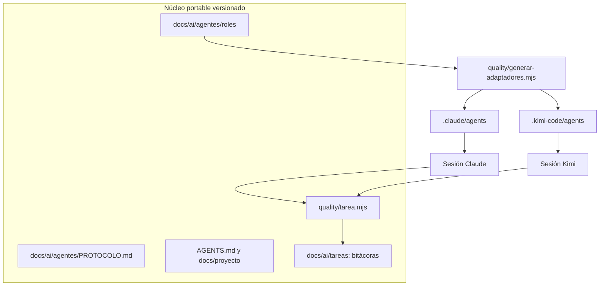
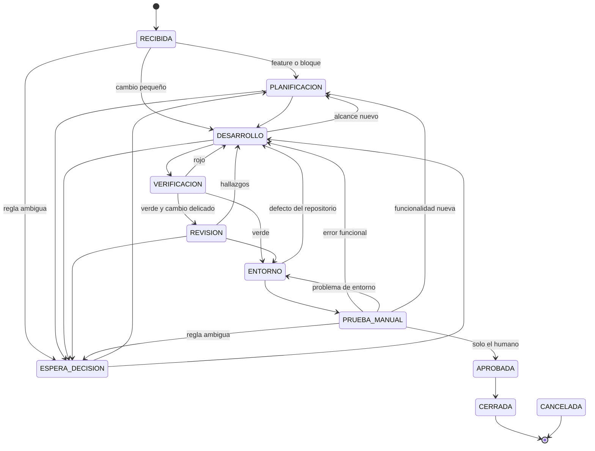

# Sistema de agentes portables entre proveedores

- **Fecha**: 2026-10-30
- **Estado**: implementada la fase 1; el diseño completo espera la aprobación del
  usuario.
- **Alcance**: seis roles especializados, reutilizables desde Claude Code y Kimi
  Code, con estado persistente fuera de la conversación y aprobación funcional
  manual. Quedan fuera las fases 3 y 4 de la sección 8.

## 1. Evaluación del estado actual

Comprobado en el repositorio y en esta máquina el 2026-10-30.

**Lo que ya existe y se reutiliza**

| Pieza | Uso en este diseño |
|---|---|
| `AGENTS.md` | Reglas comunes de todos los roles |
| `quality/adaptadores/manifiesto.mjs` y su gate | Patrón de una fuente y adaptadores generados y comprobados |
| `docs/ai/WORKFLOW.md`, `PUERTA_CALIDAD.md`, `FLUJO_GIT.md` | Proceso que los roles obedecen, sin duplicarlo |
| `docs/proyecto/` | Conocimiento compartido del producto |
| `verify.ps1`, `iniciar-pc1.ps1`, `deploy-produccion.ps1` | Herramientas reales de verificación, entorno y despliegue |
| `.local/` y `logs/` | Zonas locales fuera de git para el cerrojo y los registros |

**Lo que no existía**

- Definiciones de agentes: no había `.claude/agents/`, `.kimi-code/agents/` ni
  `.agents/agents/`.
- Estado de tarea: `docs/ai/HANDOFF.md` es de sesión, efímero y manual. El vigente
  describe el despliegue del 2026-10-01 y no sirve como estado de una tarea.
- Control de un único responsable y evidencia ligada al contenido probado.

**Herramientas verificadas**

| Herramienta | Versión | Hecho relevante |
|---|---|---|
| Claude Code | 2.1.300 | Agentes en `.claude/agents/`, opción `--agent`, hooks de proyecto |
| Kimi Code | 2.4.0 | Agentes en `.kimi-code/agents/` y `.agents/agents/`, opción `--agent` |
| Docker | 28.5.1 | Servidor activo |
| GitHub CLI | sesión iniciada | Permisos `repo` y `workflow` |
| Node | 24.15.0 | Sin dependencias nuevas |

**Hallazgos que condicionan la seguridad**

- Cualquier agente con shell hereda la sesión de `gh`, que puede lanzar el workflow
  de despliegue. Una regla escrita no es una barrera real.
- `.env` está en la raíz. Los archivos `.*ignore` generados solo cubren Cline, Cursor
  y Gemini; ni Claude ni Kimi los leen.
- `iniciar-pc1.ps1 -RecrearDatos -ConfirmarBorradoDatos` borra base de datos y
  volúmenes locales.
- Kimi no admite hooks de proyecto: solo en `~/.kimi-code/config.toml`. Si el hook
  falla, deja pasar la acción. Tampoco tiene campo `model` por agente.
- Superpowers está instalado en ambos proveedores, pero fuera del repositorio. Los
  roles no pueden depender de él.

## 2. Arquitectura y alternativas

**Elegida: núcleo en archivos, adaptadores generados y una CLI local de tareas.**



| Alternativa | Ventaja | Coste | Decisión |
|---|---|---|---|
| Archivos, adaptadores y CLI local | Sin dependencias, auditable, las dos CLI ya funcionan así | Las reglas se apoyan en disciplina y guardias parciales | **Elegida** |
| Solo prompts, sin CLI | Mínimo esfuerzo | Nada impide saltarse estados ni autoaprobar | Descartada |
| Servidor MCP de estado | Herramienta tipada común | Un proceso más sin ventaja real: ambos proveedores ya tienen shell | Pospuesta |
| Framework propio con SDK (Agent SDK, LangGraph, eve) | Orquestación programable y relevo automático | Dependencias, claves de API aparte de las suscripciones, otro sistema que mantener | Descartada |
| Automatización en la nube | Agentes persistentes | Infraestructura, credenciales remotas y más superficie de ataque | Descartada, la prohíbe el pedido |

## 3. Componentes portables y adaptadores

**Portables**: roles, protocolo, CLI de tarea, bitácoras, guardia de comandos,
documentación y puerta de calidad. Un proveedor sin adaptador puede trabajar
igual: basta con pedirle que lea `docs/ai/agentes/roles/<rol>.md` y lo obedezca.

**Adaptadores**: se generan desde el frontmatter neutral de cada rol.

| Campo neutral | Claude Code | Kimi Code |
|---|---|---|
| `nombre` | `name` | `name` |
| `descripcion` | `description` | `description` |
| `cuando_usar` | se suma a `description` | `whenToUse` |
| `nivel: alto` | `model: opus` | se elige al lanzar con `kimi -m` |
| `nivel: intermedio` | `model: sonnet` | se elige al lanzar con `kimi -m` |
| `herramientas: leer` | `Read` | `Read` |
| `herramientas: buscar` | `Grep`, `Glob` | `Grep`, `Glob` |
| `herramientas: shell` | `Bash`, `PowerShell` | `Bash` |
| `herramientas: editar` | `Edit`, `Write` | `Edit`, `Write` |
| `delega_en` | `Agent(rol, ...)` | `Agent` y lista `subagents` |

Un proveedor futuro se agrega con una función de traducción y una entrada en
el manifiesto.

El 2026-10-30 se comprobó el arranque real con `--agent verificador` en ambas CLI.
Las dos cargaron el rol y confirmaron que no disponen de edición.

## 4. Contratos de los agentes

La definición completa está en `docs/ai/agentes/roles/`. Todos reciben el
identificador de tarea y terminan con un informe autosuficiente, porque Kimi no
añade marco de cierre a los subagentes personalizados.

| Rol | Entradas | Salidas | Permisos | Termina cuando |
|---|---|---|---|---|
| Orquestador | Pedido, informe de prueba manual | Clasificación, asignación, commits, cierre | Leer, buscar, shell, delegar; no edita código | La tarea llega a estado terminal o espera al humano |
| Planificador | `tarea.md`, código relacionado | Alcance, criterios de aceptación, plan de pruebas | Leer, buscar, shell, editar documentos de tarea y plan | Los criterios son comprobables y sin decisiones pendientes |
| Desarrollador | Plan o rechazo con pasos | Cambio con pruebas, sin commit | Leer, buscar, shell, editar | Prueba dirigida en verde tras verla en rojo |
| Verificador | Árbol de trabajo | Evidencia registrada por `verificar` | Leer, buscar, shell; no edita | Hay evidencia, verde o roja, sin maquillar |
| Revisor | Diff y contexto | Hallazgos con gravedad y escenario | Leer, buscar, shell; no edita | Cada hallazgo es verificable o no hay hallazgos |
| Operaciones | Síntoma de entorno o pedido de arranque | Diagnóstico, entorno levantado | Leer, buscar, shell; no edita | Entorno sano o causa identificada |

Revisor interviene solo con cambios en seguridad, autenticación, permisos,
aislamiento de tenant, migraciones, reglas de negocio delicadas o la propia
puerta.

Se usa `Agent` solo cuando el trabajo es delegable. En la práctica cada rol puede
correr también como sesión principal con `claude --agent <rol>` o
`kimi --agent <rol>`, que es lo más económico y respeta la regla de `AGENTS.md`
sobre subagentes.

## 5. Máquina de estados



Además, todo estado no terminal puede pasar a `BLOQUEADA`, que solo vuelve al
estado previo, y a `CANCELADA`.

**Reglas que hace cumplir la CLI**

- Cada estado tiene un único dueño. El responsable activo se deriva del estado.
- Salir de `VERIFICACION` hacia adelante exige evidencia verde del árbol actual.
- Entrar en `PRUEBA_MANUAL` exige además un árbol limpio, es decir, cambios
  commiteados. Lo que el usuario prueba es exactamente lo verificado.
- `APROBADA` solo se alcanza con `aprobar`, en una terminal interactiva, escribiendo
  el commit a mano.
- `CERRADA` exige el mismo árbol aprobado y ningún commit sin push.
- Un rechazo exige pasos, resultado actual, resultado esperado y clasificación.
  La clasificación fija el destino.

**Clasificación del rechazo**

| Clasificación | Destino | Criterio |
|---|---|---|
| `funcional` | `DESARROLLO` | El código no cumple lo acordado; corrige normalmente el mismo desarrollador |
| `entorno` | `ENTORNO` | Docker, puertos, configuración o arranque |
| `negocio` | `ESPERA_DECISION` | Regla ambigua; se pregunta al usuario |
| `alcance` | `PLANIFICACION` | Funcionalidad nueva, nunca se absorbe en silencio |

**Commits y push**: el orquestador hace commit tras la verificación verde, con
rutas concretas. El push a `develop` ocurre después de la aprobación humana. Una
corrección es un commit nuevo, nunca reescritura de historia.

## 6. Estado, handoff y evidencias

Cada tarea vive en `docs/ai/tareas/<AAAA-MM-DD-slug>/` y está versionada:

- `tarea.md`: pedido, alcance, criterios de aceptación y plan de pruebas.
- `bitacora.jsonl`: eventos en orden, solo se agrega. El estado **se deriva** de
  esta bitácora, así no hay un segundo archivo que pueda desincronizarse.

```json
{"ts":"2026-10-30T13:40:00.000Z","tipo":"estado","rol":"desarrollador","proveedor":"moonshot","de":"DESARROLLO","a":"VERIFICACION","nota":"Prueba dirigida en verde"}
{"ts":"2026-10-30T13:52:10.000Z","tipo":"verificacion","rol":"verificador","proveedor":"anthropic","resultado":"verde","codigo":0,"arbol":"9f2c1e7","commit":"b5d30d2","limpio":false,"log":"logs/puerta-2026-10-30-ejemplo-20261030-135210.log","duracionMs":412000}
```

Tipos de evento: `creada`, `estado`, `verificacion`, `rechazo`, `aprobacion`,
`relevo`, `decision`, `bloqueo`, `comando` y `nota`.

**Evidencia ligada al contenido.** El campo `arbol` es el hash git del árbol de
trabajo sin `docs/ai/tareas`, calculado con un índice temporal. Sobrevive al
commit, porque el contenido no cambia, y queda invalidado por cualquier edición
posterior. La evidencia la escribe `verificar`, nunca el agente.

**Handoff.** Un proveedor sin tokens no llega a escribir nada, así que el handoff
no puede depender de un último mensaje. Se reconstruye en cualquier momento:

```powershell
node quality/tarea.mjs resumen <id>
```

El resumen muestra estado, responsable, últimos eventos, última verificación
comparada con el árbol actual, `git status` y diff. El nuevo proveedor lo contrasta
con git, ejecuta `relevo` y continúa. `docs/ai/HANDOFF.md` sigue siendo para
sesiones fuera de este sistema.

## 7. Seguridad, credenciales, concurrencia y aprobaciones

**Las guardias son un cinturón, no una cerradura.** Un agente con shell y mala
intención podría sortearlas. Protegen de errores y atajos, y dejan rastro.

| Riesgo | Control |
|---|---|
| Despliegue o push a `master` no autorizado | Guardia de comandos con tarea activa; decisión pendiente sobre revisores en GitHub |
| `--no-verify` | Guardia siempre activa |
| Lectura de `.env` | Guardia con tarea activa y denegación de lectura en Claude |
| Secretos en la bitácora | La CLI rechaza el texto y el gate `Tareas` revisa lo versionado |
| Pérdida de datos locales | Guardia sobre borrado de volúmenes y `-RecrearDatos` |
| Autoaprobación | `aprobar` exige terminal interactiva y confirmación escrita |
| Trabajo simultáneo | Cerrojo atómico en `.local/agentes/tarea-activa.json`, una tarea por árbol |

La detección de secretos cubre credenciales con formato reconocible. Los datos
personales no se detectan de forma mecánica: siguen protegidos por la regla
anti-PII de `AGENTS.md`, y los informes deben escribirse sin nombres ni documentos.

**Fuera de una tarea activa la guardia solo bloquea `--no-verify`.** Así no
interfiere con las sesiones normales, incluidas las que el usuario autoriza para
desplegar. La guardia analiza texto, de modo que también frena un comando que solo
mencione esa opción. Se acepta ese falso positivo por su bajo coste.

**Credenciales**: siempre fuera de prompts, documentos y bitácoras. Cada CLI usa
su propio inicio de sesión, y `gh`, Docker y `.env` permanecen en la máquina. Los
roles nunca necesitan ver sus valores.

**Concurrencia**: como no hay ramas de trabajo, el árbol es el recurso compartido.
El cerrojo se crea con apertura exclusiva y lo libera el cierre o la cancelación.
Si un proveedor muere, el cerrojo queda y `relevo` lo reasigna con un motivo que
queda en la bitácora. Cambiar de PC exige push previo y `relevo` en la otra máquina.

## 8. Integración progresiva

| Fase | Contenido | Estado |
|---|---|---|
| 1. Desarrollo y verificación local | Roles, adaptadores, CLI, gate `Tareas`, guardia en Claude | Implementada |
| 2. Piloto | Una tarea pequeña real con relevo entre proveedores; guardia en Kimi; ajustes | Tarea y relevo hechos; falta la guardia en Kimi |
| 3. Despliegue preparado | Operaciones prepara y comprueba; estados `DESPLIEGUE_AUTORIZADO` y `DESPLEGADA`; `autorizar-despliegue` ligado al árbol aprobado | Requiere decisión |
| 4. Ejecución sin supervisión | Script que lance `claude -p` y `kimi -p` por rol con relevo automático | Opcional, solo si el piloto lo justifica |

En la fase 1 ningún rol despliega.

## 9. Riesgos, costes y decisiones pendientes

**Riesgos**

- Los modelos pueden ignorar un rol. Por eso lo crítico está en la CLI y en la
  puerta, no en el texto del prompt.
- Las CLI cambian rápido. El gate de adaptadores detecta desvíos internos, pero no
  cambios de formato del proveedor. El arranque de ambos adaptadores debe
  comprobarse al actualizar.
- La bitácora versionada agrega ruido a git. Se commitea junto al código y al cierre,
  nunca en commits sueltos por evento.
- En Kimi el nivel de modelo depende de `kimi -m`, no del rol.
- `PRUEBA_MANUAL` mantiene el cerrojo: el árbol no acepta otra tarea hasta que el
  usuario responda. Es deliberado, porque el árbol debe seguir siendo el probado.

**Costes**

- Cada rol delegado arranca sin contexto y relee lo que necesita.
- Mantenimiento: alrededor de 850 líneas de Node, más sus pruebas, sin dependencias.
- Una tarea pequeña no debe pasar por este sistema si no aporta valor: el escalado
  de `docs/ai/WORKFLOW.md` sigue vigente.

**Decisiones del usuario**

1. Aprobar este diseño, lo que habilita el push de la fase 1.
2. Instalar el hook de guardia en `~/.kimi-code/config.toml`. Es configuración
   global de tu usuario, por eso no se aplicó.
3. Exigir un revisor en el entorno `production` de GitHub. Es la única barrera real
   frente a un agente con la sesión de `gh`.
4. Definir si en la fase 3 el despliegue lo ejecuta un agente tras tu autorización o
   lo ejecutas tú con `deploy-produccion.ps1`. Recomendación: lo ejecutas tú, y el
   agente prepara y comprueba.
5. Confirmar que la bitácora va versionada. Es lo que permite cambiar de PC y
   auditar; si prefieres menos ruido en git, puede pasar a `.local/`.
